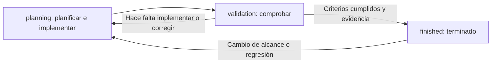

# Documentación del proyecto

Este archivo define cómo crear, relacionar y mantener la documentación. El objetivo es conservar planes comprensibles y evidencia del trabajo realizado con tres estados sencillos.

## Fase actual: implementación autorizada

El usuario autorizó comenzar la implementación después de comitear por partes los cambios documentales pendientes. Esos commits se crearon; ahora se ejecutan las fases de [08](planning/08-fases-y-validacion.md), con alcance completo, pruebas y evidencia. La preparación de datos, recursos y propuestas pendientes forma parte del trabajo. No crear nuevos commits sin petición explícita del usuario.

Los planes permanecen en `planning/` mientras exista implementación parcial. No marcar una entrega terminada por redactar su contrato ni trasladar el conjunto antes de cumplir su aceptación.

## Contexto de entorno y comunicación persistente

El frontend se desarrolla localmente y Supabase ya existe en Cloud, con credenciales en `.env` ignorado. No se instala una base/stack local de Supabase. [07](planning/07-entornos-y-despliegue.md) registra accesos comprobados y límites; [supabase/README.md](../supabase/README.md) define las fuentes backend versionadas y su aplicación remota futura. El proyecto es de desarrollo sin usuarios reales/producción según el usuario; los cambios necesarios ya autorizados no requieren confirmaciones repetidas una vez iniciada implementación. La implementación remota del alcance está autorizada; versionar primero las fuentes y comprobar el proyecto de destino.

En nuevas sesiones seguir AGENTS.md: recomendar ASCII/Mermaid para explicar relaciones y flujos cuando sea útil; presentar propuestas de UI con prompts/bocetos ASCII por defecto, antes de implementar y manteniendo después las versiones aprobadas. No sustituir un boceto aprobado por una explicación genérica ni añadir diagramas de relleno a respuestas triviales.

## Alcance completo, sin ampliar funciones

La implementación es full scope respecto al alcance acordado: cada campo, regla y operación planificados deben funcionar de principio a fin. Las fases organizan el trabajo; no autorizan entregar un MVP ni dejar operaciones como demostraciones. No añadir campos, servicios o procesos para aparentar una solución más completa.

La investigación y concreción de datos, diccionarios y manifiestos; el diseño de propuestas pendientes; la preparación de recursos; y las pruebas y correcciones forman parte del plan de implementación. Asignarlas a sus fases con resultado y criterio de aceptación. No presentarlas como trabajo externo que deba completar el usuario antes de iniciar. Las dependencias técnicas se resuelven dentro de la ejecución y solo las decisiones reales de negocio/diseño pendientes se consultan, sobre propuestas concretas.

Para dar por terminado un comportamiento se comprueban sus entradas, reglas, persistencia, recuperación, permisos y errores aplicables. Que un botón responda o que exista una tabla no demuestra que la funcionalidad esté completa. Los recursos visuales aproximados aceptados por el usuario son parte del producto; una integración simulada no sustituye una integración real acordada.

## Carpetas y estados

```text
docs/
  README.md       Reglas e índice general
  planning/       Trabajo propuesto o parcialmente implementado
  validation/     Implementación terminada, comprobación pendiente o en curso
  finished/       Implementación comprobada, con resultado documentado
```



La ubicación indica el estado real del trabajo, no el estado de redacción del Markdown. Terminar de escribir un plan no lo convierte en una funcionalidad implementada.

| Estado | Entrada | Salida |
| --- | --- | --- |
| `planning` | Idea, alcance o implementación parcial | Código y configuración previstos completos, listos para comprobar |
| `validation` | Implementación lista | Criterios comprobados y evidencia, o devolución a planning con pendientes concretos |
| `finished` | Validación satisfactoria | Se conserva como referencia del resultado entregado |

Un bloqueo de credenciales, migración sin aplicar o prueba no ejecutada se declara como pendiente. No se marca como terminado lo que solo funciona con datos simulados si el plan exige integración real. Los fallos anteriores al cambio se distinguen de regresiones, pero no se ocultan cuando impiden cumplir la entrega.

## Índice actual

- [Plan Atlas MTB](planning/README.md): catálogo, comparación, acceso Supabase y configurador 3D; implementación parcial, con evidencia y pendientes en el documento 12.
- `validation/`: sin entregas pendientes de validación por ahora.
- `finished/`: sin entregas funcionales finalizadas por ahora.

Las carpetas vacías contienen `.gitkeep` para conservarlas en Git. No representan planes ni entregas.

## Crear un plan

Usar un Markdown breve si el cambio es pequeño. Si afecta varias capas, dividirlo en documentos por responsabilidad y añadir un índice del conjunto. No crear una carpeta o plantilla adicional para cada detalle.

Cuando un documento crezca y mezcle responsabilidades que puedan leerse por separado, extraer una de ellas a un Markdown hermano y enlazarlo desde el índice. Por ejemplo: esquema de campos frente a operaciones, o principios visuales frente a bocetos de pantallas. Conservar lo aprobado, corregir enlaces y retirar duplicaciones; no dividir por cada tabla, control o párrafo ni imponer un límite rígido de líneas. Puede usarse un sufijo `a`/`b`/`c` del tema existente para mantener la lectura por capas.

Un plan debe permitir identificar:

1. Objetivo y alcance, incluyendo límites relevantes.
2. Estado actual y cambios necesarios.
3. Relaciones con otros documentos, decisiones o contratos que utiliza.
4. Pasos de implementación y criterios observables para aceptar la entrega.
5. Pendientes, y después la evidencia de validación y el resultado.

Los diagramas Mermaid explican relaciones y flujos; los bocetos ASCII explican posiciones y pantallas. Deben aportar información que el texto solo no deje clara. Enlaces relativos dentro del repositorio y enlaces oficiales para decisiones técnicas externas.

## Relacionar documentos

Cada decisión tiene un documento principal: producto, arquitectura, datos, acceso, 3D, experiencia o despliegue. Los demás lo enlazan en vez de copiar sus reglas. Si un cambio afecta un contrato, actualizar primero su documento principal y después las referencias afectadas.

Los principios de arquitectura, separación de responsabilidades, SOLID y reutilización viven en el documento de arquitectura del conjunto. Los de lenguaje de interfaz y jerarquía sin redundancias viven en el de UI/UX. Son criterios de implementación y validación, no una razón para añadir capas o servicios. La documentación para desarrollo puede usar términos técnicos; la interfaz debe convertirlos a lenguaje útil para su público.

Un conjunto de varios Markdown se lee como una sola propuesta. Su índice enumera las capas y el plan de fases identifica dependencias. Las fases pueden tener avances parciales, pero el conjunto no pasa a `validation` hasta completar el alcance declarado, salvo que se separe expresamente una entrega más pequeña con su propio alcance.

No duplicar los mismos archivos en los tres estados. No crear tableros, numeraciones de versiones documentales o procesos de aprobación por cada movimiento.

## Mover trabajo entre estados

1. Actualizar el resultado, los pendientes y la comprobación que corresponda.
2. Mover el archivo o conjunto relacionado al destino; si tiene varios documentos, moverlos juntos.
3. Corregir su ubicación en este índice y todos los enlaces relativos afectados, incluidos los de AGENTS.md si corresponde.
4. Comprobar que no queden copias obsoletas o enlaces rotos.

Los enlaces entre archivos que se mueven juntos suelen conservarse; los enlaces desde fuera del conjunto deben revisarse. Git conserva el historial. Un documento en `finished` describe lo realmente entregado, sin promesas que sigan pendientes.

Si aparece una ampliación independiente, crear su nuevo plan y enlazar el trabajo previo. Si la entrega original estaba incompleta o regresa, devolver el plan afectado a `planning` y explicar la causa. Mantener este índice fiel al estado de cada conjunto.

## Evidencia de validación

Registrar fecha, qué se comprobó, entorno, orden o recorrido utilizado y resultado. Para frontend pueden ser build, pruebas relevantes y una revisión visual o funcional. Para Supabase incluyen políticas, migraciones e integración real; para 3D, la bicicleta de referencia y el dispositivo utilizado.

No hace falta un informe aparte para cada comando: la evidencia puede vivir al final del plan o en su documento de fases. Un comando fallido se registra como fallido y un criterio pendiente permanece abierto.

## Contenido permitido

Documentación en español; nombres técnicos y de productos conservan su forma original. No incluir secretos, tokens, contraseñas, datos privados de cuentas o archivos `.env` reales. Las plantillas de entorno contienen solo nombres y valores vacíos. Referirse a datos de prueba como tales.

Mantener suficiente detalle para implementar y validar. Evitar reglas para infraestructura que el proyecto no necesita. Los cambios de alcance del usuario prevalecen sobre estos planes; después se actualizan los documentos afectados.

## Recursos finales y archivo local

La política de modelos, fotos visibles, referencias y resultados se define en [models/README.md](../models/README.md). Fotos de cards/portada en `src/assets/images/` y GLB publicados se versionan; referencias de investigación, resultados, capturas y prototipos se conservan en `models/local/` ignorado. Los manifiestos y la procedencia permanecen en Git. Las pruebas de producto no deben depender de informes generados o de originales fotográficos que un clon no recibe.
