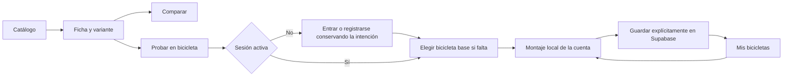

# 01 · Producto y alcance

Relacionado: [arquitectura](02-arquitectura-y-frontend.md), [3D](05-configurador-3d.md), [experiencia del espacio de trabajo](06b-espacio-de-trabajo.md) y [fases](08-fases-y-validacion.md).

## Objetivo

Construir una plataforma web donde una persona pueda entender componentes MTB, compararlos y visualizar cómo quedaría una bicicleta al combinarlos. Las fichas técnicas y el configurador comparten el mismo catálogo. La marca aprobada es **ATLAS MTB** y su eslogan es **Cada pieza define tu camino**.

El foco inicial es enduro y descenso. Las piezas principales deben ser reconocibles por su forma, posición, tamaño relativo y acabado. El usuario acepta simplificar piezas pequeñas y trabajar sin CAD oficial de todos los fabricantes.

## Orientación de producto y negocio

Público confirmado por el usuario: ciclistas y talleres/tiendas, con prioridad inicial en los ciclistas. La experiencia principal ayuda a quien quiere armar una bicicleta o mejorar la que tiene. Un taller puede aprovechar el mismo catálogo y montaje como apoyo a una conversación con su cliente; esto no añade cuentas de empresa, cotizaciones, CRM o inventario al alcance actual.

La propuesta de posicionamiento es: **ATLAS MTB ayuda a entender, comparar y visualizar los componentes de tu próxima bicicleta de enduro o descenso, conservando tus elecciones en un montaje personal.** Es una hipótesis de valor para contrastar con usuarios, no una promesa de compatibilidad certificada o de ahorro garantizado.

### Problemas que buscamos resolver

| Situación | Respuesta del alcance acordado | Límite que se comunica |
| --- | --- | --- |
| La persona consulta fichas y fotos dispersas para decidir una pieza | Catálogo con información normalizada, explicación y fuentes | Datos ausentes identificados; no completar con afirmaciones inventadas |
| Dos variantes parecen similares y cuesta entender las diferencias | Comparación de atributos de la misma categoría, con medidas y unidades coherentes | No declarar una pieza universalmente mejor por un solo número |
| Es difícil imaginar la combinación de piezas, proporciones y colores | Montaje 3D aproximado con variantes y personalización | La representación exterior no certifica encaje físico |
| Una elección tiene un conflicto conocido o faltan medidas | Avisos comprensibles vinculados a la elección | Se permite el montaje visual; no se presenta como aprobación de instalación |
| La selección se pierde o queda repartida entre notas | Montajes privados guardados, recuperables con variantes y colores | Sin colaboración o enlaces públicos de montajes en el alcance actual |

Un recorrido de valor es: buscar una horquilla, comprender su variante, compararla con otra, incorporarla al montaje y conservar la elección. La utilidad debe existir también cuando la persona solo quiere cambiar una pieza de una bicicleta que ya tiene; no obligarla a empezar por una compra completa.

### Referentes y diferencia que queremos comprobar

Revisión de sus páginas públicas a 18 de octubre de 2026. Las funciones observadas no constituyen una auditoría completa de sus productos ni permiten afirmar que una capacidad ausente de esta tabla no exista.

| Referente | Función observada | Qué orienta en ATLAS MTB |
| --- | --- | --- |
| [BikeConfig](https://www.bikeconfig.com/?from=AppAgg.com) | Configuración 3D, sustitución de componentes y colores | El 3D por sí solo no demuestra una diferencia suficiente; debe ayudar a decidir |
| [99 Spokes](https://99spokes.com/) | Comparación de bicicletas, especificaciones y geometría | Importancia de datos consistentes y comparación comprensible |
| [Bike Insights](https://bikeinsights.com/) | Comparaciones de geometría, búsqueda y funciones de perfil personal | La geometría y la información estructurada ya son áreas atendidas por otros servicios |
| [Orbea MyO](https://www.orbea.com/es-cr/m/alma) | Personalización de colores y componentes de bicicletas Orbea | ATLAS propone explorar un inventario de varias marcas en un mismo recorrido |

La diferencia propuesta es la continuidad entre conocimiento técnico en español, comparación de componentes y construcción visual de enduro/descenso, con fuentes e incertidumbre explícitas. Una persona no debería tener que reconstruir su elección al pasar de ficha a comparación y de comparación a montaje. Esta combinación es el posicionamiento buscado; no se afirma exclusividad de mercado.

La confianza se construye con datos mantenidos, distinción entre referencia y aproximación, mensajes claros y persistencia fiable. Un acabado visual atractivo ayuda a mostrar el producto; no reemplaza estas funciones.

### Hipótesis de sostenibilidad futura

No se implementan membresías, pagos, planes comerciales, afiliación ni restricciones por pago. Crear una cuenta es una decisión de acceso, distinta de comprar una membresía. La aplicación actual no necesita tablas de suscripciones, campos de facturación ni un sistema de permisos comerciales.

| Alternativa futura | Por qué podría tener sentido | Qué habría que comprobar primero |
| --- | --- | --- |
| Membresía para ciclistas | Acceso recurrente a un servicio con utilidad mantenida | Que exista una razón para volver con frecuencia y una disposición real a pagar; una configuración ocasional puede no justificarla |
| Servicio para talleres/tiendas | Uso repetido del catálogo y montaje durante asesoría al cliente | Que reduzca trabajo o mejore la explicación de propuestas en situaciones reales; funciones profesionales se planificarían aparte |
| Referencias comerciales o afiliación | Vincular una elección informada con una compra posterior | Calidad y mantenimiento de referencias, interés de comercios y claridad sobre incentivos; no condicionar silenciosamente la comparación |

Recomendación de negocio, todavía como hipótesis: captar y ayudar a ciclistas mediante contenido y una herramienta útil, y estudiar un servicio profesional para talleres si aparece uso repetido y valor demostrable. No asumir que una suscripción al ciclista será la opción ganadora antes de observar cómo usa el producto.

### Cómo comprobar el valor sin añadir funciones

Conversar con ciclistas sobre su última compra o sustitución real: dónde buscaron, qué compararon y qué duda les frenó. Recorrer con ellos una decisión en ATLAS MTB y comprobar si entienden mejor las diferencias y pueden conservar una selección útil. Con talleres, observar cómo explican un montaje y si esta herramienta ayuda en esa tarea.

Indicadores de valor para esas pruebas: completar una decisión de componente, comprender los avisos y la incertidumbre, recuperar correctamente un montaje y volver por una nueva decisión. No equiparar registros con negocio validado ni tiempo moviendo la cámara con valor de compra. No se añade una plataforma de analítica o seguimiento a este alcance por definir estas preguntas.

## Alcance completo acordado

Full scope significa implementar y validar completamente las funciones y campos de este alcance, sin añadir capacidades no solicitadas. Una fase intermedia puede estar incompleta; la entrega acordada no puede cerrarse con botones sin operación, persistencia simulada o funciones aplazadas dentro de ese mismo alcance.

| Área | Comportamiento esperado |
| --- | --- |
| Espacio de trabajo | Pestañas Bicicletas, Componentes y Mis bicicletas; conservar contexto al cambiar, sin recarga ni cadena de fichas |
| Bicicletas de referencia | Galería de cuadros y prearmadas; detalle lateral y creación de un borrador personal desde la referencia elegida |
| Catálogo | Buscar y filtrar por categoría, marca y disciplina; ver datos disponibles y procedencia |
| Ficha | Panel lateral completo en escritorio y panel inferior ampliable en móvil; fotos, variante, medidas, ajustes, uso y fuentes, sin otro salto a una ficha independiente |
| Comparación | Hasta 3 variantes de la misma categoría; diferencias y unidades consistentes |
| Configurador | Rotar, acercar, seleccionar pieza, sustituir variante y personalizar colores en las piezas habilitadas |
| Acceso | Crear cuenta con rol user, confirmar correo, entrar por un formulario común, recuperar contraseña y cerrar sesión |
| IAM y administración | Crear roles personalizados sobre permisos implementados; invitar/asignar usuarios y editar/publicar catálogo/prearmadas según autorización; user/admin iniciales protegidos |
| Mis bicicletas | Guardar, abrir, renombrar y eliminar montajes propios |
| Adaptación | Uso con ratón, teclado y controles táctiles; alternativa textual si falla el 3D |

La entrega incluye bases de enduro y descenso con cuadros reales representados de forma aproximada, según confirmación del usuario. Puede desarrollarse y comprobarse una primero, pero ambas disciplinas deben quedar operativas dentro del inventario acordado para completar la entrega. Falta definir los modelos, tallas y variantes concretos; no se interpreta este requisito como soporte de todos los productos del mercado.

## Catálogo acotado de modelos reales

La portada es una entrada visual breve que invita a iniciar sesión para personalizar. La referencia de estilo UI/UX aprobada es COMMENCAL: limpieza, protagonismo de la bicicleta y carácter deportivo con movimiento puntual; contenido y orden propios de ATLAS MTB. La dirección se desarrolla en [UI y UX](06-ui-y-ux.md). Toda la interfaz usa voz propia del negocio y evita comentarios de asistente o instrucciones genéricas de relleno. El detalle técnico y las herramientas viven en sus vistas, no en una explicación extensa de portada. Se mantiene el acceso público al catálogo, fichas y comparación ya confirmado.

Se selecciona un conjunto manejable de modelos comerciales reales de la gama actual documentada al preparar el inventario, con fuente y fecha de consulta. No se replica toda la oferta de cada fabricante, todas sus generaciones o cada combinación de medidas. El catálogo anterior se revisa: no se migra entero por obligación. Un modelo comercial real puede tener una representación 3D aproximada; esa simplificación no autoriza inventar su nombre o especificaciones.

Organización: categoría → marca → familia/modelo → versión elegible. Una ficha agrupa las versiones del mismo modelo; colores y acabados no crean tarjetas duplicadas. Solo se incluyen variantes concretas necesarias para elegir, comparar o montar, con diferencias documentadas de versión, medida o sistema. No se genera el producto cartesiano de años, recorridos, ruedas, acabados y ajustes. Cada variante ofrecida debe existir realmente como combinación comercial.

El criterio de suficiencia es cubrir las categorías y los slots acordados, enduro y descenso, y alternativas que aporten una diferencia útil. No se fija un mínimo artificial por marca ni se incorporan familias ajenas al enfoque para engordar el catálogo. Reducir amplitud no reduce funcionalidad: todas las piezas y variantes acordadas se entregan completas. La cobertura ampliada por marcas, cuadros M/L y categorías queda registrada en [11](11-propuesta-de-inventario.md); referencias físicas y medidas exactas se completan con fuente. Se permiten manillar, potencia y sillín genéricos ATLAS identificados, sin fingir productos comerciales.

Ejemplo de organización, no inventario aprobado: FOX 36 como familia y las versiones comerciales documentadas que se elijan dentro de ella. Las familias [FOX 38](https://ridefox.com/pages/fox-38) y [FOX 40](https://ridefox.com/pages/fox-40) tienen posicionamientos de enduro y descenso respectivamente; son referencias pertinentes para estudiar. El [catálogo oficial FOX](https://ridefox.com/pages/bike-forks) sirve para verificar nombres; «FOX 46» no se adopta del ejemplo conversacional sin evidencia. No se presupone que toda familia tenga exactamente las mismas versiones.

En suspensión se distingue tipo de resorte —aire o muelle cuando exista— de amortiguación y ajustes manuales: «manual» no es la alternativa técnica a «aire». No se inventan versiones de muelle por simetría. Colores de fábrica y personalización visual se presentan por separado; un color libre aplicado en el visor no demuestra que el fabricante lo venda así.

## Precios orientativos

Se pueden almacenar y mostrar precios de referencia de mercado en fichas, comparación y selección de piezas, con importe, moneda, mercado, fuente y fecha. Son una orientación consultada, no precio de venta de ATLAS MTB, cotización, disponibilidad ni garantía de importe actual. No hace falta sincronización en tiempo real, seguimiento histórico o integración comercial.

Se usa una referencia identificable por variante cuando se disponga de ella; si solo corresponde al modelo o a otra versión, no se atribuye silenciosamente a todas sus variantes. Sin fuente suficiente se muestra «Sin referencia de precio». No se inventan importes para llenar el catálogo ni se convierten monedas automáticamente. Detalles del contrato en [datos](03-datos-y-operaciones.md).

## Piezas y fidelidad

| Grupo | Representación |
| --- | --- |
| Cuadro | Silueta y proporciones cercanas a la referencia; geometría propia por talla soportada |
| Horquilla y amortiguador | Volúmenes reconocibles, posición y medidas principales conocidas |
| Aros, neumáticos, bujes y radios | Diámetro y anchura coherentes; radios y dibujo del neumático simplificables |
| Cassette, cadena, bielas, plato y pedales | Presencia, tamaño y ubicación; dientes y eslabones simplificables |
| Discos, pinzas y manetas | Diámetro de discos y forma general; sin reproducir todos los mecanismos |
| Manillar, potencia, tija y sillín | Forma y ubicación creíbles; ajustes dentro de los límites previstos |
| Cables y latiguillos | Curvas sencillas entre anclajes; sin simulación física |

La referencia del usuario a un «50 %» expresa tolerancia a la simplificación. No se utiliza como porcentaje técnico de exactitud. Se valida una bicicleta de referencia desde ambos lados, frente, parte superior y vista de tres cuartos, hasta el acercamiento previsto.

Una variante puede tener ficha técnica sin tener un modelo 3D propio. El visor distingue «Modelo de referencia» y «Representación aproximada». Los datos sin verificar aparecen como «Sin confirmar». Ninguna etiqueta implica certificación del fabricante.

## Recorridos de usuario

La portada, el catálogo, las fichas y la comparación se consultan sin cuenta. Probar piezas, armar una bicicleta y consultar los avisos del montaje requiere sesión; guardar también. Antes del acceso se conserva solo la intención de abrir el configurador o probar una variante, no un montaje anónimo. El borrador de la cuenta sobrevive a una recarga en ese dispositivo y no se guarda en Supabase sin una acción explícita.

El usuario aprobó dos formas de comenzar: desde un cuadro y desde una bicicleta prearmada de referencia. La pestaña Bicicletas agrupa «Bicicletas completas» y «Cuadros». Las prearmadas permiten conocer sus piezas y personalizar una composición sin montarla desde cero; aplicar exige sesión. Se etiqueta «Montaje de fábrica» solo con composición comercial documentada, o «Montaje de ejemplo» para una selección de ATLAS. Falta concretar el inventario de referencias, versiones y tallas para ambas disciplinas; los ejemplos no se consideran modelos ya implementados. No incluye mercado de plantillas ni publicación de montajes privados. La administración de referencias y roles se define por separado en [IAM](04a-iam-roles-y-permisos.md) y [administración](04b-administracion-y-operaciones.md).

## Límites del producto

Fuera del alcance acordado: tienda, pagos, stock, precios en tiempo real, integración con ERP, comunidad, enlaces públicos a montajes, colaboración simultánea, realidad aumentada, editor CAD, simulación estructural y simulación física de suspensión. Se incorpora administración web de datos, referencias, cuentas y roles, por decisión posterior del usuario. Los permisos y operaciones concretos están en [administración](04b-administracion-y-operaciones.md); no incluye editar código, SQL o infraestructura desde la web.

Las animaciones de suspensión, si se añaden después, ilustrarán movimiento; no se presentarán como predicciones de comportamiento mecánico.

La compatibilidad tendrá tres resultados: sin conflicto conocido en las comprobaciones disponibles, conflicto identificado y datos insuficientes. Por decisión del usuario, cualquier combinación entre piezas de sus categorías correspondientes puede aplicarse y guardarse como montaje visual, incluso con conflictos conocidos. Los avisos explican el problema; no bloquean la elección ni certifican instalación real. Las entradas malformadas o categorías incorrectas siguen siendo errores del contrato, no combinaciones válidas.

El cuadro y las piezas habilitadas permiten elegir color libre. Las demás mantienen sus acabados definidos. Guardar, abrir y recuperar un montaje debe conservar estos colores además de las variantes y acabados predefinidos.

## Base existente y reconstrucción

Al revisar el repositorio se encuentran 22 entradas de suspensión de 8 marcas, 7 imágenes asignadas, fichas individuales y un comparador inicial. La aplicación no tiene todavía integración Supabase, autenticación o visor 3D implementados. El proyecto Supabase Cloud sí está creado y sus accesos de lectura están comprobados, según [entornos](07-entornos-y-despliegue.md). Los filtros y varios botones no tienen comportamiento.

La compilación actual falla porque el comparador consume campos ausentes del tipo y del catálogo, y por una importación sin uso. Las pruebas fallan al arrancar por la combinación instalada de Vitest y Vite. Son tareas de la fase 0, no requisitos a trasladar al diseño nuevo.

Se pueden reemplazar Home, Compare, ModelDetail, estilos, rutas y estado. Se revisan descripciones e imágenes antes de migrarlas; no se inventan precios, pesos, años o especificaciones para completar huecos. La nueva estructura debe permitir otras categorías además de suspensión.

## Criterio de éxito

Una persona puede encontrar una pieza, entenderla, compararla con una alternativa y probar una representación en una bicicleta proporcionada. Puede guardar ese montaje con su cuenta, recargarlo y recuperar las mismas variantes y acabados. En móvil puede completar ese recorrido sin depender de gestos difíciles o de una GPU potente.

## Cierre de cobertura del catálogo

Todas las piezas publicadas del catálogo deben poder montarse en 3D. Se admite una representación genérica identificada, proporcionada y versionada; no habrá fichas publicadas solo documentales. Se elige el cambio trasero con su mando asociado incluido en la representación, sin otro selector. La selección concreta se prepara en [11 · Propuesta de inventario](11-propuesta-de-inventario.md) para revisión del usuario, sin convertir la propuesta en alcance aprobado.

La ampliación posterior del usuario sustituye el límite inicial propuesto de cuatro cuadros y una talla: cobertura enduro/DH por marcas documentadas, tallas principales M/L, cuatro marcas de suspensión, varias gamas de frenos y transmisión, neumáticos por medidas/terreno y pedalier independiente. Los campos y el registro documental se separan por categorías en 11a–11m. No implica ingesta remota ni un alcance mundial de SKU implícitamente completado.

Delimitación temporal ampliada el 21/10/2026: se admiten gama actual y generaciones anteriores documentadas e identificadas, por confirmación expresa del usuario. Un histórico conserva año/generación y no se presenta como vigente; una página de soporte antigua sigue sin probar vigencia comercial. Alcance concreto y aceptación en [11o](11o-ampliacion-gravity.md).
