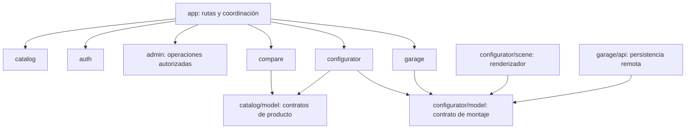
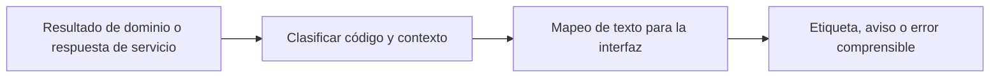
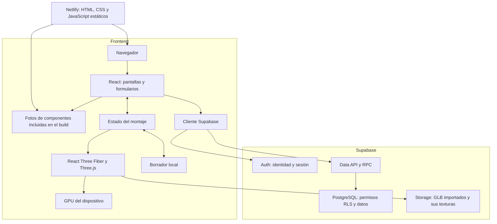
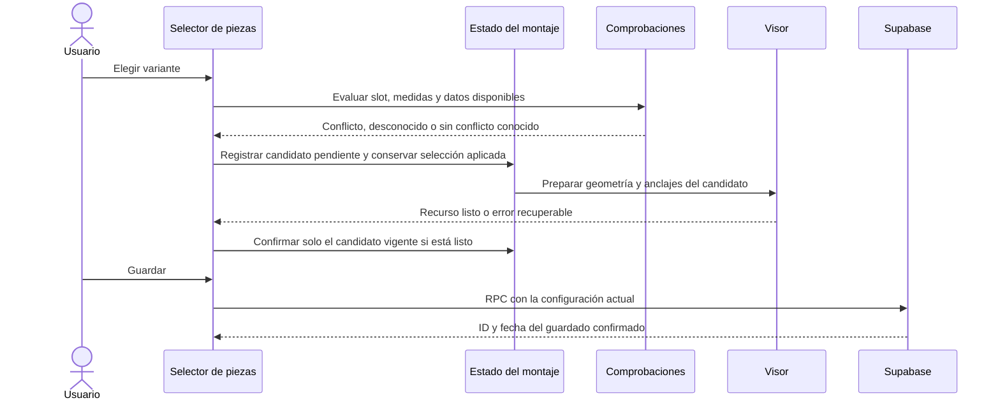

# 02 · Arquitectura y frontend

Relacionado: [datos](03-datos-y-operaciones.md), [esquema](03a-esquema-y-campos.md), [acceso](04-autenticacion-y-acceso.md), [3D](05-configurador-3d.md) y [despliegue](07-entornos-y-despliegue.md).

## Arquitectura acordada

Decisión aprobada por el usuario: arquitectura modular por funcionalidades, incorporando de Clean Architecture la independencia de las reglas de montaje respecto a React, Three.js y Supabase. Se mantienen los módulos, contratos y límites descritos aquí. La adopción es selectiva: no exige replicar toda la estructura de Clean Architecture ni crear adaptadores o interfaces sin una necesidad real.

Esta decisión establece cómo se implementará el proyecto; la reconstrucción todavía no se ha ejecutado. La comparación siguiente se conserva como fundamento de la elección.

### Alternativas evaluadas

La distribución Netlify + Supabase y la organización modular ya están acordadas. Se evaluaron estas alternativas para el alcance completo, no para una demostración reducida.

| Alternativa | Organización | Encaje y coste en Atlas MTB |
| --- | --- | --- |
| Módulos por funcionalidad | Catálogo, Auth, comparación, configurador y montajes, con reglas y accesos acotados | Elegida con independencia de reglas: refleja el negocio y no exige capas idénticas en todos los módulos |
| Capas globales | Carpetas comunes de vistas, servicios, modelos y acceso a datos | Válida para CRUD sencillo; en este proyecto una modificación de montaje o 3D quedaría repartida entre varias carpetas globales |
| Clean Architecture o hexagonal completa | Dominio, casos de uso y adaptadores con dependencias hacia el negocio | Ofrece aislamiento fuerte; implantar contratos y adaptadores para cada consulta del catálogo añade trabajo que este alcance no necesita |
| Feature-Sliced Design formal | Capas, slices y reglas de importación normalizadas | Alternativa útil con más equipos y funciones; aquí se pueden tomar límites y entradas públicas sin adoptar toda su taxonomía |

La aplicación frontend será modular por funcionalidades, publicada como una única SPA, con Supabase como backend gestionado. Puede describirse como organización de monolito modular en el frontend; no implica crear un servidor monolítico propio ni separar cada función en un despliegue.

Se aplican funciones de dominio independientes en las partes que las necesitan: configuración, comprobaciones, acabados y ensamblaje. No se reproduce Clean Architecture con repositorios genéricos, contenedores de dependencias o una clase por operación.

## Reglas de módulos

| Módulo | Es propietario de | Qué puede ofrecer a otros módulos |
| --- | --- | --- |
| `catalog` | Componentes, variantes, categorías, referencias prearmadas y consultas del catálogo | Tipos de producto, datos normalizados y operaciones de lectura |
| `auth` | Sesión, formularios, flujo de acceso y consulta de permisos propios | Estado de sesión y acciones de autenticación |
| `compare` | Selección de variantes y comparación por categoría | Pantalla y acciones de comparación; consume contratos del catálogo |
| `configurator` | Configuración, sustituciones, avisos, colores, ensamblaje y escena | Modelo del montaje separado de su interfaz y renderizador |
| `garage` | Consulta, guardado y eliminación de montajes remotos | Operaciones que reciben/devuelven el contrato de configuración |
| `admin` | Administración de catálogo/prearmadas, cuentas y roles autorizados | Formularios y operaciones administrativas; no credenciales privilegiadas en React |
| `app` | Rutas, proveedores y coordinación de recorridos | Composición de los módulos; no almacena las reglas de cada uno |



Las flechas representan dependencias permitidas entre responsabilidades, no una llamada HTTP entre servicios. Los contratos de `catalog/model` y `configurator/model` usan TypeScript y datos simples, sin React, Three.js ni Supabase. El resto de archivos del módulo puede usar las librerías que le corresponden.

1. Cada módulo exporta únicamente lo que otros necesitan. Importar contratos de montaje desde su entrada de modelo, sin pasar por un archivo que también exporte el canvas o cargue Three.js.
2. Los componentes de pantalla usan funciones o hooks de su módulo para consultar servicios; no contienen cadenas de consultas Supabase repartidas por JSX.
3. El acceso a Supabase vive junto a la funcionalidad que lo utiliza, por ejemplo `catalog/api.ts`, `auth/api.ts` y `garage/api.ts`. Un archivo con funciones basta cuando no hay razón para más carpetas.
4. Las reglas del montaje no consultan servicios, no leen localStorage y no crean objetos del motor gráfico. Reciben datos y devuelven una configuración, anclajes numéricos o avisos.
5. La escena interpreta esos resultados para dibujar. No decide permisos, no escribe en la base y no es el único lugar donde existe el montaje.
6. `app` coordina abrir y guardar: el configurador entrega una instantánea mediante una acción o callback y la operación de `garage` la persiste. `configurator` y `garage` no se importan mutuamente.
7. Los tipos de negocio permanecen en su módulo. Los tipos generados de PostgreSQL se usan en los accesos a datos y se traducen al contrato del módulo; no se propagan filas del SDK por toda la aplicación.
8. `lib` contiene conexiones y utilidades técnicas compartidas; `components/ui` contiene elementos visuales reutilizables. Ninguno se convierte en un almacén de reglas de catálogo, sesión o bicicleta.

Las reglas de propiedad y formato exigidas en RPC/SQL permanecen en el servidor aunque el frontend valide para dar respuesta inmediata. Son validaciones en dos límites de confianza, no permiso para tener dos políticas mecánicas contradictorias. Los avisos de incompatibilidad siguen permitiendo el montaje visual acordado.

## Principios de código y reutilización

Código explícito, tipado y con responsabilidades acotadas. SOLID se utiliza como guía de diseño, no como obligación de crear clases, jerarquías o una interfaz para cada función. En este proyecto también se aplica a funciones, componentes y módulos TypeScript.

| Principio | Aplicación en Atlas MTB |
| --- | --- |
| Responsabilidad única | Un componente de campo presenta su control y error; la regla de personalización vive en el modelo y el guardado en su acceso remoto |
| Abierto a extensión | Añadir una categoría o generador en su punto de registro cuando exista esa necesidad, sin repartir condiciones por todas las pantallas |
| Sustitución coherente | Las representaciones GLB y generadas por código cumplen el contrato del visor; un reemplazo no altera el significado del montaje ni sus operaciones |
| Interfaces pequeñas | Una tarjeta recibe los datos y acciones que usa, no el cliente Supabase ni todo el estado de la aplicación |
| Dependencias hacia las reglas | Modelo y comprobaciones no dependen del SDK o del canvas; la coordinación conecta las operaciones externas donde haga falta |

Reglas prácticas:

- TypeScript estricto; entradas externas se validan al entrar. Una aserción de tipo no sustituye la validación de JSON, respuestas remotas o borradores locales.
- Reutilizar los controles que comparten comportamiento: campo de texto, selector, mensaje de error, diálogo y botón. No clonar un input completo para «nombre», «peso» y «año» cuando solo cambian etiqueta, valor y validación.
- Mantener la semántica: un selector, un campo numérico y una elección de color pueden necesitar controles distintos. No convertir todos los formularios en un componente universal con decenas de parámetros o modos.
- Compartir una regla de montaje utilizada por varias vistas mediante una función del modelo; no copiarla dentro de cada tarjeta, formulario o pieza 3D.
- Extraer una abstracción cuando exista comportamiento común real. Una coincidencia visual entre dos pantallas no basta para acoplar reglas de negocio distintas.
- Las consultas, errores de red y persistencia quedan fuera de los controles visuales reutilizables. Los efectos tienen limpieza y las operaciones asincrónicas no aplican respuestas obsoletas.
- Nombres de código expresan responsabilidad; sin archivos globales que acumulen funciones no relacionadas ni efectos ocultos durante imports.
- Las pruebas verifican reglas y recorridos relevantes. Compartir controles exige comprobar también sus etiquetas, foco y errores, para que un cambio no rompa varias pantallas.

La arquitectura se revisa mediante dependencias y comportamiento, no por contar carpetas o clases. Las reglas de comunicación hacia el usuario pertenecen al documento 06; no deben mezclarse con los identificadores internos.

## Separación entre contratos técnicos y lenguaje de interfaz

Las funciones de dominio y los adaptadores entregan datos y códigos de resultado estables. El módulo que presenta la operación los convierte en etiquetas, mensajes y acciones del usuario según el vocabulario del documento 06. Esta conversión puede ser un pequeño mapeo TypeScript tipado junto al módulo; no necesita un servicio de traducción ni infraestructura multilingüe.



No renderizar directamente `error.message` de un servicio, claves de JSON, enums internos o nombres de columnas. Los códigos conocidos tienen un mensaje específico; uno desconocido usa un mensaje seguro con una acción aplicable. El detalle técnico se conserva solo donde corresponda al diagnóstico del desarrollo, sin registrar secretos ni datos privados.

Un código de incompatibilidad mecánica se traduce a un aviso que mantiene la opción de aplicar la pieza. No se convierte en un error bloqueante al cambiar su redacción. Un campo inválido o una sesión ausente tiene un tratamiento distinto, acorde con el contrato.

## Ejemplo completo: cambiar color y guardar

1. El selector solicita cambiar el color de un slot de la configuración actual.
2. Una función del modelo comprueba que la variante admita personalización y que el color tenga formato válido.
3. La acción produce una configuración nueva; no cambia objetos Three.js ni escribe en Supabase.
4. El estado del configurador actualiza el borrador y la escena aplica el color a sus nodos pintables.
5. Al guardar, la coordinación envía esa instantánea a `garage/api.ts`, que llama a `save_build`.
6. La función PostgreSQL verifica identidad, revisión y contenido antes de persistir de forma atómica.
7. Al abrir el montaje, los mismos contratos reconstruyen variantes y colores; un error o cambio posterior no se oculta con un estado de éxito anterior.

La prueba de la regla de color no necesita canvas ni red. La prueba de persistencia sí requiere Supabase de prueba. La revisión visual comprueba por separado que las superficies elegidas reciben el color correcto.

## Cómo crecer sin rehacer la aplicación

| Crecimiento real | Cambio previsto |
| --- | --- |
| Más marcas y variantes | Catálogo y datos; no añadir un servicio ni un módulo por marca |
| Más representaciones de una categoría | Recurso o generador y su manifiesto; mantener el mismo contrato de selección |
| Más complejidad dentro del configurador | Dividir sus archivos de modelo, ensamblaje o escena cuando exista responsabilidad suficiente |
| Más usuarios | Medir consultas, índices, paginación, archivos y cuotas del servicio; la estructura de carpetas no aumenta por sí sola la capacidad |
| Un acceso remoto repetido empieza a ser difícil | Extraer la función concreta compartida o introducir una herramienta de consultas cuando haya evidencia, sin crear una capa universal |

La escalabilidad del código, la capacidad de Supabase y el rendimiento gráfico se evalúan por separado. No se añaden microservicios, microfrontends, colas, CQRS, bus de eventos ni workers propios por anticipación. Una arquitectura ayuda a localizar y comprobar fallos; no garantiza ausencia absoluta de errores.

## Distribución de responsabilidades



El navegador dibuja la bicicleta y responde a los controles. Supabase no renderiza la escena. Netlify no ejecuta un backend propio para este alcance. La administración de cuentas incorpora Edge Functions gestionadas en Supabase; verifican identidad/permisos y usan Auth Admin exclusivamente en servidor. Los roles/configuración se administran por funciones SQL protegidas del esquema IAM. Esto no añade workers de negocio ni microservicios propios. Las migraciones SQL se aplican a Supabase mediante un proceso separado del build del frontend.

## Ubicación de recursos

| Recurso | Ubicación | Cuándo se utiliza |
| --- | --- | --- |
| Fotos de componentes | `src/assets/images/`, incluidas por Vite en el frontend | Catálogo y fichas; se sirven desde Netlify |
| Geometría generada por código | Generadores del frontend y memoria del navegador | Construir piezas desde parámetros; sin descargar un archivo 3D |
| Modelos GLB importados y sus texturas | Supabase Storage | Solo para las piezas que utilicen un modelo preparado |
| Información del catálogo y elecciones guardadas | PostgreSQL de Supabase | Consultar componentes y recuperar montajes de una cuenta |

Un generador puede probarse con parámetros locales sin consultar Supabase ni Storage. En la aplicación integrada, el catálogo proporciona datos y Auth habilita el acceso al configurador y al guardado; la escena utiliza el estado ya disponible, sin consultas por fotograma. La elección de Storage no obliga a guardar allí cada forma que se dibuja.

## Herramientas elegidas

| Necesidad | Elección | Límite |
| --- | --- | --- |
| Interfaz | React + TypeScript + Vite | Aplicación cliente; sin SSR inicial |
| Navegación | React Router, modo declarativo | Rutas limpias; reescritura SPA en Netlify |
| Escena | Three.js + React Three Fiber + Drei | Carga diferida del visor |
| Supabase | Cliente oficial supabase-js | Una instancia compartida |
| Datos remotos | TanStack Query para React | Caché y ciclo de consultas; cliente Supabase como transporte |
| Estado UI y borrador | Estado React y contextos acotados | Sin duplicar caché remota en contextos ni añadir Redux o un bus de eventos |
| Estado por fotograma | Referencias de Three.js | Sin actualizar toda la UI cada fotograma |
| Pruebas | Vitest + Testing Library | Versiones compatibles con Vite y Node seleccionados |

Se mantiene inicialmente React 18 con Fiber 8 y una versión compatible de Drei. No instalar la última versión de cada paquete sin revisar compatibilidad. Una actualización de React y Fiber debe hacerse como una tarea única, con su validación. El gestor objetivo es pnpm, con una versión fijada y un solo lockfile verificado al iniciar la reconstrucción; no eliminar los archivos pnpm actuales sin determinar su uso.

## Estructura objetivo

```text
src/
  app/                     # Router, proveedores y composición general
  components/ui/           # Botón, campo, diálogo, etiquetas y estados
  features/
    catalog/               # Listado, ficha, filtros y acceso al catálogo
    compare/               # Selección por ID y tabla comparativa
    auth/                  # Formularios, callback, sesión y acceso propio
    admin/                 # Administración autorizada; sin secretos de Auth Admin
    garage/                # Listado y acciones sobre montajes guardados
    configurator/
      model/               # Contrato y reglas de montaje, sin React/Three/Supabase
      state/               # Borrador, acciones y persistencia local
      scene/               # Visor, piezas y cámaras
      assembly/            # Cálculo de anclajes y transformaciones con datos simples
  lib/                     # Cliente Supabase y lectura de variables
  types/                   # Tipos generados de DB; los de negocio viven en su módulo
  styles/                  # Variables visuales y estilos compartidos
  assets/
    images/                # Fotos locales de componentes, incluidas en el build
    atlas-mtb.svg          # Logo actual, si se conserva
supabase/
  README.md                # Procedimiento Cloud y fuente versionada del backend
  config.toml              # Configuración de funciones/herramientas al implementar
  migrations/              # SQL ordenado, versionado y revisable
  seed.sql                 # Catálogo/datos de prueba deliberados; sin credenciales
  functions/               # Cada función real en <nombre>/index.ts
    admin-users/           # Ejemplo de función, aún no implementada
      index.ts
      deno.json            # Solo si necesita configuración/dependencias propias
public/
  _redirects               # Reescritura SPA al pasar a rutas limpias
docs/
  README.md                # Reglas e índice de documentación
  planning/                # Planes y trabajo parcial
  validation/              # Implementado, por comprobar
  finished/                # Implementado y comprobado
```

La carpeta supabase contiene ahora su README documental; el resto del árbol backend es objetivo futuro, no contenido ya creado. Seguir [su procedimiento](../../supabase/README.md): frontend local y backend/base en Supabase Cloud, sin stack local. Los roles/permisos base obligatorios se crean por migración IAM, no dependen de un seed opcional.

Crear módulos cuando tengan código real. No generar carpetas vacías, capas de repositorio genéricas, inyección de dependencias ni abstracciones para proveedores futuros.

## Rutas objetivo

| Ruta | Acceso | Propósito |
| --- | --- | --- |
| `/` | Público | Presentación breve y accesos a catálogo y configurador |
| `/bicicletas` | Público para explorar; sesión para aplicar | Pestaña Bicicletas; completos/cuadros, referencia y talla elegidas en parámetros |
| `/componentes` | Público | Pestaña Componentes: búsqueda, categorías y filtros |
| `/catalogo` | Público | Alias que redirige a Componentes, conservando filtros admitidos |
| `/componentes/:slug` | Público | Misma pestaña Componentes con panel de detalle abierto; variante en parámetro |
| `/comparar` | Público | Hasta 3 variantes de una misma categoría |
| `/configurador` | Sesión y permiso | Nuevo montaje con recuperación local de la cuenta |
| `/configurador/:buildId` | Propietario con permiso | Abrir un montaje guardado |
| `/mis-bicicletas` | Sesión y permiso propio | Montajes de la cuenta |
| `/administracion/*` | Sesión y permiso de área | Usuarios, roles, catálogo y referencias; retorno al trabajo |
| `/entrar`, `/registro` | Público | Acceso común y registro siempre user |
| `/recuperar`, `/auth/callback`, `/nueva-contrasena` | Según flujo Auth | Correo y recuperación |
| Cualquier otra | Público | Página de enlace no encontrado |

El hash routing actual puede mantenerse solo durante la transición. Al sustituirlo, interpretar los antiguos `#/modelo/:slug` y redirigir a su nueva ficha cuando exista el mapeo. No mezclar el fragmento de autenticación con rutas de modelos.

### Pestañas y panel de detalle

Las composiciones y bocetos están en [espacio de trabajo](06b-espacio-de-trabajo.md). Este apartado define únicamente navegación y estado.

Un layout de `app` mantiene cabecera y navegación de Bicicletas, Componentes y Mis bicicletas. React Router cambia el contenido central y la URL sin recarga completa. Las rutas no obligan a construir páginas independientes para cada ficha. El detalle reutiliza una presentación de `catalog` como panel lateral, inferior en móvil o dentro del panel del configurador según contexto; comparte datos y reglas sin duplicar pantallas.

La pestaña activa y el detalle abierto se derivan de la URL. Los filtros de cada pestaña, selección y desplazamiento se conservan en estado acotado de navegación mientras siga activa la sesión de trabajo. Volver a una pestaña recupera ese contexto; un enlace explícito con filtros nuevos prevalece sobre el recuerdo anterior. No mantener todos los canvas o peticiones activos para conservar un listado. Abandonar el editor conserva el borrador de la cuenta y libera el renderizador cuando corresponda.

Abrir un detalle genera una entrada de historial que Atrás puede cerrar sin perder filtros; cambiar entre tarjetas con el panel abierto reemplaza la selección en esa entrada, evitando decenas de pasos de retorno. Cerrar explícitamente navega a la galería de origen con sus filtros, usando reemplazo si se entró directamente por URL; nunca depende de que exista una entrada anterior. La elección de versión actualiza la selección en URL sin añadir una entrada por cada campo.

Las peticiones del panel se cancelan o descartan por ID de selección para que una respuesta lenta de otra tarjeta no cambie el detalle actual. Cambiar un filtro que excluye el elemento abierto cierra el panel y conserva los filtros nuevos. Las rutas privadas y el estado de Mis bicicletas siguen exigiendo sesión; cambiar de pestaña o cerrar sesión nunca revela datos de otra cuenta.

Los filtros se conservan en la URL para soportar recarga y botones atrás/adelante. Los IDs de variantes seleccionadas se resuelven contra el catálogo; un slug sirve para presentar enlaces, no como clave primaria.

## Estado y flujo de cambios

| Estado | Ubicación | Persistencia |
| --- | --- | --- |
| Pestaña, filtros, detalle y variante | URL | Enlace, recarga e historial |
| Contexto recordado por pestaña y desplazamiento | Estado acotado de navegación | Sesión de trabajo; sin almacenar datos privados como públicos |
| Sesión | SDK de Supabase + proveedor Auth | Gestionada por el SDK |
| Comparación | IDs en estado acotado y sessionStorage | Solo la pestaña, máximo 3 |
| Intención previa al acceso | Acción y variante opcional validadas en sessionStorage | Solo la pestaña; se consume al continuar |
| Montaje de cuenta abierto | Estado de montaje + recuperación local por usuario | Supabase al guardar |
| Geometrías, texturas y cámara | Visor y caché de recursos | Memoria; no se guardan en PostgreSQL |

El borrador contiene IDs, acabados y colores personalizados permitidos, no objetos Three.js, contraseñas ni URLs arbitrarias. Al cerrar sesión se descarta de memoria la información privada y se elimina la recuperación local de esa cuenta; otro usuario del dispositivo no debe verla. No existe un montaje anónimo; la intención pública de probar una variante no contiene datos privados. Los borradores privados se identifican por cuenta y montaje; nunca se cargan o fusionan al entrar con otra cuenta.

Las acciones de montaje se resuelven con un reducer y funciones de modelo comprobables, dentro de un proveedor acotado al configurador. No se crea un contexto global que mezcle catálogo, sesión, cámara y guardado. Se conservan IDs en el montaje y se derivan sus variantes desde los datos disponibles, evitando copias desincronizadas.

Cámara, punteros y actualizaciones por fotograma usan referencias del visor. No se despacha una acción React ni se consulta Supabase por cada fotograma. Estados discretos como guardar, cargar o fallar se representan con estados excluyentes en vez de varias banderas que permitan combinaciones contradictorias.



En modo 3D, la variante/colores solicitados son un candidato pendiente hasta preparar su recurso y manifiesto; solo entonces se confirma su aplicación atómica al borrador y a la escena. Mientras carga, la pieza anterior continúa aplicada, con carga visible en el selector; guardar conserva únicamente las piezas aplicadas y no confirma el candidato. Un fallo mantiene esa selección y ofrece reintentar. Los resultados se identifican por solicitud y slot: una carga antigua no confirma otro candidato ni revierte una selección posterior. La preparación también identifica las dependencias del montaje sobre las que se calculó: si cambia cuadro, horquilla u otra pieza que afecte sus anclajes/medidas, descartar el cálculo obsoleto o recalcularlo sobre el montaje vigente antes de confirmar. No basta con coincidir en solicitud y slot; un candidato preparado para el cuadro A no se aplica al cuadro B sin resolver sus dependencias.

Si WebGL no está disponible o se pierde el contexto, el editor ofrece modo textual identificado «Vista 3D no disponible». En ese modo se permite aplicar selecciones validadas con sus metadatos/manifiestos disponibles, sin esperar al canvas ni exigir descargar un GLB para guardar. La lista muestra las piezas realmente aplicadas y el visor no presenta una imagen anterior como vista actual. Al recuperar el visor se reconstruye el borrador aplicado vigente. Si se permite continuar con una forma genérica, se informa expresamente. El indicador «Guardado» solo aparece al recibir confirmación remota.

Los avisos mecánicos no impiden sustituir piezas ni guardar el montaje. Los errores de formato, categoría o datos corruptos sí se rechazan. Si la persona edita mientras se guarda, la respuesta confirma la instantánea enviada; los cambios posteriores siguen marcados como pendientes, sin sobrescribirlos con la respuesta anterior.

## Carga y fallos

La portada tampoco importa el motor 3D para una animación decorativa. Su imagen o secuencia prerenderizada se resuelve como recurso de presentación del frontend; no necesita una nueva tabla, worker, cuenta o servicio de vídeo. El texto y el acceso no esperan su descarga. Los detalles de movimiento, pausa y alternativa estática están en [UI y UX](06-ui-y-ux.md).

El catálogo no importa el motor 3D. El visor se descarga al abrir el configurador o la vista 3D de una ficha. Consultas paginadas, cancelación o descarte de respuestas antiguas y estados de carga, vacío y error por pantalla. No añadir Realtime para datos que solo cambian al publicar catálogo o guardar.

Si faltan variables de Supabase, mostrar una explicación de configuración en desarrollo; una demostración local, si existe, se identifica como tal y deshabilita las acciones remotas. No presentar datos ficticios como información cargada de una cuenta.

## Autorización integrada

El esquema iam y su contrato viven en [04a](04a-iam-roles-y-permisos.md), las operaciones en [04b](04b-administracion-y-operaciones.md). Un mismo login identifica todas las cuentas. React consulta acceso propio y muestra áreas autorizadas; las RPC, Edge Functions y RLS comprueban permisos vigentes, sin confiar en un rol del navegador. El esquema iam no se expone como API de tablas. No introducir un proveedor de identidad distinto ni mantener roles paralelos en metadata/JWT por obligación.

La continuación tras acceso y el retorno por permiso revocado siguen la regla única de [04](04-autenticacion-y-acceso.md#destino-después-del-acceso): intención válida autorizada, «Mis bicicletas» con `builds.read_own` o «Componentes». Denegar autorización no provoca otro login si la sesión sigue siendo válida.

## Consultas remotas con TanStack Query

TanStack Query gestiona datos del servidor; no cámara, objetos Three.js ni el borrador editable. `catalog` y `garage` conservan sus funciones de acceso Supabase y ofrecen hooks/opciones acotados de consulta. No se crea una segunda capa universal de repositorios o un contexto global que copie sus resultados.

Las claves incluyen recurso, filtros normalizados, orden y página/IDs. Para montajes privados incluyen también usuario. Consultas de detalle/listado no comparten clave si tienen proyecciones diferentes. Las referencias prearmadas se consultan en Supabase; el manifiesto local anterior deja de ser fuente de composición.

Punto de partida para configuración, sujeto a medición: catálogo con `staleTime` de 5 minutos y retención inactiva de 30 minutos; montajes privados con vigencia breve o cero y revalidación al entrar/reconectar. La vigencia no garantiza que una pieza siga seleccionable: aplicar/guardar verifica el estado pertinente. Sin polling ni Realtime para este catálogo. No persistir la caché privada de TanStack en almacenamiento local; la recuperación del borrador es el mecanismo separado ya definido.

- Búsqueda con espera breve y peticiones por filtros reales; consumir AbortSignal en el transporte y descartar respuestas de selecciones antiguas.
- Activar detalle solo cuando exista selección y montajes privados solo con sesión comprobada. Consultar lotes o relaciones para evitar una petición por tarjeta/celda.
- Cambiar de cuenta o salir cancela consultas anteriores, limpia caché privada y descarta callbacks de una identidad/sesión anterior. Incluir usuario en la clave es necesario pero no basta para proteger el borrador actual de una mutación tardía.
- Un guardado exitoso actualiza/invalida la cabecera, montaje y listado afectados de esa cuenta. No invalidar todo el catálogo ni presentar éxito antes de confirmar RPC.
- Reintentos de lectura limitados a fallos transitorios; no repetir errores de permisos o contratos inválidos. Guardado sin reintento automático de mutación: usar el protocolo de ID/revisión conocido y reconciliación de timeout.
- Mantener snapshot remoto separado del borrador. Revalidar no sobrescribe cambios sin guardar. Si se editó durante el envío, solo queda confirmado el snapshot enviado; los cambios posteriores siguen pendientes.
- La caché de GLB/texturas tiene otra política; no guardar objetos gráficos o duplicar binarios en TanStack.

## Referencias

- [TanStack Query: claves](https://tanstack.com/query/latest/docs/framework/react/guides/query-keys).
- [TanStack Query: valores por defecto](https://tanstack.com/query/latest/docs/framework/react/guides/important-defaults).
- [TanStack Query: cancelación](https://tanstack.com/query/latest/docs/framework/react/guides/query-cancellation).
- [React Three Fiber: integración con React y versiones](https://r3f.docs.pmnd.rs/getting-started/introduction).
- [React Three Fiber: carga, caché y rendimiento](https://r3f.docs.pmnd.rs/advanced/scaling-performance).
- [Supabase con React](https://supabase.com/docs/guides/auth/quickstarts/react).
- [React: evitar estado contradictorio, duplicado o redundante](https://react.dev/learn/choosing-the-state-structure).
- [React Three Fiber: actualizaciones y errores de rendimiento](https://r3f.docs.pmnd.rs/advanced/pitfalls).
- [Feature-Sliced Design: capas y reglas de dependencia](https://feature-sliced.design/docs/reference/layers).
- [Clean Architecture: independencia de reglas y dirección de dependencias](https://blog.cleancoder.com/uncle-bob/2012/08/13/the-clean-architecture.html).
- [Martin Fowler: costes de empezar con servicios distribuidos](https://martinfowler.com/bliki/MonolithFirst.html).
