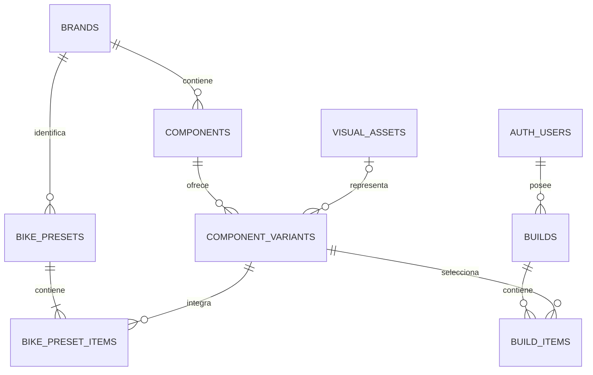

# 03a · Esquema, campos y relaciones

Relacionado: [operaciones y guardado](03-datos-y-operaciones.md), [acceso y permisos](04-autenticacion-y-acceso.md), [arquitectura](02-arquitectura-y-frontend.md) y [revisión adversarial](09-revision-adversarial-de-datos.md).

Estado: planificación. El usuario aprobó el árbol de ocho tablas de negocio, las relaciones y la distribución de campos que se documentan aquí. Los tipos son el contrato propuesto para las migraciones futuras, no SQL ejecutado. Los detalles de catálogo y su diccionario final deben corresponder al inventario elegido.

## Modelo inicial

Ocho tablas de negocio cubren el catálogo, las bicicletas de referencia y los montajes. Se añaden cuatro tablas propias de autorización en el esquema iam, detalladas en [04a](04a-iam-roles-y-permisos.md): roles, permissions, role_permissions y user_roles. El total es doce tablas propias; Auth conserva su esquema administrado. La revisión de variantes reales, integridad y consultas está registrada en [revisión adversarial](09-revision-adversarial-de-datos.md). Es un contrato de planificación; no una base implementada o medida. Supabase Auth conserva la identidad en `auth.users`; no se crea una tabla de contraseñas ni un sistema paralelo de usuarios. No hace falta una tabla de perfiles hasta tener atributos de perfil reales.



## Árbol completo de tablas y columnas

`PK`: clave principal. `FK`: referencia por clave foránea. `?`: columna nullable. Los tipos de catálogo controlados pueden resolverse mediante texto con restricciones; no requieren una tabla por cada código.

```text
Supabase
├── auth.users                         Administrada por Supabase Auth
│   └── id                    uuid PK
│       No duplicamos sus campos internos.
└── public
    ├── brands                         Marcas
    │   ├── id                uuid PK
    │   ├── name              text
    │   ├── slug              text UNIQUE
    │   ├── region            text ?
    │   └── published         boolean
    │
    ├── components                     Familias/modelos comerciales
    │   ├── id                uuid PK
    │   ├── brand_id          uuid FK → brands.id
    │   ├── name              text
    │   ├── slug              text UNIQUE
    │   ├── category          text controlado
    │   ├── disciplines       text[] controlado
    │   ├── description       text
    │   ├── technical_notes   text ?
    │   ├── image_key         text ?
    │   ├── sources           jsonb
    │   └── published         boolean
    │
    ├── component_variants             Versiones concretas
    │   ├── id                uuid PK
    │   ├── component_id      uuid FK → components.id
    │   ├── label             text
    │   ├── model_year        smallint ?
    │   ├── generation        text ?
    │   ├── manufacturer_code text ?
    │   ├── image_key         text ?
    │   ├── sources           jsonb
    │   ├── specs_schema_version integer
    │   ├── specs             jsonb
    │   ├── price_reference   jsonb ?
    │   ├── allowed_finishes  jsonb
    │   ├── visual_asset_id   uuid FK → visual_assets.id ?  Solo nullable en preparación
    │   ├── representation    text controlado
    │   ├── published         boolean
    │   └── selectable        boolean
    │
    ├── visual_assets                  Recursos de representación 3D
    │   ├── id                uuid PK
    │   ├── kind              text: glb / procedural
    │   ├── storage_path      text ?
    │   ├── generator_key     text ?
    │   ├── manifest          jsonb
    │   ├── reference_notes   text ?
    │   └── published         boolean
    │
    ├── bike_presets                   Bicicletas prearmadas
    │   ├── id                uuid PK
    │   ├── brand_id          uuid FK → brands.id
    │   ├── name              text
    │   ├── slug              text UNIQUE
    │   ├── family_key        text
    │   ├── label             text
    │   ├── model_year        smallint ?
    │   ├── image_key         text ?
    │   ├── kind              text: factory / example
    │   ├── sources           jsonb
    │   ├── published         boolean
    │   └── selectable        boolean
    │
    ├── bike_preset_items              Piezas de prearmadas
    │   ├── id                uuid PK
    │   ├── preset_id         uuid FK → bike_presets.id
    │   ├── slot              text controlado
    │   ├── variant_id        uuid FK → component_variants.id
    │   ├── finish_id         text
    │   └── custom_color      text ?
    │
    ├── builds                         Montajes privados
    │   ├── id                uuid PK
    │   ├── user_id           uuid FK → auth.users.id
    │   ├── name              text
    │   ├── schema_version    integer
    │   ├── revision          integer
    │   ├── created_at        timestamptz
    │   └── updated_at        timestamptz
    │
    └── build_items                    Piezas del montaje personal
        ├── id                uuid PK
        ├── build_id          uuid FK → builds.id
        ├── slot              text controlado
        ├── variant_id        uuid FK → component_variants.id
        ├── finish_id         text
        └── custom_color      text ?
```

`published` controla la publicación; `selectable` permite retirar una opción de nuevas selecciones conservando referencias anteriores. No duplicar identidades ni añadir tablas de categorías, colores, generaciones o ajustes solo por organizar códigos. Los roles/permisos configurables sí tienen relaciones propias en el esquema iam, según [su contrato](04a-iam-roles-y-permisos.md).

## Campos estructurados JSONB

Las estructuras siguientes definen responsabilidades y propiedades previstas. No son bloques de JSON ejecutable ni permiten introducir claves arbitrarias. El contrato final fija tipos, obligatoriedad y tamaños conforme al inventario, sin añadir funciones o campos de perfil.

```text
sources[]                              Procedencia de información
├── url                   Fuente identificable
├── consulted_at          Fecha de consulta
├── note                  Observación cuando haga falta
└── fields[]              Atributos respaldados cuando corresponda

price_reference                        null si no existe referencia suficiente
├── amount                Importe numérico positivo
├── currency              Moneda ISO 4217
├── market                País/mercado observado
├── source_url            Fuente del precio
└── as_of                 Fecha de consulta

allowed_finishes
├── default_finish_id     ID del acabado inicial
├── custom_color_enabled  boolean
└── options[]
    ├── id                ID estable dentro de la variante
    ├── label             Nombre visible
    ├── image_key         Foto local del acabado, si existe
    └── material          Definición visual permitida y validada

manifest
├── manifest_version
├── units
├── origin
├── anchors
├── selectable_nodes
├── paintable_nodes
└── parameters            Parámetros del recurso/generador
```

`finish_id` no es FK a una tabla de colores: se valida contra las opciones de la variante en la operación correspondiente. `material` y `parameters` no admiten código, scripts ni CSS arbitrario. El contrato espacial y los ejemplos conceptuales del manifiesto viven en [3D](05-configurador-3d.md#contrato-espacial); el adaptador de representación traduce los nombres del contrato a los de la librería sin exponerlos al usuario.

## Restricciones y relaciones

| Relación/campo | Regla |
| --- | --- |
| Marca → modelos | Una marca puede tener varios componentes; cada componente referencia una marca |
| Modelo → variantes | Cada variante pertenece a un modelo concreto |
| Recurso → variantes | Una variante puede no tener recurso específico; varias pueden compartir uno si su contrato espacial lo permite |
| Marca → prearmadas | La marca de la bicicleta es independiente de la marca de sus piezas |
| Prearmada → piezas | UNIQUE `(preset_id, slot)`; composición concreta por talla/versión |
| Usuario → montajes | Cada montaje tiene propietario obligatorio; lectura/operaciones según RLS |
| Montaje → piezas | UNIQUE `(build_id, slot)`; una variante por posición |
| Variante → piezas | IDs referenciados por FK, categoría correcta y acabado validado |
| `custom_color` | null o sRGB `#RRGGBB`, solo si la variante lo permite |
| `name` de montaje | Entre 1 y 80 caracteres |
| Revisiones/versiones | Enteros válidos según el contrato, con actualización de revisión únicamente en `save_build` |

Borrar un montaje propio elimina sus piezas en cascada. Las variantes y recursos referenciados no se eliminan como forma rutinaria de archivo. La composición y política de retirada se desarrollan en [operaciones](03-datos-y-operaciones.md); las FK no sustituyen RLS ni la validación de publicación.

La categoría del componente y el parentesco de variantes publicadas/referenciadas se protegen conforme a [03](03-datos-y-operaciones.md#archivo-y-cambios-de-catálogo); cambiar esos vínculos no es una corrección editorial.

## Recursos, fotos e identidad

IDs UUID; fechas de servidor. Los nombres de campos son la propuesta para la primera migración. `specs`, `price_reference`, `sources`, `allowed_finishes` y `manifest` pueden ser JSONB pequeño con estructura validada; no convertir todo el catálogo en texto libre.

No guardar binarios GLB o imágenes en PostgreSQL. Las fotos viven en `src/assets/images/`; `image_key` identifica una entrada del mapeo de imágenes del frontend, que usa imports de Vite y devuelve la URL publicada. No usar una cadena `/src/assets/...` como URL de producción ni interpretar la clave como una ruta arbitraria. Si no existe la clave o falta la foto, se muestra el placeholder previsto. Añadir o sustituir fotos requiere reconstruir y desplegar el frontend.

`storage_path` se utiliza exclusivamente para recursos 3D importados desde Storage. `kind=glb` requiere ruta y prohíbe generador; `kind=procedural` requiere un identificador de generador permitido y no una ruta GLB. En el segundo caso, PostgreSQL puede guardar el identificador y metadatos, pero la geometría se crea en memoria del navegador y no se sube como archivo. El frontend no ejecuta código obtenido de la base de datos.

`representation` distingue `reference`, `approximate` y `generic`. Un generador puede representar varias variantes. Si cambian parámetros visuales estimados o anclajes, se crea el recurso/manifiesto correspondiente, reutilizando archivo/generador cuando proceda. Compartir un archivo no obliga a compartir todas las dimensiones; no copiar estimaciones al dato técnico de catálogo. `visual_asset_id` solo puede faltar durante la preparación administrativa; toda variante publicada y seleccionable exige un recurso publicado válido, incluso si es procedural genérico. No resolver montajes mediante un fallback implícito a «la última versión»: la referencia fija generador, parámetros y anclajes versionados. Una indisponibilidad excepcional posterior conserva el contrato de recuperación textual de 05.

El `image_key` opcional de variante sobrescribe la imagen familiar. Un acabado puede indicar una clave propia cuando exista foto correspondiente. Fallback: acabado → variante → modelo → placeholder; si la foto disponible solo es familiar se identifica como referencia y no se afirma que muestre el acabado elegido. Todas las claves pasan por el mismo mapeo local permitido.

`generation` y `manufacturer_code` son opcionales, recogidos de una fuente cuando existan. El UUID identifica la variante; año, etiqueta o código aislados no se presuponen identificadores universales. No crear generaciones o SKU ficticios para completar campos. Las fuentes de variante registran los atributos observados cuando haga falta; no atribuir a todas las versiones una especificación tomada de otra. No necesitan una tabla universal de evidencias. Los acabados cosméticos no alteran las interfaces; si una edición cambia construcción, carcasa, compuesto o propiedades técnicas, se ingesta como variante real diferente.

## Componentes frente a variantes

«Modelo X» identifica el producto. «Modelo X, año conocido, 29 pulgadas, recorrido determinado» identifica una variante. Las fotos, medidas, acabados y recursos de la variante deben corresponder a esa selección. No rellenar el año con el año actual.

| Dato | Formato propuesto | Uso |
| --- | --- | --- |
| Peso | `weight_g`: número o null | Comparación con unidad explícita |
| Recorrido | `travel_mm`: número o null | Selección y medidas; rango comercial en el modelo si hace falta |
| Rueda | `wheel_format`: código controlado | Presentación 27.5/29; no confundir con diámetro exterior real del neumático |
| Neumático | `tire_width_mm`, `outer_diameter_mm`: números o null | Apariencia y posibles conflictos conocidos |
| Eje | `axle_standard`: código controlado | Comparar interfaces compatibles conocidas |
| Disco | `rotor_diameter_mm`, `rotor_mount`: número/código o null | Tamaño visual y comprobaciones disponibles |
| Amortiguador | `eye_to_eye_mm`, `stroke_mm`, `mount_standard` | Anclajes y selección |
| Precio orientativo | `price_reference`: objeto o null | `amount`, `currency`, `market`, `source_url`, `as_of`; referencia consultada de esa variante |

Las restricciones numéricas positivas, códigos permitidos y límites de tamaño del JSON se definen en SQL. Las reglas específicas de categoría se validan al cargar los datos y en las operaciones de edición. El JSON no acepta HTML ejecutable. Las fuentes registran URL, fecha de consulta y nota sobre el dato observado.

Las comparaciones no consideran siempre «mejor» al valor mayor: un precio menor o más recorrido no determinan por sí solos la elección. Se resaltan diferencias y se explica el significado de cada medida.

Los diccionarios por categoría, registros de modelos y reglas de ingesta están separados en [11 y sus documentos](11-propuesta-de-inventario.md). `specs.maintenance` admite el objeto documental de manuales/tareas/intervalos allí definido; no crea una agenda ni nuevas tablas. Categoría y slot `bottom_bracket` se incorporan al contrato inicial antes de implementarlo. Las representaciones genéricas ATLAS de contacto se identifican como diseño propio, sin SKU ni precio comercial.

Para suspensión, `specs` también define `damping_system`, `adjustments`, `wheel_format`, `axle_standard` o `mount_standard` según la categoría, y `stanchion_diameter_mm` cuando se conozca. Uso recomendado, notas de compatibilidad y fuentes se conservan como contenido documentado, no como comprobaciones mecánicas ejecutables.

### Grupos de características por categoría

El conjunto siguiente es el árbol funcional aprobado de atributos pertinentes. No son campos universales obligatorios ni filtros que deban aparecer todos en UI. La lista final de claves, códigos y obligatoriedad se cierra contra el inventario; los datos desconocidos permanecen null.

| Categoría | Características de `specs` |
| --- | --- |
| Cuadro | Talla, material, tipo de suspensión, rueda delantera/trasera, geometría, dirección, eje, pedalier, tija y anclajes de amortiguador |
| Horquilla | Recorrido, eje-corona, offset, rueda, pletina, arquitectura convencional/invertida, dirección, eje, resorte, hidráulico y ajustes |
| Amortiguador | Entreojos, carrera, resorte, hidráulico, anclajes y herrajes por extremo |
| Freno | Conjunto pinza/maneta, accionamiento, pistones, orientación, montaje y fluido |
| Disco | Diámetro, espesor, anclaje y restricciones documentadas |
| Aro | Diámetro ETRTO, anchuras, perfil, agujeros, material y tubeless |
| Neumático | ETRTO, talla comercial, carcasa, compuesto, talón y tubeless |
| Buje | Posición, diámetro/ancho de eje, estándar, disco, núcleo y agujeros |
| Cassette | Velocidades, dentado, núcleo y ecosistema |
| Cadena | Velocidades, ecosistema y construcción |
| Cambio trasero | Velocidades, ecosistema, capacidad, montaje, accionamiento y mando asociado documentado |
| Pedalier | Estándar/diámetro/ancho/rosca de caja, interfaz/diámetro de eje, separadores y restricciones |
| Bielas y plato | Longitud, interfaz de eje, línea de cadena y dentado |
| Manillar | Anchura, elevación, ángulos y diámetro de abrazadera |
| Potencia | Longitud, ángulo e interfaces de montaje |
| Tija | Diámetro, longitud, inserción, recorrido y accionamiento |
| Sillín | Dimensiones e interfaz de raíles |
| Pedales | Tipo, dimensiones, interfaz y material |

Ejemplo conceptual de propiedades de una horquilla, sin valores de producto inventados:

```text
specs
├── weight_g
├── travel_mm
├── axle_to_crown_mm
├── offset_mm
├── wheel_format
├── crown_type
├── steerer_standard
├── axle_standard
├── spring_type
├── damping_system
└── adjustments
```

El cambio trasero incluye `associated_shifter` dentro de `specs`: marca/modelo, accionamiento e interfaz documentados, sin crear otra entidad seleccionable. Sus nodos y anclajes viven en el manifiesto del recurso compuesto, no en medidas técnicas inventadas. El precio corresponde al producto observado por la fuente; no se presenta como precio del conjunto con mando si la fuente no lo incluye. Los componentes integrados adicionales dependen del inventario, según [fases](08-fases-y-validacion.md#trabajo-de-concreción-incluido-en-el-plan).

### Alcance de variantes y precios

No hacen falta tablas adicionales de familias, precios históricos o comercios. `components` agrupa la familia/modelo comercial; `component_variants` contiene únicamente las versiones reales seleccionadas. La denominación comercial de la versión se conserva en `label`; `specs` registra sus medidas y sistemas documentados. Color/acabado se mantiene en `allowed_finishes` sin duplicar variantes técnicas por cada color. Si una edición comercial cambia otros atributos relevantes, sí puede justificar una variante propia.

No crear variantes por cada posición de un ajuste, ni cruzar automáticamente todos los valores de una familia. La selección usa datos completos y verificables de la combinación concreta. Para suspensión, distinguir `spring_type` —aire o muelle, solo cuando esté documentado— de `damping_system` y `adjustments`. No usar «manual» como tipo de resorte.

`price_reference` agrupa una única referencia orientativa por variante: `amount` positivo, `currency` ISO 4217, `market` como país/mercado observado, `source_url` HTTP(S) identificable y `as_of` como fecha de consulta. Todo el objeto es null cuando no existe referencia suficiente; no usar cero ni objetos a medias. No aceptar URLs ejecutables. Corregir o actualizar una referencia de precio no cambia el ID ni la revisión del montaje: no afecta a su geometría.

El precio se muestra como «Precio de referencia», acompañado de moneda y fecha, con fuente y mercado consultables. Una comparación con distintas monedas o mercados conserva esos contextos y no calcula diferencias porcentuales o rankings de precio engañosos. No hay conversiones automáticas, desglose tributario, ofertas, stock ni total presupuestado del montaje en este alcance. Si una fuente deja de estar disponible, se puede mantener la observación fechada, sin presentarla como precio vigente garantizado. Las referencias se revisan manualmente al preparar o actualizar catálogo; no se añade un trabajo programado.

Los montajes guardan elecciones de piezas, no una cotización congelada. Al reabrir se puede ver la referencia de catálogo actual con su fecha; cambiarla no altera las piezas ni los colores guardados.
