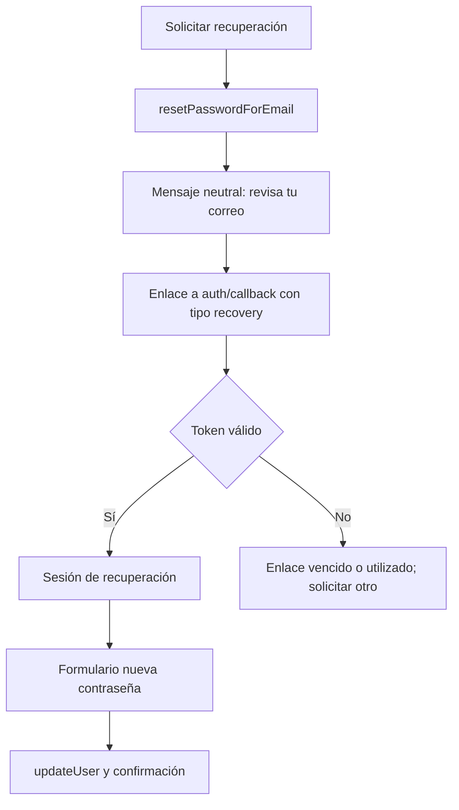
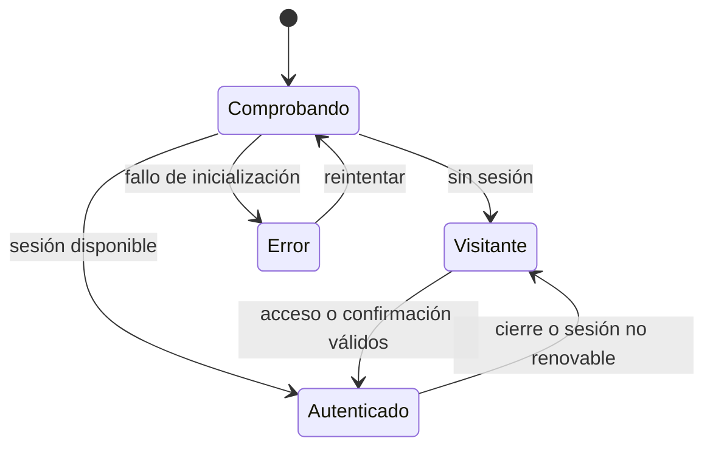

# 04 · Autenticación y acceso

Relacionado: [IAM](04a-iam-roles-y-permisos.md), [administración](04b-administracion-y-operaciones.md), [contrato de datos](03-datos-y-operaciones.md), [pantallas de acceso](06a-portada-y-acceso.md) y [entornos](07-entornos-y-despliegue.md).

El proyecto Cloud y los accesos de lectura a Auth/Admin ya fueron comprobados; [07](07-entornos-y-despliegue.md) registra evidencia y variables disponibles. No se ha probado todavía el recorrido funcional de registro/invitación ni se han creado roles o tablas de aplicación.

## Alcance inicial

Registro con correo y contraseña, confirmación de correo, inicio de sesión, recuperación de contraseña y cierre de sesión mediante Supabase Auth. Formularios propios coherentes con la interfaz. No se implementan contraseñas en SQL, tokens propios ni cuentas anónimas de Supabase. Ampliación autorizada el 21/10/2026: acceso y registro mediante Google OAuth gestionado por Supabase, conservando correo y contraseña. Formularios comunes para todos los roles; autorización mediante el esquema propio IAM. El registro público siempre asigna user; solo operaciones autorizadas pueden asignar admin u otros roles. La administración web y creación de roles están incluidas según [04a](04a-iam-roles-y-permisos.md) y [04b](04b-administracion-y-operaciones.md).

La portada, catálogo, fichas, comparación y exploración de bicicletas de referencia son públicos. En el espacio de trabajo, Componentes y Bicicletas permiten explorar sin cuenta; Mis bicicletas pide sesión y aplicar una prearmada también. El configurador, los avisos del montaje, el guardado y «Mis bicicletas» requieren sesión. Crear una cuenta no implica contratar una membresía. Los contenidos técnicos públicos de una ficha siguen disponibles sin cuenta.

Al pulsar «Crear mi bicicleta» o «Probar», conservar una intención acotada: acción, variante o referencia prearmada/talla opcionales y ruta pública de origen. Validar IDs y destinos internos; no aceptar redirecciones externas. Tras entrar, continuar esa acción y elegir una base si falta. Si la variante ya no está disponible, explicar el motivo y permitir elegir otra. No cargar el editor ni crear un montaje anónimo antes de autenticar.

Cancelar el acceso vuelve a la página pública de origen; entrar directamente a una ruta privada sin sesión lleva al formulario. Tras comprobar la sesión, un ID de montaje solo se abre si pertenece a la cuenta y dispone de los permisos pertinentes. Si la confirmación se abre en otro dispositivo sin intención local, se usa el destino por permisos descrito abajo; no prometer trasladar la intención entre dispositivos.

### Destino después del acceso

Esta regla es común al acceso, confirmación, invitación y recuperación completados: primero consultar los permisos vigentes y continuar una intención interna válida únicamente si está autorizada. Sin intención válida/autorizada, abrir «Mis bicicletas» si existe `builds.read_own`; de lo contrario, abrir «Componentes», que es público. Una intención denegada informa que esa acción no está disponible y no intenta ejecutarla.

Una sesión válida sin permiso no se trata como una sesión ausente: no redirigir repetidamente al login. Si se revoca un permiso durante el uso, detener la operación afectada, retirar su información privada de la vista y volver al destino permitido según esta misma regla. Los permisos desconocidos por un fallo de consulta no se interpretan como concedidos: mostrar error recuperable y conservar únicamente la recuperación local autorizada de esa cuenta.

## Presentación aprobada

La composición de acceso y registro está aprobada en [portada y acceso](06a-portada-y-acceso.md#inicio-de-sesión-en-escritorio): panel estático de bicicleta a la izquierda y formulario claro a la derecha en escritorio; una columna sin fotografía en móvil. Títulos «Iniciar sesión» y «Crear cuenta», etiquetas persistentes, controles «Mostrar» independientes y retorno al origen público. Registro pide solo correo, contraseña y confirmación, con requisitos coherentes con Auth; después muestra «Revisa tu correo», reenvío y vuelta al acceso. La confirmación de contraseña es validación local, no un dato almacenado. Se añade «Continuar con Google» en acceso y registro; no se añaden campos de perfil ni otros proveedores.

## Flujos

```mermaid
sequenceDiagram
  actor U as Persona
  participant UI as Formulario
  participant A as Supabase Auth
  participant E as Correo
  U->>UI: Crear cuenta
  UI->>A: signUp con emailRedirectTo permitido
  A->>E: Enlace de confirmación
  A-->>UI: Solicitud procesada; sesión puede ser null
  UI-->>U: Revisa tu correo
  U->>UI: Abrir enlace de confirmación
  UI->>A: verifyOtp con token_hash y tipo permitido
  A-->>UI: Sesión confirmada o error
  UI-->>U: Continuar al destino autorizado
```

El formulario de entrada usa `signInWithPassword`. Tras entrar se aplica la regla de destino por permisos anterior. Un montaje nuevo comienza como borrador local asociado a la cuenta; no se guarda en Supabase automáticamente. Una reautenticación permite recuperar los cambios locales de esa misma cuenta si conserva los permisos necesarios. El registro no se interpreta como sesión activa mientras el SDK no la haya establecido.



## Contrato del callback

Para evitar mezclar rutas hash con tokens y evitar depender de un verificador almacenado en otro dispositivo, se planifica un callback de token hash verificado por el SDK:

- Registro: `signUp` recibe `emailRedirectTo` con el origen permitido y `/auth/callback`.
- Recuperación: `resetPasswordForEmail` recibe ese callback en `redirectTo`.
- Invitación administrativa: Auth Admin usa ese callback como `redirectTo` permitido, desde una Edge Function o el Dashboard.
- Plantilla de confirmación: enlace a `{{ .RedirectTo }}?token_hash={{ .TokenHash }}&type=email`.
- Plantilla de recuperación: enlace a `{{ .RedirectTo }}?token_hash={{ .TokenHash }}&type=recovery`.
- Plantilla de invitación: enlace a `{{ .RedirectTo }}?token_hash={{ .TokenHash }}&type=invite`.
- El callback acepta únicamente `email`, `recovery` e `invite`, llama una sola vez a `verifyOtp` y elimina los parámetros sensibles de la barra mediante reemplazo de historial.

Los enlaces de correo mantienen este contrato. Google usa un flujo separado PKCE: `signInWithOAuth` con proveedor Google y retorno al mismo `/auth/callback`; el callback canjea `code` una sola vez con `exchangeCodeForSession`. No se aceptan tokens de sesión del fragmento de URL ni se activa su detección automática. En este diseño el cliente deshabilita `detectSessionInUrl`, mientras el SDK sigue gestionando persistencia y renovación. El manejador comparte una única verificación en curso para resistir remontajes de React StrictMode; un doble efecto no debe consumir el enlace dos veces.

La página de callback no carga el visor ni recursos externos de analítica. Se configura una política de referencia que no propague la URL del callback. Un error conserva un mensaje útil, nunca imprime el token, y permite pedir otro enlace. No usar `next` recibido de Internet como redirección libre: el destino posterior pertenece a una lista de rutas internas.

El tipo invite, verificado una sola vez, conduce a «Define tu contraseña»; recovery conduce a «Nueva contraseña». Ambos usan `updateUser` bajo la sesión correspondiente y no aceptan un rol de la URL. El enlace de invitación no sustituye la operación de asignación IAM ni convierte un registro público en admin. Tras completar se consulta acceso propio y se continúa a un destino interno permitido; si falla la asignación administrativa se mantiene el rol real, sin prometer privilegios.

La configuración de plantillas y URLs forma parte de la implementación y se prueba con correo real de prueba. No basta con crear un formulario.

## Estado de sesión



El proveedor Auth se suscribe una vez a los cambios del SDK y cancela la suscripción al desmontarse. Durante la comprobación no redirige prematuramente ni muestra datos de otra cuenta. Los guardas de rutas mejoran la experiencia; los permisos reales los aplica Supabase.

El SDK puede persistir la sesión en el navegador. No duplicar sus tokens en el borrador, logs, URLs internas ni tablas de aplicación. Si una sesión caduca mientras se edita, se conserva una recuperación local asociada a esa cuenta y se solicita volver a entrar. No convertir automáticamente un montaje privado en borrador público del dispositivo.

## Matriz de acceso

| Recurso | Visitante | Usuario normal | Administrador / rol autorizado |
| --- | --- | --- | --- |
| Contenido publicado y comparación | Leer | Leer | Leer |
| Configurador y aplicar prearmada | Solicita acceso | Usar con permiso | Usar con permiso |
| Montajes propios | Sin acceso | Operaciones propias autorizadas | Operaciones propias autorizadas |
| Montajes ajenos | Sin acceso | Sin acceso | Sin acceso por defecto |
| Catálogo/prearmadas en borrador | Sin acceso | Sin acceso | Leer con permiso de área |
| Editar/publicar datos | Sin acceso | Sin acceso | Operaciones controladas con permiso |
| Listar/invitar cuentas, asignar roles | Sin acceso | Sin acceso | Permiso específico y límites de IAM |
| Crear/editar roles personalizados | Sin acceso | Sin acceso | roles.manage y permisos otorgables |
| Tablas iam o auth por API directa | Sin acceso | Sin acceso | Sin acceso directo desde navegador |
| Assets públicos aprobados | Descargar | Descargar | Descargar |
| Subir GLB desde la web | Sin acceso | Sin acceso | Fuera de alcance; herramientas del equipo |


Se habilita RLS en todas las tablas expuestas y se conceden únicamente las operaciones de la matriz. Un usuario registrado no se convierte en editor. Una FK no transmite RLS; las comprobaciones de publicación y propiedad se definen para cada lectura directa expuesta. Vistas, si se añaden, respetan las políticas mediante `security_invoker`; las funciones de lectura no reciben privilegios elevados por costumbre.

## Políticas por relación

- `brands`, `components`, `component_variants` y `visual_assets`: SELECT público solo del contenido publicado. Las variantes exigen también que el componente y su marca estén publicados. Sin DML directo a `anon` ni `authenticated`; lectura de borradores y escrituras administrativas mediante funciones enfocadas con permisos de área. No abrir las tablas a toda cuenta autenticada.
- `bike_presets`: lectura de referencias publicadas con marca publicada, sin escritura directa del cliente; operaciones administrativas autorizadas por funciones. Publicación controlada verifica composición completa; no presupone que una FK valide publicación.
- `bike_preset_items`: lectura exige preset/marca publicados y variante/componente/marca de cada pieza publicados; sin DML directo del cliente y edición administrativa mediante funciones autorizadas. Evitar políticas recursivas entre padre e hijos: la visibilidad del padre no consulta una política de hijos que vuelva al padre. Validar integridad de composición al publicar y disponibilidad al aplicar. Una retirada excepcional de datos deja un aviso, no un montaje falsamente completo.
- `iam.*`: fuera de Data API de tablas, RLS/grants restrictivos y acceso por funciones autorizadas; definición principal en [IAM](04a-iam-roles-y-permisos.md).
- `builds`: SELECT y DELETE directos exigen permiso propio correspondiente y `auth.uid() = user_id` con sus grants y políticas RLS. Sin INSERT/UPDATE directo para el cliente; creación y cambios pasan por `save_build`. El propietario procede de la identidad Auth, nunca de metadata editable.
- `build_items`: SELECT exige permiso de lectura propia y que la cabecera pertenezca a `auth.uid()`. Sin INSERT/UPDATE/DELETE directos para el cliente; la RPC modifica piezas y la eliminación de cabecera las borra en cascada.
- `save_build`: ejecución solo para `authenticated`, `security definer` con `search_path` vacío y comprobaciones explícitas de permiso de escritura propia, identidad y propiedad descritas en [datos](03-datos-y-operaciones.md). La función puede eludir RLS por sus privilegios; cada operación valida propietario y referencias antes de escribir. Esa excepción no se extiende a las consultas del navegador.
- Storage: modelos 3D importados y recursos asociados aprobados para descarga pública; sin políticas de subida, modificación o borrado para clientes. La carga se hace con acceso del equipo al panel o herramientas administrativas fuera del navegador. Las fotos de componentes se publican desde `src/assets/images/` con Netlify y no necesitan políticas de Storage.

Un bucket público no mantiene un archivo secreto aunque su fila de catálogo esté oculta. Solo se suben a él recursos destinados a descarga pública. La aplicación no necesita un bucket de archivos personales: el montaje privado es una selección en PostgreSQL, no un GLB privado.

## Validación y mensajes

Campos con etiquetas, autocompletado correcto y errores asociados. La política de contraseña del formulario coincide con la de Supabase; permitir pegar y usar gestores de contraseñas. Deshabilitar envíos duplicados mientras se procesa la solicitud.

Entrada fallida: «No pudimos iniciar sesión con esos datos». Recuperación: mensaje neutral independientemente de si el correo existe. Confirmación vencida: permitir solicitar un nuevo enlace con espera visible, respetando los límites de Supabase. Un fallo de red no se presenta como contraseña incorrecta.

Antes de abrir el registro a terceros, verificar el servicio de correo. El SMTP predeterminado de Supabase tiene restricciones de destinatarios y envío; para registro público se configura SMTP apropiado. Sus credenciales permanecen en Supabase, nunca en Vite. Esto es una tarea de lanzamiento, no una razón para añadir un backend propio.

## Pruebas de aceptación

1. Registro, confirmación, entrada y cierre con un correo de prueba.
2. Recuperación y nueva contraseña; enlace repetido, vencido y abierto en otro navegador.
3. Recarga durante comprobación y callback; una sola verificación efectiva bajo StrictMode.
4. Visitante navega por las páginas públicas; «Probar», crear y rutas privadas piden acceso. Tras entrar continúa la intención válida sin guardado automático; cancelar devuelve al origen público. Comprobar confirmación en otro dispositivo sin intención local.
5. A y B no pueden leer ni modificar montajes ajenos por API ni RPC, aunque manipulen IDs.
6. Cerrar sesión limpia la vista, las consultas privadas y la recuperación local de esa cuenta.
7. Faltan variables, falla la red o caduca la sesión: ninguna pantalla finge éxito.
8. Invitación válida/vencida/repetida, contraseña y asignación de rol real; no aceptar roles desde el callback.
9. Ejecutar la matriz de IAM/administración de [fases](08-fases-y-validacion.md), incluidos registro manipulado, roles personalizados y revocaciones concurrentes.

## Referencias

- [Autenticación con contraseña](https://supabase.com/docs/guides/auth/passwords).
- [Verificación de token hash](https://supabase.com/docs/reference/javascript/auth-verifyotp).
- [Plantillas de correo](https://supabase.com/docs/guides/auth/auth-email-templates).
- [URLs permitidas de redirección](https://supabase.com/docs/guides/auth/redirect-urls).
- [Restricciones de correo y SMTP](https://supabase.com/docs/guides/auth/auth-smtp).
- [Acceso a Storage](https://supabase.com/docs/guides/storage/security/access-control).

## Google · ampliación del 21/10/2026

El usuario creó el cliente OAuth y configuró el proveedor en Supabase Cloud. La lectura de configuración confirma proveedor activo, credenciales presentes y retorno local permitido. El secreto permanece en Supabase; no se copia al frontend ni a documentación. Registro Google conserva el provisionamiento IAM existente de rol user; permisos y aislamiento siguen aplicados por RPC/RLS.

El callback elimina parámetros sensibles antes de verificar, comparte la operación durante remontajes y libera el estado al terminar. Cancelación, retorno inválido o error permiten volver a entrar sin exponer mensajes del proveedor. Tras Google se abre el acceso compartido, que espera la consulta de permisos antes de continuar la intención interna. La prueba con consentimiento real de Google requiere la cuenta del usuario; no se simula como evidencia de acceso real.
