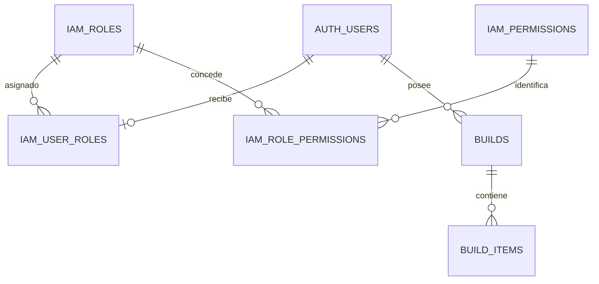
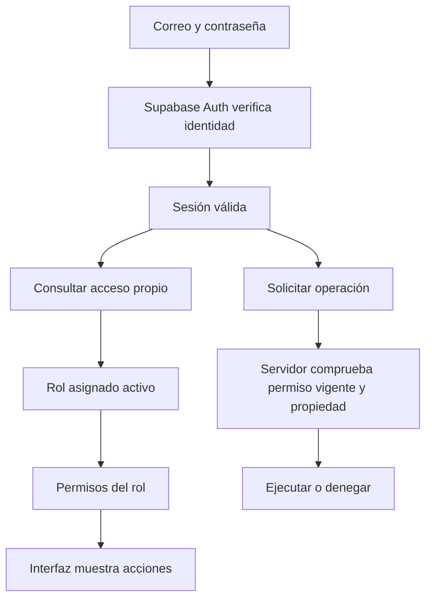

# 04a · IAM, roles y permisos

Relacionado: [Auth y sesión](04-autenticacion-y-acceso.md), [esquema de negocio](03a-esquema-y-campos.md), [administración](04b-administracion-y-operaciones.md) y [fases](08-fases-y-validacion.md).

Estado: planificación. Decisión del usuario: un único acceso con Supabase Auth, registro público siempre como usuario normal y capacidad real de crear roles y asignar permisos desde administración. Inicialmente solo se crean `user` y `admin`. Esto sustituye la alternativa anterior de una sola tabla con dos roles fijos y amplía la base a doce tablas propias: ocho de negocio y cuatro de IAM. No se han creado esquemas, tablas o funciones.

## Separación de responsabilidades

```text
Proyecto Supabase
├── auth                         Gestionado por Supabase
│   └── users.id                 Identidad; credenciales y sesiones mediante Auth
├── iam                          Esquema propio, fuera de la Data API de tablas
│   ├── roles                    Roles configurables
│   ├── permissions              Catálogo de acciones implementadas
│   ├── role_permissions         Permisos asignados a un rol
│   └── user_roles               Rol vigente de cada usuario
├── public                       Ocho tablas de negocio
│   ├── brands / components / component_variants / visual_assets
│   ├── bike_presets / bike_preset_items
│   └── builds / build_items
├── Funciones SQL controladas    Consultar acceso y administrar con autorización
├── Edge Functions               Operaciones que necesitan Auth Admin
└── Storage                      Recursos 3D y sus políticas
```

Auth resuelve contraseñas, confirmación, recuperación y tokens. IAM decide acciones permitidas; RLS y funciones las ejecutan bajo reglas. Un administrador de ATLAS no recibe acceso al Dashboard, credenciales o rol PostgreSQL `service_role`. El rol SQL `authenticated` identifica una sesión de API; no equivale al rol de negocio `admin`.

## Árbol de campos IAM

`?` indica nullable. Los campos de autoría describen la creación o última modificación, no un historial completo de auditoría. No se añade por esta decisión un subsistema de auditoría.

```text
iam.roles
├── id                 uuid PK
├── key                text UNIQUE          Código estable: user, admin o personalizado
├── name               text                 Nombre visible
├── description        text ?
├── is_system          boolean              Protege roles base
├── active             boolean
├── revision           integer              Control de edición concurrente
├── created_by         uuid ? → auth.users.id
├── updated_by         uuid ? → auth.users.id
├── created_at         timestamptz
└── updated_at         timestamptz

iam.permissions
├── code               text PK              Acción estable implementada
├── name               text                 Etiqueta comprensible
├── description        text
└── area               text controlado      Agrupación de interfaz

iam.role_permissions
├── role_id            uuid FK → iam.roles.id
└── permission_code    text FK → iam.permissions.code
    PK compuesta: (role_id, permission_code)

iam.user_roles
├── user_id            uuid PK, FK → auth.users.id
├── role_id            uuid FK → iam.roles.id
├── assigned_by        uuid ? → auth.users.id
├── assigned_at        timestamptz
└── revision           integer              Evitar asignaciones que se sobrescriban
```

Un usuario tiene un rol vigente; un rol contiene varios permisos; un permiso puede estar en varios roles. No hay herencia de roles, permisos por usuario, grupos, organizaciones o matrices de denegaciones. Los UUID de autoría nullable permiten bootstrap/operaciones del sistema; el navegador nunca declara el autor. Si se elimina excepcionalmente una identidad desde herramientas del proyecto, preservar autoría como null cuando corresponda y no dejar referencias inválidas.



La cardinalidad opcional del rol contempla fallos o cuentas pendientes de provisionar: sin asignación válida se deniegan operaciones privadas/administrativas. No asignar administración como fallback.

## Roles iniciales y creación de otros

- `user`: rol de sistema asignado siempre al registro público. Su clave, estado y permisos base no son editables desde la web; no se permite convertir el rol por defecto en administrador.
- `admin`: rol de sistema con todos los permisos implementados del catálogo inicial. Protegido frente a edición, desactivación o borrado desde la web.
- Roles personalizados: crear con nombre, descripción y selección explícita de permisos disponibles; el servidor genera una clave interna estable sin pedir terminología técnica en el formulario. Inicialmente no hay otros roles precreados. La capacidad de crearlos y utilizarlos forma parte de esta implementación, no queda como botón pendiente.

Las claves de roles de sistema están reservadas. No se puede simular un rol de sistema cambiando `is_system`, copiar su clave o mandar campos protegidos. Una clave personalizada se normaliza, se valida y permanece estable después de crearse; el nombre visible sí puede corregirse.

Los permisos son acciones respaldadas por funciones/políticas reales. Se incorporan por migración junto a la función correspondiente, no por un formulario que invente códigos o SQL. La web administra roles y sus asignaciones; no crea nuevas capacidades del software por escribir un permiso.

## Catálogo inicial de permisos

| Código | Etiqueta visible | user | admin |
| --- | --- | --- | --- |
| `configurator.use` | Crear y editar montajes | Sí | Sí |
| `builds.read_own` | Ver mis bicicletas | Sí | Sí |
| `builds.write_own` | Guardar mis bicicletas | Sí | Sí |
| `builds.delete_own` | Eliminar mis bicicletas | Sí | Sí |
| `catalog.manage` | Editar catálogo | No | Sí |
| `catalog.publish` | Publicar catálogo | No | Sí |
| `presets.manage` | Editar bicicletas de referencia | No | Sí |
| `presets.publish` | Publicar bicicletas de referencia | No | Sí |
| `users.read` | Ver usuarios | No | Sí |
| `users.invite` | Invitar usuarios | No | Sí |
| `users.assign_role` | Asignar roles | No | Sí |
| `roles.manage` | Crear y configurar roles | No | Sí |

La lectura pública del contenido publicado no depende de un rol. Los permisos `_own` siempre exigen propiedad; ni `admin` ni un rol personalizado obtienen acceso a montajes ajenos. El catálogo de permisos no añade por sí solo edición de código, SQL, infraestructura, archivos 3D, datos privados de otros usuarios, borrado de cuentas o restablecimiento de contraseñas ajenas.

### Dependencias de permisos

El conjunto de permisos de un rol personalizado debe ser coherente también con sus operaciones y recorridos. El servidor valida estas dependencias tanto al crear/editar un rol como al guardar la matriz:

| Permiso seleccionado | Permisos que también debe contener el rol |
| --- | --- |
| `builds.write_own` o `builds.delete_own` | `builds.read_own` |
| `catalog.publish` | `catalog.manage` |
| `presets.publish` | `presets.manage` |
| `users.assign_role` | `users.read` |
| `users.invite` | `users.read` y todos los permisos base del rol de sistema `user` |

Una combinación incompleta se rechaza indicando sus dependencias; no se conceden permisos adicionales silenciosamente. La interfaz presenta el requisito y permite seleccionarlo explícitamente antes de guardar. Los requisitos son transitivos y forman parte del mismo validador compartido entre formulario individual y matriz. `configurator.use` puede existir sin permiso de guardado: permite trabajar con un borrador local, sin prometer persistencia remota. `roles.manage` no exige por sí mismo lectura de usuarios.

Lectura/escritura propia sin `configurator.use` permite renombrar montajes existentes, conservando las piezas. Crear, copiar o cambiar piezas/acabados/colores requiere también `configurator.use`, comprobado por la RPC según el [contrato de guardado](03-datos-y-operaciones.md#rpc-save_build). No convertir el permiso de interfaz en una vía que pueda eludirse por API.

Invitar una cuenta concede primero el rol base `user`, aunque el destino final sea un personalizado más limitado. Por ello quien invita debe poder otorgar todos los permisos de ese rol base y también los del destino final, antes de crear la identidad. Una invitación a un rol distinto requiere además `users.assign_role`.

`catalog.manage` y `presets.manage` permiten trabajar con borradores. Toda escritura que cambie contenido públicamente visible exige también el permiso `publish` del área, incluidas correcciones de texto, fuentes y precio. No se necesita una variante nueva para corregir datos editoriales, pero esa corrección no elude el permiso de publicación. Despublicar o retirar de nuevas selecciones también exige ese permiso y conserva las restricciones sobre referencias ya utilizadas.

Si un rol personalizado carece de permiso para el configurador o para montajes, la interfaz omite esas acciones y el servidor las deniega. La portada para crear no garantiza acceso a toda cuenta autenticada: debe comprobar también su autorización vigente. Los roles iniciales conservan el recorrido ya aprobado.

## Resolución y protección



`iam` no se incluye entre esquemas expuestos de la Data API. Revocar acceso directo a sus tablas a visitante/cliente autenticado; protegerlas también con RLS sin políticas de escritura de cliente. Las entradas SQL públicas son funciones enfocadas y autorizadas, no una API CRUD genérica de IAM.

Una función interna de autorización deriva el actor de la identidad verificada y resuelve su rol activo y permisos en la base. La función pública de acceso propio no acepta un usuario arbitrario y devuelve solo su rol/permisos. Las funciones privilegiadas usan `security definer` únicamente cuando hace falta, `search_path` vacío, nombres cualificados, grants mínimos y sin SQL dinámico. Evitar recursión de políticas. El frontend no puede ascenderse por INSERT, UPDATE, metadata o payload manipulado.

No se necesita un hook de claims para este alcance: la fuente vigente es IAM en PostgreSQL. `app_metadata` y `user_metadata` no son una segunda fuente de roles. Un JWT todavía válido no conserva privilegios administrativos si la asignación cambió; cada operación nueva consulta permisos vigentes. Las operaciones ya iniciadas se ordenan transaccionalmente frente a los cambios de autorización; no se promete revertir una operación que ya se confirmó.

La matriz visual y sus interacciones están aprobadas en [06c](06c-administracion-usuarios-roles-y-permisos.md). Editar varias columnas guarda un lote transaccional de roles afectados con revisiones; un fallo revierte todo el lote, sin actualizaciones implícitas de columnas no cargadas.

El selector de rol de una invitación o asignación puede consultar únicamente roles activos otorgables por el actor, con el permiso de esa operación; no exige `roles.manage` ni abre la matriz o la administración completa de roles. La lectura devuelve los identificadores y etiquetas necesarios, y la escritura vuelve a comprobar disponibilidad, permisos y revisión.

Ediciones de rol/permisos/asignaciones comprueban revisión esperada y se serializan sobre una fila de sistema estable —por ejemplo el rol protegido admin—, con orden de bloqueos consistente. Revalidar actor y destino después del bloqueo. Esto evita que dos cambios simultáneos eliminen al último administrador o eludan una revocación concurrente.

No permitir quitar administración al último administrador con cuenta utilizable y confirmada. No desactivar/borrar un rol personalizado asignado: primero reasignar sus usuarios mediante acciones explícitas. Un rol personalizado no asignado se puede desactivar o borrar con confirmación; sus permisos dependientes se eliminan en cascada. FK de asignación restringe el borrado de un rol en uso. Añadir índices de `user_roles(role_id)`; PK/UNIQUE cubren identidades y relaciones de permisos según sus accesos.

Un actor solo puede otorgar permisos que posee. Asignar un rol exige `users.assign_role` y comprobar sus permisos efectivos; crear/editar roles exige `roles.manage` y no permite conceder capacidades superiores a las propias. No cambiar el rol propio o un rol del que depende la autorización actual desde un formulario que pueda dejar al actor bloqueado; utilizar otro administrador para esos cambios. El último administrador siempre queda protegido en servidor.

## Registro, primer administrador y evolución

1. Registro público: Auth crea la identidad; un trigger/operación controlada fija el rol de sistema `user`, ignorando cualquier rol o autor enviados por metadata. Provisionamiento atómico en la transacción de alta cuando se use trigger; si falla, no devolver un registro aparentemente completo. No promover automáticamente al primer correo o al primer registro.
2. Primer administrador: responsable del proyecto crea/invita la cuenta desde Supabase o utiliza una cuenta normal ya registrada; verifica el UUID y asigna admin mediante operación SQL controlada fuera del navegador. Tener cuenta en el Dashboard no concede por sí solo rol dentro de ATLAS.
3. Administración posterior: una cuenta autorizada invita o asigna roles desde la web, mediante los flujos de [administración](04b-administracion-y-operaciones.md). Nunca modificar credenciales escribiendo directamente en `auth.users`.
4. Nuevos roles: se guardan sus permisos en las relaciones y se pueden asignar a cuentas existentes. Sin migración por cada nuevo nombre de rol; solo se requiere migración al implementar nuevas capacidades/estructuras.

En React, permisos remotos se consultan con clave por usuario, sin duplicar autoridad en localStorage. Tras cambiar rol/permisos se invalidan las consultas relevantes y se vuelve a comprobar acceso al entrar en administración, al recuperar foco o tras una denegación. Cancelar peticiones y limpiar datos administrativos al perder autorización/cambiar cuenta; un formulario obsoleto no puede escribir aunque siga visible.

## Comprobaciones del contrato

- Rechazar roles con dependencias incompletas desde el formulario, la matriz y peticiones directas, sin añadir concesiones silenciosas ni confirmar un lote parcial.
- Permitir configurar un rol de uso local del configurador sin guardado y reflejar esa diferencia en sus acciones disponibles.
- Probar que una cuenta con asignación de roles, pero sin `roles.manage`, obtiene las opciones activas otorgables y puede asignarlas, sin consultar o modificar la matriz completa.
- Denegar toda edición públicamente visible sin el permiso `publish` del área, aunque el campo sea editorial o el precio de referencia; permitir trabajo autorizado sobre borradores.
- Comprobar antes de invitar que el actor puede otorgar los permisos de `user` y del destino final, incluidas peticiones manipuladas o permisos revocados desde que se abrió el formulario.

## Referencias

- [Supabase: RBAC y permisos](https://supabase.com/docs/guides/api/custom-claims-and-role-based-access-control-rbac).
- [Supabase: RLS](https://supabase.com/docs/guides/database/postgres/row-level-security).
- [Supabase: funciones de base](https://supabase.com/docs/guides/database/functions).

## Fuente de verdad y simplificación · 26/10/2026

Se retira la ampliación administrativa de edición de correo/recuperación: no añadir permisos para esas operaciones. Se mantiene el catálogo IAM existente. Cada cuenta tiene un rol (`user_roles`); ese rol concede los permisos definidos en `role_permissions`, con catálogo `permissions`. Las tablas son la fuente de verdad; React muestra el acceso recibido y el servidor lo comprueba en cada operación.

En la UI, Roles edita nombre/descripción/estado y Permisos es el único editor de asignaciones por rol. No duplicar las casillas en el panel del rol, ni crear niveles numéricos, herencia o excepciones por usuario. Crear un rol no le concede permisos; user/admin mantienen sus restricciones de sistema. El acceso Google conserva provisionamiento user y asignación administrativa autorizada.
