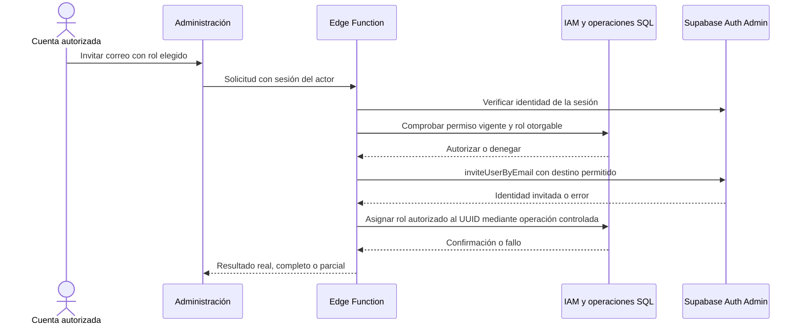

# 04b · Administración de usuarios, roles y catálogo

Relacionado: [IAM y campos](04a-iam-roles-y-permisos.md), [Auth](04-autenticacion-y-acceso.md), [operaciones de negocio](03-datos-y-operaciones.md) y [UI de trabajo](06b-espacio-de-trabajo.md).

Estado: planificación. Administración web incorporada por el usuario, sustituyendo la exclusión anterior de panel editorial. No se implementan todavía código, migraciones ni Edge Functions. El formulario de acceso es común para usuarios y administradores.

## Funciones administrativas del alcance

| Área | Funciones completas | Límite |
| --- | --- | --- |
| Usuarios | Listar paginadamente, consultar rol, invitar y asignar otro rol | Sin contraseñas visibles, suplantación, borrado de cuentas o gestión de sesiones ajenas |
| Roles | Listar, crear, editar nombre/descripción/permisos, asignar, desactivar y eliminar personalizados no asignados | Roles user/admin protegidos; sin herencia ni permisos individuales |
| Permisos | Listar acciones por área y seleccionarlas dentro de roles | Catálogo implementado y versionado; no crear capacidades ficticias desde UI |
| Catálogo | Crear/corregir marcas, modelos, variantes y datos técnicos/precios; revisar y publicar/retirar | Inmutabilidad de variantes usadas; sin editor de código, SQL o infraestructura |
| Prearmadas | Crear/corregir composiciones concretas y publicar/retirar | Referencias reales, slots/variantes/acabados válidos; fábrica/ejemplo explícitos |

Los archivos GLB siguen cargándose mediante herramientas del equipo en Supabase; las fotos locales mediante cambios del frontend. La edición de datos permite seleccionar referencias de recursos existentes y claves de imagen permitidas, no añade un cargador web de archivos ni un generador de modelos. Los grants de administración de datos no permiten escribir IAM ni datos privados de montajes ajenos.

El código SQL/RPC y Edge Functions de estas operaciones se versionará bajo [supabase/](../../supabase/README.md) antes de aplicarlo a Cloud. Las credenciales y el acceso ya están disponibles para herramientas; IAM y administración siguen sin implementar.

## Entradas de servidor

| Operación conceptual | Ejecución | Controles |
| --- | --- | --- |
| Consultar acceso propio | RPC SQL enfocada | Actor derivado de sesión; sin ID arbitrario |
| Listar roles/permisos | RPC SQL enfocada | Permiso pertinente; datos mínimos y paginación de roles |
| Opciones de rol para invitar/asignar | RPC SQL enfocada | Permiso de la operación; solo roles activos otorgables, sin exigir `roles.manage` ni exponer toda la matriz |
| Crear/editar/desactivar/eliminar rol | RPC SQL transaccional | `roles.manage`, subconjunto de permisos del actor, revisión, rol no protegido/no asignado según operación |
| Asignar rol | RPC SQL transaccional | `users.assign_role`, actor/destino vigentes, revisión, permisos otorgables y protección del último admin |
| Listar/invitar cuentas | Edge Function en Supabase | Identidad verificada, autorización vigente y Auth Admin solo en servidor |
| Editar/publicar datos de negocio | RPC SQL por operación coherente | Permisos de área, validación de esquema/referencias y versiones inmutables |

Los nombres finales de RPC se fijan al implementar sus contratos. No crear una RPC por campo ni una función genérica que reciba nombres de tabla o SQL libre. Las funciones de escritura y lectura privilegiadas usan `search_path` vacío, esquemas explícitos y grants mínimos. Rechazan campos protegidos y payloads fuera de contrato. La representación visual y el SDK de Auth no deciden autorización.

## Primer administrador

```text
Responsable del proyecto
    ├── Dashboard → Authentication → Users → crear/invitar cuenta
    └── Operación SQL controlada → asignar rol de sistema admin al UUID correcto
            └── La persona confirma su cuenta y entra por el acceso habitual
```

La migración IAM crea roles y permisos base; el funcionamiento no depende de ejecutar un seed opcional. No incluye un correo/contraseña administrativos conocidos. No existe una ruta pública de bootstrap ni una promoción por ser el primer usuario. La operación inicial se documenta para el equipo y se verifica con la identidad correcta. La misma vía controlada permite recuperación si se pierde acceso administrativo; no se añade una puerta trasera al frontend.

## Invitación desde ATLAS



Dos clientes acotados en la función cuando proceda: uno con identidad del solicitante para RPC y otro administrativo para Auth. Nunca derivar el actor de un ID incluido en el cuerpo; verificar JWT mediante mecanismo soportado por Supabase. La RPC de asignación vuelve a comprobar autorización vigente dentro de su transacción. No basta con validar una vez en React o al inicio de la función.

La invitación requiere `users.invite` y, para asignar un rol distinto del registro por defecto, `users.assign_role`; el rol debe estar activo y sus permisos deben ser otorgables por el actor. Antes de llamar a Auth Admin también se comprueba que el actor pueda otorgar todos los permisos del rol de sistema `user`, ya que Auth crea inicialmente una identidad con ese rol por el provisionamiento habitual. Elegir un destino final más limitado no evita esa concesión inicial. La promoción posterior es una operación separada y autorizada. Nunca aceptar `role=admin` en metadata del registro como fuente de privilegios.

La invitación llega al destinatario, que verifica el enlace y establece su contraseña. El administrador no conoce ni elige la contraseña de esa persona. El callback incorpora el tipo `invite` y la pantalla de establecimiento de contraseña descritos en Auth; rol y destino posterior no se aceptan como autoridad desde la URL.

Auth Admin y PostgreSQL no forman una única transacción. Si invitar tuvo éxito y asignar falló, informar «Cuenta invitada; rol pendiente de asignar», manteniendo user o el rol anterior; no anunciar administración completa. Conservar el UUID retornado y consultar el resultado antes de reintentar tras un timeout. No repetir invitaciones automáticamente, borrar cuentas para compensar o promover por coincidencia de nombre/correo no verificada. Para una cuenta ya existente se usa su identidad canónica y el flujo de asignación, sin recrearla; no modificar contraseñas o verificación como efecto secundario.

Deshabilitar envíos duplicados en UI. Reintentos de invitación no automáticos; recuperación basada en la identidad y estado del servicio. Fallos parciales tienen estado y acción concreta, no un mensaje de éxito genérico.

## Usuarios existentes y modificaciones de roles

El detalle permite editar el rol con autorización. Correo, confirmación y fechas son informativos; editar correo, contraseña, estado de verificación o metadatos de cuenta no se incorpora como CRUD genérico. Un cambio de correo futuro requerirá un contrato específico de Auth. La acción «Crear usuario» utiliza invitación con correo y rol, sin contraseña temporal.

La RPC autenticada `admin_list_users` lista cuentas paginadamente y devuelve únicamente identificador, correo necesario, estado relevante, fecha de creación, último acceso disponible y rol asignado, sin metadata completa, tokens o hashes. El navegador invoca esa lectura autorizada directamente para evitar el recorrido adicional por Edge Function y Auth Admin. Invitación y asignación de rol permanecen en Edge Functions. La búsqueda global por correo usa esa lectura SQL enfocada y autorizada sobre datos necesarios de Auth, con parámetros vinculados, proyección mínima y orden estable; no filtrar solo una página de Auth Admin ni exponer auth.users al navegador. La autorización users.read se comprueba también en esa lectura. No se añade un índice o una tabla duplicada en el esquema auth por costumbre; medir y utilizar capacidades soportadas antes de intervenir su estructura administrada. Obtener roles por lote para los IDs de la página, evitando N+1. No exponer `auth.users` como tabla pública ni copiar sus correos a una tabla de perfil por comodidad.

La matriz de permisos guarda un lote de cambios explícitos por rol con su revisión esperada, en una transacción y con el bloqueo/controles definidos en IAM. Cualquier conflicto o permiso inválido revierte el lote entero. No borrar concesiones de roles/columnas que el cliente no cargó. Reutilizar el mismo validador de conjunto de permisos en edición individual y matriz; sin RPC por casilla.

Ese validador comprueba las dependencias de [IAM](04a-iam-roles-y-permisos.md#dependencias-de-permisos): escritura/borrado propio requiere lectura propia, publicación requiere gestión del área, asignación requiere lectura de usuarios e invitación requiere además los permisos base de `user`. Un requisito ausente se explica y se selecciona explícitamente antes de guardar; no se amplían permisos automáticamente. El selector de invitación/asignación usa una lectura acotada de roles activos otorgables, sin exigir al operador acceso a Roles/Permisos mediante `roles.manage`.

Asignar un rol y editar sus permisos requiere revisión esperada. El servidor comprueba el conjunto de permisos, no el texto del nombre del rol. La desactivación/borrado de un personalizado asignado se rechaza con explicación de que primero deben reasignarse sus usuarios. Nunca reasignar un grupo de personas a otro rol silenciosamente. La protección de los roles base y del último administrador se aplica también a peticiones directas, concurrentes o provenientes de formularios viejos.

No ofrecer cambio del rol propio o edición del rol del que depende la autorización actual; otro administrador puede hacerlo. Las modificaciones se serializan y revalidan como define IAM. La reasignación inicial user → admin es posible solo por un actor autorizado; una persona que se registró públicamente nunca puede autoconcedérsela.

## Administración de contenido

Las lecturas administrativas admiten borradores solo con permiso de su área. Las escrituras del catálogo se concentran en operaciones validadas, sin habilitar DML indiscriminado para todo `authenticated`. Una operación de publicación valida relaciones, datos obligatorios y recursos de la composición. La autorización no sustituye la validación técnica de `specs`, categorías, fuentes o fotos.

El permiso de gestión permite crear/editar borradores; cualquier escritura que cambie contenido ya públicamente visible exige también publicación del área. Esto incluye texto, fuentes, precios, composición y cambios de disponibilidad. Un editor sin permiso de publicación no puede eludir esa separación corrigiendo directamente una fila publicada. No se incorpora un sistema adicional de propuestas editoriales: para editar contenido público se necesita el permiso correspondiente.

Corregir texto, fuente o precio no exige una nueva variante. Cambiar interfaces, forma o comportamiento de acabados ya publicados crea una nueva variante/recurso y retira la anterior de nuevas selecciones. No borrar o despublicar padres de piezas referenciadas como operación rutinaria. La UI comunica «Crear nueva versión» cuando el cambio afecta datos inmutables, conservando los montajes existentes. No existe permiso general para eludir esas reglas por ser admin.

La corrección editorial sin nueva variante conserva la comprobación de publicación si afecta contenido público. Publicar, retirar o despublicar referencias comprueba el permiso del área y las reglas de conservación; no sustituye las variantes usadas ni abre lecturas privadas.

## Comprobaciones de las operaciones

- Invitar con el permiso aislado o un rol manipulado no debe crear una identidad si faltan capacidades base requeridas; probar el rechazo antes de llamar a Auth Admin.
- Un operador con `users.read` y `users.assign_role`, sin `roles.manage`, puede consultar opciones otorgables y asignar un rol autorizado; no obtiene acceso a la matriz completa.
- Formulario individual y matriz rechazan las mismas combinaciones incompletas, sin autoconcesión de dependencias ni escrituras parciales.
- Un editor sin publicación puede modificar borradores, pero no texto, fuentes, precio, composición o disponibilidad ya públicos, tampoco mediante petición directa.
- Las correcciones de texto/precio autorizadas conservan el ID de variante y no alteran piezas o acabados de montajes guardados; los cambios inmutables siguen creando otra variante.

## UI administrativa aprobada

La composición vive en [06c · Usuarios, Roles y Permisos](06c-administracion-usuarios-roles-y-permisos.md): pestañas integradas, tablas sencillas, paneles derechos y matriz con roles horizontales y permisos verticales. Sustituye el antiguo boceto lateral de este documento. Aquí se mantienen únicamente contratos de operación, sin duplicar los esquemas.

La edición de catálogo/prearmadas reutiliza controles y contratos de categoría: marca/modelo, versión, características correspondientes, fuentes, precio y referencia visual; las composiciones seleccionan variantes por slot. No añadir campos globales de estilo, infraestructura, código o perfiles al decir «configuración de la web».

## Referencias

- [Dashboard y usuarios de Supabase](https://supabase.com/docs/guides/auth/users).
- [Invitar por Auth Admin](https://supabase.com/docs/reference/javascript/auth-admin-inviteuserbyemail).
- [Crear usuarios: operación de servidor](https://supabase.com/docs/reference/javascript/auth-admin-createuser).
- [Autenticación de Edge Functions](https://supabase.com/docs/guides/functions/auth).


## Simplificación de cuentas · decisión del usuario, 26/10/2026

El acceso habitual es Continuar con Google y seleccionar la cuenta. En esta refactorización el correo de Usuarios es informativo: no incorporar edición administrativa de correo ni envío administrativo de recuperación, ni contraseña temporal o nueva gestión de identidad. Se retira la ampliación documental anterior; no requiere permisos, migraciones o acciones Edge nuevos para esas operaciones.

Las cuentas que se registran con Google reciben user; un actor autorizado puede asignar otro rol desde Usuarios. Roles solo define nombre/descripción/estado; la matriz es el único editor de permisos por rol. Conservar protecciones de roles del sistema, último administrador, revisiones y comprobaciones de servidor. La autorización usa las tablas IAM existentes como fuente de verdad, sin excepciones individuales o permisos duplicados en React.

Esta decisión no borra identidades ni deshabilita automáticamente los flujos Auth de correo/contraseña o invitación ya implementados. No ampliar esos recorridos como parte del rediseño; cualquier retirada global de acceso existente se trataría como cambio independiente. La interfaz nueva no solicita una contraseña para entrar con Google.
