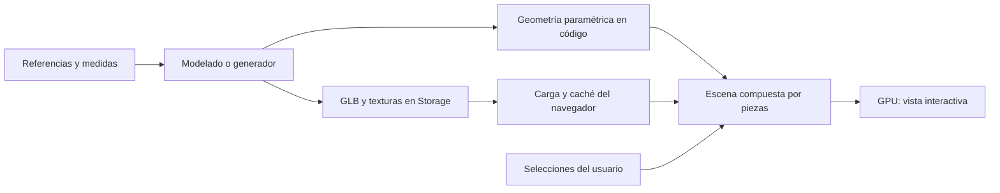
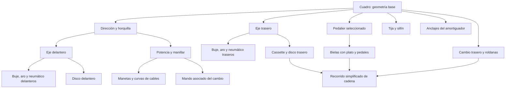

# 05 · Configurador 3D

Relacionado: [alcance visual](01-producto-y-alcance.md), [variantes y recursos](03-datos-y-operaciones.md), [pantallas de trabajo](06b-espacio-de-trabajo.md) y [validación](08-fases-y-validacion.md).

## Objetivo visual

Mostrar una bicicleta convincente que permita entender el efecto de elegir componentes y acabados. Las siluetas y proporciones principales tienen prioridad. Los detalles diminutos pueden simplificarse. La estética se valida sobre una bicicleta completa; un componente atractivo aislado no garantiza un montaje coherente.

React Three Fiber organiza la escena, Three.js dibuja geometrías y materiales, y Drei aporta herramientas de carga y cámara. El resultado depende de las referencias, los modelos, los materiales y la iluminación, además de las librerías.

## Qué es un archivo 3D y qué ocurre en tiempo real



Un GLB describe geometría, materiales y estructura; puede incluir texturas y animaciones. Se descarga y después el navegador calcula nuevas vistas al mover la cámara. No es un vídeo ni una imagen de cada combinación. Cambiar pintura actualiza materiales; cambiar una horquilla sustituye la geometría. Supabase guarda la selección y sirve los archivos, sin producir cada fotograma.

Los generadores producen formas desde parámetros controlados. La arquitectura admite ambos métodos; no obliga a conseguir un GLB por variante ni un archivo de bicicleta por combinación.

### Construcción sin archivos 3D almacenados

Es posible crear aros, neumáticos, tubos, radios, discos y otras formas mediante código y parámetros dentro del navegador. Por ejemplo: diámetro, anchura, perfil y material producen la geometría de una rueda en memoria. No hace falta subir esa rueda a Storage ni escribir sus vértices en la base de datos. Una geometría más compleja también se puede programar, aunque su fidelidad y coste de preparación deben evaluarse con las referencias.

En ambos métodos la visualización es en tiempo real. La diferencia está en si la forma se calcula con un generador o se carga desde un modelo preparado. La construcción por código no garantiza que la forma coincida automáticamente con un producto real; esa fidelidad se prepara y se revisa igual que la de un GLB.

Supabase conserva el catálogo, las cuentas y las elecciones del montaje según el alcance acordado. Dibujar y manipular una escena con parámetros ya disponibles no necesita consultar esos servicios. Guardar una bicicleta significa conservar variantes, acabados y colores para reconstruirla, no almacenar una copia completa de su geometría. No se añade simulación física de esfuerzos o suspensión.

Las fotos usadas en fichas permanecen en `src/assets/images/`. No son archivos 3D ni se convierten automáticamente en geometría; pueden servir como referencia para preparar una representación.

## Cómo obtener las piezas

| Pieza | Primera estrategia | Revisión visual |
| --- | --- | --- |
| Cuadro | Modelo construido con referencias o archivo existente utilizable | Silueta, curvaturas, talla, posición de ejes y anclajes |
| Horquilla | Modelo aproximado por familia o pieza específica | Longitud eje-corona, offset, barras/botellas, pletinas y arquitectura convencional/invertida |
| Amortiguador | Geometría sencilla o modelo específico | Distancia entre anclajes y volúmenes exteriores |
| Aros, radios, bujes | Generadores paramétricos | Diámetros, anchuras y número visual de radios |
| Neumáticos | Perfil paramétrico; dibujo mediante textura o geometría simplificada | Volumen exterior y anchura |
| Discos y cassette | Generadores o modelos de referencia | Diámetro, ubicación y silueta reconocible |
| Cockpit, sillín y pedales | Modelos genéricos ajustados o específicos | Dimensiones y posición |
| Cables y cadena | Curvas y repetición simplificada | Recorrido verosímil sin atravesar piezas visibles |

Se pueden modelar recursos con Blender/CAD y exportarlos a GLB; se conserva el original editable fuera del paquete servido al visitante. Si no hay una referencia suficiente se marca la aproximación. La generación por IA no sustituye la revisión de tamaños o siluetas.

## Contrato espacial

- Unidad de escena: metro. Medidas del catálogo en milímetros se convierten una sola vez al resolver geometría.
- Convención común: X hacia delante de la bicicleta, Y hacia arriba y Z hacia su lado derecho. Mantener un sistema de mano derecha.
- Origen de la bicicleta: centro del eje de pedalier del cuadro base.
- Cada recurso declara pivote, orientación local, dimensiones de referencia, piezas seleccionables y anclajes con posición y orientación.
- Se conservan escala y origen al exportar; no «ajustar hasta que parezca bien» en cada tarjeta o montaje.
- Tallas distintas de cuadro requieren geometría o parámetros validados; no escalar uniformemente neumáticos, ejes y todos los tubos.

La conversión de ejes de recursos importados se realiza una sola vez en su límite de carga/exportación, preservando orientación y normales; no introducir inversiones por pantalla.

Manifiesto conceptual de un cuadro, sin coordenadas inventadas:

```text
manifestVersion: 1
units: meters
origin: bottom_bracket
anchors:
  rear_axle:       posición y orientación verificadas
  rear_derailleur_mount: anclaje del cambio, aproximado si no está documentado
  head_tube:       posición, eje de dirección y orientación
  shock_upper:    anclaje si existe
  shock_lower:    anclaje si existe
  seat_tube:      posición y eje de inserción
selectableNodes:
  frame_shell, rear_triangle
paintableNodes:
  frame_paint
```

El contrato implementado se conserva en `src/features/catalog/model/visual.ts` y en la migración generada de Supabase: versión 1, metros, origen identificado y anclajes con `position` (tres coordenadas), `rotation` (tres ángulos en radianes) y `estimated` explícito. Las posiciones tienen límites de seguridad de ±5 m y las rotaciones de ±2π; no sustituyen la comprobación de medidas reales. Los parámetros aceptados del generador actual se declaran explícitamente; por ahora `size_scale` opcional entre 0,7 y 1,4 para la base aproximada. No escala ruedas ni sustituye la geometría específica de talla. Un nuevo parámetro exige ampliar el contrato compartido y crear otra migración, sin reescribir las aplicadas.

El manifiesto es JSON validado, no un script. El catálogo decide qué generador soportado usar y sus parámetros permitidos. Los identificadores de nodos y anclajes se comprueban antes de publicar el recurso.

## Ensamblaje



El pedalier seleccionable ocupa su propio slot y recurso, visible o parcialmente oculto según cuadro/bielas; no se duplica el eje de las bielas. Manillar, potencia y sillín pueden utilizar los genéricos sencillos identificados de [11m](11m-contacto-y-auxiliares.md), manteniendo interfaces y proporciones. Las tallas M/L se preparan por cuadro; no son escalados uniformes de la bicicleta completa.

Las piezas se colocan por anclajes y medidas, no por offsets independientes escritos en cada pantalla. Seleccionar una variante resuelve su recurso, dimensiones y acabado antes de sustituirla. No estirar un GLB de forma que cambie diámetros o deforme piezas rígidas; modificar solo secciones parametrizadas para ello.

Una horquilla con longitud diferente puede cambiar la orientación del cuadro y la distancia entre ejes. La representación utiliza sus dimensiones y anclajes; no deforma piezas rígidas para fingir un encaje mecánico. Por decisión del usuario se pueden aplicar combinaciones incompatibles: se muestran como montaje visual con avisos, incluso si evidencian interferencias. Si faltan medidas, la aproximación visual se identifica; no se oculta la elección por ese motivo.

La revisión de variantes reales y los límites de cobertura se registran en [revisión adversarial](09-revision-adversarial-de-datos.md). El cambio trasero y su mando asociado forman la unidad de selección confirmada en 03. Su manifiesto compuesto declara ambos nodos y anclajes: montaje del cambio en el cuadro y del mando en el manillar; sustituir o quitar el slot actualiza ambos de forma atómica. No hay selector separado de mando. Los integrados adicionales requieren ocupación/exclusión definida antes de incluirse.

No hay simulación de suspensión. Se usa una postura estática de referencia, consistente entre variantes y sin prometer sag real. Cables se recalculan al cambiar anclajes y se corrigen visualmente cuando haga falta.

## Comprobaciones disponibles

| Resultado | Significado | Acción |
| --- | --- | --- |
| Conflicto identificado | Medidas o interfaces conocidas se contradicen | Permitir aplicar y guardar; explicar el conflicto |
| Datos insuficientes | No hay datos para una comprobación | Permitir vista aproximada si el ensamblaje la soporta, con aviso |
| Sin conflicto conocido | Pasan las reglas actualmente disponibles | Permitir; no afirmar compatibilidad certificada |

Primeras reglas: categoría por slot, formato delantero/trasero admitido por la variante de cuadro, interfaz completa de eje conocida, diámetro/anclaje/espesor de disco cuando se conozcan y medidas/anclajes del amortiguador. Herrajes, orientación o interferencias documentadas pueden aportar excepciones, conservando estados de incertidumbre. No deducir compatibilidad universal por marca, número de velocidades, anchura nominal de eje o longitud/carrera únicamente. No se declaran holguras reales a partir de una simple intersección de mallas aproximadas.

La entrega debe representar todo el inventario acordado para el configurador, tanto en enduro como en descenso. Ese inventario será acotado a modelos comerciales reales y variantes útiles; no se exige un recurso distinto por cada color ni por cada combinación teórica de medidas. Los acabados comparten geometría cuando corresponda, manteniendo las diferencias de forma y proporción de las variantes realmente ofrecidas. Un subconjunto sirve para una prueba técnica intermedia, pero no completa la entrega. Si una variante ofrecida para montar necesita geometría genérica o anclajes aproximados, esa representación debe estar implementada y etiquetada; no dejar un botón sin resultado. Decisión confirmada: todas las piezas del catálogo deben poder montarse en 3D; no se publican entradas exclusivamente documentales. Cada variante seleccionable fija un `visual_asset_id` versionado, también para aproximaciones genéricas.

## Interacción y presentación

Vista inicial lateral en tres cuartos. Controles de giro, zoom con límites y botones «Lateral», «Frontal», «Superior» y «Restablecer vista». Seleccionar una pieza la destaca sutilmente y abre el mismo slot del panel; el panel ofrece una alternativa accesible a la selección dentro del canvas.

Cambiar acabado o color libre no reemplaza todo el modelo. El cuadro y las piezas habilitadas admiten un color sRGB por slot, aplicado a sus superficies pintables; logotipos, goma y metal se conservan. Las demás piezas mantienen sus acabados de catálogo. `allowed_finishes` indica opciones y permiso de personalización; `custom_color` conserva la elección del usuario. El color debe persistir y recuperarse también cuando la pieza use un generador. No se promete coincidencia exacta de color entre pantallas y producto físico.

Fondo de estudio neutro, sombras suaves y luz ambiental controlada. Pintura, goma y metal se distinguen mediante materiales PBR. Evitar brillo plástico uniforme, reflejos excesivos, bloom y movimientos de cámara decorativos que dificulten inspeccionar el montaje.

## Rendimiento sin workers propios

Primero limitar complejidad, reutilizar recursos y cargar solo lo elegido. No añadir workers como requisito ni exigir que todos los efectos funcionen con calidad máxima en móviles.

Presupuestos iniciales para la bicicleta de referencia, a medir y ajustar:

| Indicador | Objetivo de partida |
| --- | --- |
| Descarga inicial del 3D | Hasta 10 MB comprimidos de recursos de la base |
| Geometría visible | Aproximadamente hasta 300 000 triángulos en modo móvil |
| Texturas | Preferentemente 1K–2K; justificar cada recurso mayor |
| Fluidez durante interacción | Al menos 30 fps sostenidos en el móvil de referencia acordado |
| Primera vista utilizable | Objetivo de hasta 5 s en una prueba de red de 10 Mbps y caché vacía |

Son metas del prototipo, no garantías para cualquier dispositivo. Registrar navegador, GPU, tamaño transferido, tiempo de primera vista y comportamiento térmico en la prueba real. Si no se alcanzan, reducir sombras, resolución de render y detalles antes de introducir infraestructura.

La primera vista útil será una base ligera, preferentemente procedimental o de hasta unos 3 MB; no esperará la descarga completa de 10 MB. El resto de detalles puede cargarse después. A 10 Mbps, descargar 10 MB completos ya requiere aproximadamente 8 segundos sin contar latencia ni procesamiento: los objetivos de descarga y primera vista se miden por separado.

Renderizar bajo demanda cuando la escena esté quieta; activar actualizaciones mientras se interactúa o carga un recurso. Cachear GLB y texturas; reutilizar materiales y radios repetidos; liberar recursos al dejar de necesitarlos. La caché de cargadores requiere una política explícita de retención para no acumular cada pieza probada.

La entrega puede usar GLB sin compresión geométrica especial si cumple el presupuesto. Si se añaden Meshopt, Draco o KTX2, verificar decodificadores, rutas y carga en Netlify. Algunos decodificadores usan workers internos: no equivalen a diseñar workers de negocio ni son una dependencia inicial.

Si falla WebGL, se pierde el contexto o un archivo no carga, mostrar la lista de componentes y una vista de referencia disponible. No bloquear guardar o consultar la ficha por un fallo gráfico. La sustitución de piezas debe resistir respuestas fuera de orden cuando la persona cambia rápidamente de selección.

## Referencias

- [glTF: formato de entrega de escenas y modelos](https://www.khronos.org/gltf/).
- [Three.js: materiales físicos y coste visual](https://threejs.org/docs/pages/MeshPhysicalMaterial.html).
- [React Three Fiber: escalado de rendimiento](https://r3f.docs.pmnd.rs/advanced/scaling-performance).
- [Drei: controles de cámara](https://drei.docs.pmnd.rs/controls/introduction).

## Ensamblaje de descenso, segunda versión

El lote de descenso usa `atlas-bike-v2` para el cuadro SUPREME DH V5 y las piezas nuevas que requieren doble pletina o montaje directo. La versión del recurso del cuadro fija el ensamblaje del conjunto; no se calcula a partir de la disciplina ni de un nombre comercial mutable. Los montajes con cuadro v1 conservan el ensamblaje v1. Las piezas comunes reutilizan los sólidos v1 en las coordenadas explícitas del nuevo cuadro; la cadena sigue la polea cuando existe el anclaje `chain_idler`. No duplicar variantes comerciales ya publicadas solo para integrarlas en el nuevo cuadro.

```text
Recurso del cuadro guardado
   ├─ atlas-bike-v1 → ensamblaje v1 conservado
   └─ atlas-bike-v2 → anclajes v2 → piezas comunes + doble pletina / polea
```

Los anclajes adicionales caben en el manifiesto tipado existente: `chain_idler`, `suspension_pivot` y `fork_upper_crown`. Sus posiciones, la silueta de bieletas y el recorrido exterior de cadena son aproximaciones identificadas, no medidas CAD ni una simulación cinemática. La versión v2 conserva entreojos visual del amortiguador cuando se conoce y distingue aire/muelle. Se revisan M/L, contacto de ruedas con el suelo y sustituciones entre piezas de enduro/descenso. Las advertencias mecánicas siguen permitiendo guardar.

Publicación de recursos procedimentales: una clave de generador nueva requiere primero su implementación en el cliente. La ingesta y una restricción de base rechazan publicar claves que el visor no reconoce; los recursos aún en borrador pueden prepararse sin ofrecerlos al ciclista. No basta que `generator_key` sea un texto no vacío.

## Calidad adaptada y recuperación de recursos

Se conserva la geometría de v1/v2. Para visores de menos de 640 px se usa DPR 1 y mapa de sombra de 512 px; en los demás, DPR hasta 1,5 y sombra de 1024 px. Es una reducción de coste de rasterizado, sin retirar piezas, cambiar medidas ni añadir workers. Validar de nuevo primera imagen, interacción, selección y móvil después del ajuste; una medición SwiftShader no acredita el objetivo de teléfono físico.

El primer render de un GLB espera su preparación, manteniendo accesible el panel. Se comparte la descarga concurrente de un mismo recurso y se limita a 20 segundos la entrega/preparación; los errores conservan el montaje y activan la lista sin 3D. La caché libera geometrías, materiales y texturas al expulsar recursos inactivos. El resaltado usa materiales temporales exclusivos de la instancia seleccionada, que siguen su color y se liberan al deseleccionar. No altera pintura persistida ni materiales compartidos; las identidades separadas evitan arrastrar uniformes del resaltado a otras piezas.

Plataforma móvil confirmada por el usuario: **Android, Brave y Chrome**. La automatización usa un perfil Pixel 7 en Chromium para cubrir distribución, entrada táctil y recuperación en Android; es un perfil de prueba, no un dispositivo físico elegido por el usuario ni una validación del ejecutable Brave. La aceptación de 30 fps requiere modelo real, navegador/versión y condiciones térmicas registrados.
