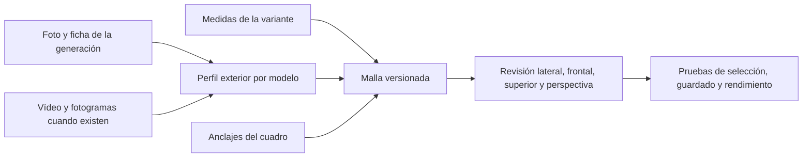

# Geometría exterior por modelo

Ampliación autorizada el 19 de octubre de 2026: mejorar los 53 modelos del inventario, incluyendo borradores. La aceptación de parecido se realiza por modelo; no asignar un porcentaje de fidelidad sin comparación multivista. Las medidas documentadas prevalecen sobre proporciones estimadas de fotografías.

## Contrato

`atlas-bike-v3` incorpora perfiles explícitos e inmutables por modelo en `manifest.parameters.profile_key`. El recurso fija perfil, medidas y anclajes; los nombres comerciales no seleccionan geometría. Los recursos v1/v2 y sus variantes se conservan para montajes guardados. Las nuevas capturas de variante mantienen especificaciones y acabados comerciales; únicamente las anteriores seleccionables se archivan al publicar sus sucesoras. Los borradores siguen siendo borradores.



## Trabajo dentro de las fases 3D y aceptación

1. Vincular los 53 perfiles con las fuentes existentes del catálogo y el manifiesto de fotografías. Registrar los vídeos disponibles y distinguir localizar un vídeo de revisar sus fotogramas. Una foto de otra generación no valida el modelo actual.
2. Construir secciones variables de cuadros, basculantes/bieletas, botellas/puentes/pletinas, cuerpos y depósitos de amortiguador, pinzas/manetas, discos perforados, engranajes, bielas/pedales, bujes/radios, dibujos de neumáticos y auxiliares. Reutilizar operaciones geométricas, manteniendo diferencias explícitas de familia. No modelar interiores mecánicos ni inventar cotas CAD.
3. Unir geometría por material para limitar llamadas de dibujo; liberar recursos al cambiar piezas. Conservar pinturas habilitadas, selección de pieza, cámaras y recuperación de WebGL.
4. Verificar todos los perfiles y variantes en el visor. Comparar multivista con las referencias disponibles y registrar incertidumbres: disponer de geometría no demuestra parecido al 90 %. Los auxiliares ATLAS mantienen su identidad genérica.
5. Aplicar fuente versionada y migración de contrato al Cloud autorizado después de las comprobaciones locales. Comprobar que montajes anteriores siguen abriendo con sus versiones originales y que las nuevas elecciones/plantillas utilizan recursos nuevos.
6. Registrar coste geométrico, dibujo e interacción; repetir comprobación móvil automatizada. La fluidez de Android físico sigue requiriendo dispositivo real.

Fuentes fotográficas por modelo: `src/assets/images/catalog/photos.json`; fuentes y medidas comerciales: las cinco ingestas revisadas de `supabase/catalog/`. Evidencia y limitaciones de esta entrega se anotarán en el documento 12.

## Corrección detectada en revisión frontal · 20/10/2026

El barrido de secciones de v3 usa un plano XY y pierde volumen cuando un puente o tramo del manillar sigue el eje transversal Z. La carga del recurso no detecta ese defecto: añadir una prueba de volumen en los tres ejes y corregir la orientación de las secciones en 3D. Como v3 ya fue publicado, esta corrección física se entrega en `atlas-bike-v4`, reutilizando los perfiles y operaciones que no cambian. Conservar v3 para reproducir sus capturas; publicar sucesoras y comprobar la transición real v3 → v4 antes de retirar las elecciones anteriores. Repetir renderizado, selección, guardado y rendimiento sobre v4. Esta corrección forma parte de la fase de recursos y validación, sin ampliar funciones del producto.

La revisión de los ocho cuadros detectó también el amortiguador SCOTT fuera de su envolvente integrada. Los recursos v4 de ese cuadro sitúan sus anclajes estimados dentro de la carcasa, conservando el entreojos comercial; se repiten sus dos tallas y cuatro cámaras. No reconstruye el mecanismo interior.

## Replanteamiento aprobado: siluetas verificables

El usuario aprobó visualmente el conjunto el 20/10/2026 y autorizó extender esta dirección al inventario. Continuar sin otra aprobación rutinaria: referencias y contornos específicos por modelo, reconstrucción editable y recursos nuevos; integrar GLB con espacios de montaje explícitos para cuadro/horquilla/amortiguador y conservar geometría paramétrica en piezas donde sus dimensiones y patrones la hacen apropiada. Verificar montaje, selección, pintura, persistencia y coste antes de publicar sucesoras. La aprobación del conjunto no certifica por extensión los otros modelos ni su parecido al 90 %.

El usuario rechazó el parecido de v3/v4. La cobertura de perfiles y el detalle superficial no resuelven sus contornos compartidos. Se conserva el alcance de todos los modelos, comenzando por un conjunto de referencia SUPREME DH V5, FOX 40 MY27 y Bomber CR de 250 × 75 mm para comprobar el método antes de extenderlo.

Dentro de las fases de recursos y visor: localizar dibujo lateral/fotos de la generación; revisar fotogramas útiles de montaje; registrar puntos y contornos junto a su procedencia; construir mallas propias editables en Blender y exportar GLB en metros; comparar referencia, render lateral y superposición con cámara coincidente; comprobar también profundidad desde frente/perspectiva. Un vídeo histórico sirve para identificar la estructura, no para demostrar vigencia comercial. No sustituir v4 ni publicar sucesoras hasta revisar este conjunto; conservar fuentes, incertidumbres y exportación reproducible en el repositorio.

```text
+----------------------------------------------------------+
| SUPREME DH V5 · Revisión de forma                         |
| [Cuadro] [Horquilla] [Amortiguador] [Conjunto]              |
| [Referencia] [Modelo] [Superposición]      [Lateral] [3D]   |
|                                                          |
|              Referencia y modelo a la misma escala        |
|                                                          |
| Opacidad [----------o-----]  Fuentes y límites             |
+----------------------------------------------------------+
```

En móvil, controles en filas y lienzo ajustado al ancho; rotación solo en modo 3D. La superposición es una herramienta interna de revisión, no una función nueva del producto. Aceptación: contorno y huecos reconocibles, puntos de dirección/pedalier/eje coincidentes con la referencia, horquilla con pletinas y puente propios, amortiguador con depósitos/anclajes propios; comprobar volúmenes y exportación, y registrar diferencias pendientes sin declarar un porcentaje de parecido. Solo después se integrarán capturas nuevas, montaje intercambiable, pinturas, selección y persistencia, con sus comprobaciones y sin alterar recursos publicados.

## Contrato de integración v5

Los GLB nuevos de cuadro se expresan desde el pedalier; los de horquilla desde la pletina inferior (+Y dirección, +X offset); los de amortiguador desde el anclaje superior (−Y hacia el inferior). El manifiesto incorpora `parameters.mount_space` (`frame`, `fork`, `shock`) y, para cuadros, `assembly_version: atlas-assembly-v5`. Cada recurso conserva `profile_key` y anclajes en metros. Las piezas paramétricas mejoradas usan `atlas-bike-v5`; los generadores anteriores permanecen intactos.

El montaje v5 obtiene el eje delantero del recurso de horquilla transformado sobre la dirección y orienta el amortiguador sobre sus ojos conservando entreojos propio. El asentamiento de ambas ruedas se resuelve mediante una inclinación global pequeña, sin estirar piezas ni modificar los montajes antiguos. Si la horquilla elegida es de una generación anterior, se conserva su resolución anterior dentro del montaje mixto. Cada espacio de montaje exige categoría correspondiente y puntos mínimos; los recursos nuevos se publican por identidad nueva y rutas Storage inmutables. Verificar carga, colores, selección, mezcla de generaciones, guardado y reapertura antes de retirar elecciones v4.

## Continuidad multivista autorizada · v6

El usuario pide completar las zonas ocultas con criterio de arquitectura de bicicleta después de investigar referencias adicionales: brazos a ambos lados cuando corresponda, bieletas y ejes conectados, soportes y piezas sin flotación. No dejar un hueco artificial solo por no aparecer en la foto lateral. No asumir simetría en protectores, patillas, anclajes de freno o poleas. «Investigado» significa fuentes consultadas concretas, nunca afirmar que se agotó Internet.

Dentro de las fases de recursos, montaje y aceptación:

1. Revisar despieces y vistas adicionales por modelo/generación; conservar enlaces, imágenes útiles y distinción entre observación y cierre inferido. Priorizar los ocho cuadros y las nueve suspensiones por su estructura y conexiones.
2. Auditar la geometría local antes de agruparla por material: pares de brazos/bieletas, soportes de amortiguador, ejes de pivote, uniones de dirección/pedalier, puentes y coronas de horquilla. Construir cierres específicos por modelo manteniendo cavidades funcionales y hueco de rueda; no rellenar con bloques centrales ni añadir barras genéricas entre puntos arbitrarios.
3. Generar GLB nuevos con fuentes editables en `models/catalog-v6/`, sin modificar trazados, binarios ni identidades v5. Reutilizar recursos que no cambien: una actualización de referencia no obliga a duplicar piezas sin modificación física. Conservar las mismas medidas, acabados y espacios de montaje ya aceptados.
4. Comprobar conexiones sobre superficies reales antes de exportar, parseo y anclajes después; revisar ambos laterales, frontal, superior, inferior y perspectivas opuestas. Registrar excepciones y cierres estimados. La unión visual no acredita resistencia, cinemática o compatibilidad mecánica.
5. Integrar las sucesoras comprobadas en Cloud conservando recursos y montajes anteriores; probar catálogo, selección, pintura, persistencia y presupuesto. Documentar cobertura real y pendientes sin certificar 90 % ni 30 fps en Android físico.

```text
referencias del modelo → estructura observada → cierre inferido explícito
                                      ↓
                  superficies y conexiones → revisión multivista → recurso nuevo
```

La revisión v6 detectó además que las pinzas traseras heredaban el desplazamiento hacia atrás de las delanteras. Las nueve variantes de freno reciben recurso procedimental `atlas-bike-v6` para adelantar únicamente la pinza trasera y su recorrido de latiguillo; los cuadros nuevos incorporan apoyos de ese lado. Las otras 43 variantes paramétricas conservan identidad y generador v5. Migración 017 amplía el contrato de generador sin tablas nuevas; el espacio de montaje GLB y las medidas comerciales conservan el contrato v5.


La comprobación de superficie de las pinzas detectó que el filtro de la envolvente antigua también eliminaba parte de la nueva. V6 ya había sido publicado: se conserva su resultado, y nueve sucesoras v7 completan sus carcasas. Las demás 119 capturas se reutilizan con sus IDs. Migración 018 amplía el renderer admitido; la corrección compartida mantiene su resultado histórico por defecto y solo v7 termina las caras nuevas. Aceptación y límites en [12c](12c-evidencia-continuidad.md).
