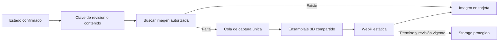

# Miniaturas del montaje guardado

Implementación autorizada el 21/10/2026. [UI aprobada](06b-espacio-de-trabajo.md). Sustituir portadas genéricas por imágenes del montaje real, incluidas composiciones incompletas. Un montaje vacío tiene una portada vacía. No modificar la portada principal de marketing, las fotografías de componentes ni añadir edición a las tarjetas.

## Contrato y arquitectura

- Reutilizar el mismo ensamblaje, geometría versionada y acabados del configurador. Cámara fija de tres cuartos, encuadre del volumen instalado y fondo neutro, sin selección, controles o textos dentro de la imagen.
- Captura independiente de una copia del estado confirmado por el guardado; no fotografiar el lienzo editable que puede haber cambiado durante la petición. No capturar un guardado rechazado o una revisión ajena.
- Imágenes WebP de 640×400, límite 256 KiB. Cola local de captura única y temporal; las tarjetas usan imágenes, sin una escena WebGL por tarjeta. Carga diferida al acercarse a la vista y reutilización mediante TanStack Query. Sin workers ni servidor de renderizado nuevo.
- Bucket privado `bike-previews`. Montajes: `builds/<user>/<build>/<revision>-v1.webp`; lectura solo del propietario autorizado y revisión vigente; escritura solo del propietario con permiso y revisión vigente. Presets: `presets/<preset>/<hash>-v1.webp`, hash del contenido visual guardado; lectura de presets publicados/seleccionables, escritura con permisos administrativos. Sin cambios en las doce tablas propias.
- Las imágenes son derivadas: su fallo no revierte ni bloquea el guardado de la bicicleta. Sin miniatura exacta, el área queda neutra; un fallo no sustituye la imagen por una bicicleta inventada. Revisiones nuevas no reutilizan imágenes antiguas.
- Montajes existentes sin miniatura se reconstruyen desde su revisión guardada al mostrarse, una captura a la vez; las cuentas de solo lectura pueden mostrar la imagen generada localmente sin escribir. Una sesión cancelada no puede compartir la miniatura con otra cuenta. Borrar un montaje limpia sus imágenes como operación secundaria.
- Las prearmadas actuales se precalculan desde sus fuentes publicadas y se cargan con un script local; no poner secretos privilegiados en el navegador. Cambios administrativos generan otra clave de contenido; una imagen previa no se reutiliza para piezas distintas.

## Trabajo y aceptación dentro de las fases de implementación

1. Separar escena compartida y captura estática sin cambiar geometrías publicadas; comprobar encuadre de cuadro solo, cuadro/horquilla y bicicleta completa, colores y ausencia de piezas inventadas.
2. Versionar/aplicar bucket y políticas, con pruebas de lectura/escritura propia, otra cuenta, visitante, revisión antigua y preset público/borrador. No añadir campos o tablas de negocio para guardar binarios.
3. Integrar imágenes en ambas galerías y generación tras guardar; reconstruir imágenes faltantes desde el estado guardado. Mantener guardado, conflictos, recuperación de borradores y navegación intactos.
4. Generar las cuatro miniaturas públicas vigentes y verificar descarga pública autorizada. Comprobar que un nuevo guardado cambia la portada y cambios sin guardar no la cambian; comprobar estado vacío y fallo de Storage/WebGL sin romper la tarjeta.
5. Build, pruebas de contratos/cola, pruebas reales de navegador y Storage; registrar evidencia y límites antes de cerrar. Sin commits ni push salvo solicitud posterior.

## Validación de integración y carga · 21/10/2026

Las cuatro miniaturas públicas se generaron y cargaron desde sus composiciones reales. Lectura pública protegida y render de 640×400 comprobados. Migración 019 crea el bucket privado y políticas; la correctiva 020 califica el nombre de objeto en subconsultas para evitar resolverlo como nombre de bicicleta. Ambas aplicadas; sin tablas adicionales.

Durante la auditoría de [12d](12d-rendimiento-consultas.md) se comprobó guardado de un cuadro incompleto, recuperación de miniatura de 640 px y tarjeta sin lienzo 3D, además de datos privados reutilizados al reabrir. La fuente de prearmada cambia la clave visual de la imagen sin repetir consultas para subconjuntos conocidos. Pruebas unitarias cubren cambio de cuenta durante descarga, cancelaciones compartidas y actualización de imagen al recibir otra configuración con el mismo ID.

La evidencia de esta ronda no sustituye toda la matriz de políticas y fallos de Storage definida arriba ni certifica todos los encuadres. El validador actual elimina imágenes de sus cuentas temporales antes de eliminar Auth. Algunas ejecuciones anteriores a esa limpieza pudieron dejar miniaturas huérfanas; no se eliminaron rutas sin atribución demostrable. Mantener estos pendientes explícitos antes de cerrar la entrega completa de miniaturas.
