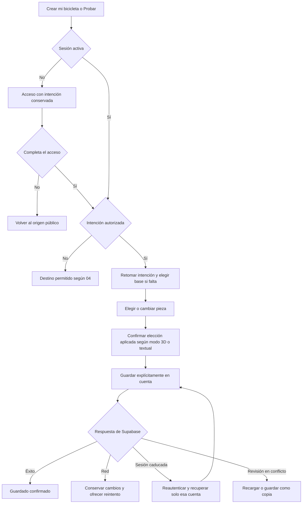

# 06b · Espacio de trabajo y configurador

Relacionado: [principios UI/UX](06-ui-y-ux.md), [portada y acceso](06a-portada-y-acceso.md), [rutas y estado](02-arquitectura-y-frontend.md), [datos](03-datos-y-operaciones.md) y [3D](05-configurador-3d.md).

Estado: planificación. Este documento concentra las composiciones y recorridos aprobados de pestañas, tarjetas, paneles y montaje. Se aplican los principios de contenido, estilo y accesibilidad del documento 06.

## Espacio de trabajo con pestañas: aprobado

La administración se accede desde el menú de cuenta con permisos, con retorno al trabajo; sus [vistas aprobadas viven en 06c](06c-administracion-usuarios-roles-y-permisos.md) y sus [operaciones en 04b](04b-administracion-y-operaciones.md). No añade una cuarta pestaña de catálogo ni se muestra al registro normal.

Una sola estructura persistente con cabecera y pestañas «Bicicletas», «Componentes» y «Mis bicicletas». Cambiar de pestaña sustituye el contenido central sin recargar la aplicación ni encadenar páginas de listado y ficha. Se conservan búsqueda, filtros, posición de desplazamiento y selección de cada pestaña mientras se navega en la misma sesión. El configurador es el modo de edición del montaje; entrar en él no crea una cuarta pestaña principal.

Después de iniciar sesión se sigue la [regla de destino por permisos de 04](04-autenticacion-y-acceso.md#destino-después-del-acceso): intención válida autorizada; en su ausencia «Mis bicicletas» con `builds.read_own`, o «Componentes» sin ese permiso. Desde «Comenzar» se continúa la creación autorizada y desde «Probar» se conserva la variante. La portada y el acceso mantienen sus composiciones aprobadas. La exploración pública de componentes no exige sesión; al visitante, «Mis bicicletas» y cualquier acción de personalización le solicitan acceso. Una sesión válida sin permiso recibe una denegación comprensible y un destino permitido, sin bucle de login. La galería de bicicletas de referencia puede consultarse sin cuenta, pero aplicar una prearmada exige sesión y permiso.

La URL representa pestaña, filtros y detalle abierto para permitir enlaces, recarga y Atrás/Adelante. Eso no convierte la experiencia visual en varias pantallas independientes. No guardar una segunda pestaña activa contradictoria con la URL. La retención de desplazamiento es de navegación local; no se promete recuperar la posición de otra persona o dispositivo.

### Bicicletas

Dos selecciones internas: «Bicicletas completas» y «Cuadros». Filtros de disciplina, marca y búsqueda en la misma vista. Las marcas son filtros, no módulos ni recorridos separados.

```text
┌──────────────────────────────────────────────────────────────────────────┐
│ ATLAS MTB                                               Cuenta ▾        │
│                                                                          │
│ [ Bicicletas ]       Componentes       Mis bicicletas                    │
├──────────────────────────────────────────────────────────────────────────┤
│                                                                          │
│ [ Bicicletas completas ] [ Cuadros ]                                     │
│                                                                          │
│ Todas   Enduro   Descenso             Marca [Todas ▾]   Buscar [_______] │
│                                                                          │
│ ┌─────────────────────────────┐  ┌─────────────────────────────┐          │
│ │                             │  │                             │          │
│ │      BICICLETA COMPLETA     │  │      BICICLETA COMPLETA     │          │
│ │                             │  │                             │          │
│ │ COMMENCAL                   │  │ SANTA CRUZ                  │          │
│ │ SUPREME DH                  │  │ V10                         │          │
│ │ Descenso                    │  │ Descenso                    │          │
│ │ Montaje de ejemplo          │  │ Montaje de ejemplo          │          │
│ │                             │  │                             │          │
│ │ [ Personalizar ]   Detalles │  │ [ Personalizar ]   Detalles │          │
│ └─────────────────────────────┘  └─────────────────────────────┘          │
└──────────────────────────────────────────────────────────────────────────┘
```

Los nombres ilustran referencias que se estudiarán; no fijan una versión, talla o inventario ya entregado. Incluir también enduro en la selección acordada. «Montaje de fábrica» exige una composición comercial concreta documentada; «Montaje de ejemplo» identifica una selección preparada para ATLAS. No presentar una mezcla aproximada como equipamiento oficial.

- «Personalizar» abre la composición como borrador de la cuenta en el configurador, sin guardar en Supabase automáticamente. Si hay que elegir talla o versión se solicita en el panel existente antes de comenzar.
- «Detalles» abre el panel derecho con foto, modelo, disciplina, versión/talla y lista de piezas incluidas. No obliga a una página nueva. Seleccionar otra bicicleta actualiza ese panel.
- En «Cuadros» se conserva la galería, con foto del cuadro, marca/modelo y las tallas elegibles. Acción «Empezar con este cuadro»; no añade automáticamente piezas que la persona no eligió.
- Si ya hay un montaje con cambios, aplicar una nueva base ofrece guardar, descartar o cancelar. No sustituirlo silenciosamente ni crear una copia remota por abrir una tarjeta.

### Componentes

Categorías visibles y subcategorías inmediatas: Suspensión → Horquillas / Amortiguadores. Ruedas → Aros / Neumáticos / Bujes; Frenos → Conjuntos / Discos. Transmisión muestra Cassette, Cadena, Cambio trasero, Pedalier y Bielas y plato. Elegir Cambio trasero incluye su mando asociado sin otro selector; la ficha identifica ese mando, sin afirmar un kit ni precio conjunto. Manillar y potencia, y Sillín y tija exponen sus piezas según el contrato del documento 03. En móvil los grupos pueden desplazarse horizontalmente con indicación de continuidad; no reducir el texto hasta volverlo ilegible.

```text
┌──────────────────────────────────────────────────────────────────────────┐
│ ATLAS MTB                                               Cuenta ▾        │
│                                                                          │
│ Bicicletas       [ Componentes ]       Mis bicicletas                    │
├──────────────────────────────────────────────────────────────────────────┤
│ Cuadros  [Suspensión]  Ruedas  Frenos  Transmisión  Manillar  Sillín      │
│                                                                          │
│ [ Horquillas ]   Amortiguadores                                          │
│                                                                          │
│ Buscar [________________]   Marca [Todas ▾]   Más filtros                │
│                                                                          │
│ ┌────────────────────┐ ┌────────────────────┐ ┌────────────────────┐     │
│ │                    │ │                    │ │                    │     │
│ │    FOTO PRODUCTO   │ │    FOTO PRODUCTO   │ │    FOTO PRODUCTO   │     │
│ │                    │ │                    │ │                    │     │
│ │ FOX                │ │ MARCA              │ │ MARCA              │     │
│ │ 38                 │ │ Modelo             │ │ Modelo             │     │
│ │ Versiones elegidas │ │ Versiones elegidas  │ │ Versiones elegidas  │     │
│ │                    │ │                    │ │                    │     │
│ │ [ Ver opciones ]   │ │ [ Ver opciones ]   │ │ [ Ver opciones ]   │     │
│ │ + Comparar        │ │ + Comparar        │ │ + Comparar        │     │
│ └────────────────────┘ └────────────────────┘ └────────────────────┘     │
└──────────────────────────────────────────────────────────────────────────┘
```

Una tarjeta por familia/modelo: foto, marca, nombre y dos o tres atributos decisivos documentados. «Versiones elegidas» es una anotación del boceto: mostrar las versiones disponibles o una síntesis útil, no esa frase como relleno. No duplicar tarjetas por colores ni generar combinaciones de versiones inexistentes. No cargar todas las tarjetas con formularios completos. Los filtros secundarios dependen de la categoría y solo aparecen si hay datos que permitan utilizarlos.

Los filtros cambian realmente los resultados y la URL. El estado vacío ofrece limpiar filtros; fallo de consulta ofrece reintentar; falta de imagen muestra una alternativa sobria. No usar cifras de ejemplo como contadores reales.

### Tarjeta y detalle de componente en panel lateral

Pulsar la imagen, nombre o «Ver opciones» abre el mismo panel derecho; no se exige hover ni doble clic. Mantener una acción principal semántica y controles separados para comparar, sin botones anidados. La tarjeta elegida queda marcada y la galería se adapta al espacio conservando desplazamiento. Seleccionar otra tarjeta actualiza el panel sin cerrarlo previamente.

```text
┌──────────────────────────────────────────────────────────────────────────┐
│ Bicicletas       [ Componentes ]       Mis bicicletas                    │
├────────────────────────────────────────┬─────────────────────────────────┤
│ Suspensión / Horquillas                │ FOX 38                       ✕ │
│                                        │                                 │
│ Buscar [__________]  Marca [Todas ▾]    │         FOTO AMPLIADA           │
│                                        │                                 │
│ ┌────────────────┐ ┌────────────────┐ │ Versión [ Seleccionar ▾ ]      │
│ │                │ │                │ │                                 │
│ │  FOX 38        │ │  Otro modelo   │ │ Recorrido     Dato documentado │
│ │  SELECCIONADO  │ │                │ │ Rueda         Dato documentado │
│ │                │ │                │ │ Sistema       Dato documentado │
│ └────────────────┘ └────────────────┘ │                                 │
│                                        │ Precio de referencia            │
│ ┌────────────────┐ ┌────────────────┐ │ Importe · Moneda · Fecha         │
│ │                │ │                │ │                                 │
│ │  Otro modelo   │ │  Otro modelo   │ │ [ Probar en mi bicicleta ]      │
│ │                │ │                │ │ + Comparar                      │
│ └────────────────┘ └────────────────┘ │                                 │
│                                        │ Especificaciones             ▾ │
│                                        │ Ajustes                      ▾ │
│                                        │ Fuentes                      ▾ │
└────────────────────────────────────────┴─────────────────────────────────┘
```

El panel es la ficha completa: información esencial arriba y secciones desplegables abajo. No añadir otro enlace «Ver ficha completa» ni una cadena de modales. Una entrada directa por enlace abre la pestaña Componentes con ese panel ya seleccionado; cerrar recupera la galería, incluso cuando no existe una página previa en el historial.

| Categoría | Atributos prioritarios cuando estén documentados |
| --- | --- |
| Cuadro | Talla, formato de rueda y disciplina |
| Horquilla | Recorrido, rueda y tipo de resorte |
| Amortiguador | Medida entre ojos, carrera y anclaje |
| Aro / neumático / buje | Formato y anchura, o estándar de eje según la pieza |
| Freno / disco | Características del conjunto, o diámetro y anclaje del disco |
| Transmisión | Velocidades, dentado o interfaz según la pieza |
| Manillar / potencia / tija / sillín | Medidas e interfaz que distingan la variante |

Los valores ausentes no se inventan. Una variante única se resuelve automáticamente y se identifica; si hay varias se pide elegir sin seleccionar silenciosamente una distinta. «Comparar» añade directamente la variante única; cuando hay varias abre el mismo panel y solicita versión, sin un modal adicional. Comparación conserva máximo tres variantes distintas de una categoría.

Mostrar «Precio de referencia» con importe, moneda y fecha, con fuente/mercado consultables; sin dato, «Sin referencia de precio». Colores de fábrica y color personalizado del visor tienen etiquetas distintas. La foto y especificaciones corresponden a la variante. El 3D de detalle es opcional y solo se carga al solicitarlo; no retrasar la ficha por ello.

«Probar en mi bicicleta» requiere sesión, conserva intención y aplica al slot adecuado cuando haya base. En posiciones ambiguas —por ejemplo un neumático delantero o trasero— se elige la posición en el panel, sin adivinarla. Se conserva el montaje abierto de la cuenta. Los conflictos mecánicos muestran avisos y permiten aplicar como montaje visual.

En escritorio el panel es complementario: la galería sigue operativa. No bloquearla con una máscara ni contener el foco como si fuera un modal. Apertura mediante teclado con foco en el encabezado/primer control pertinente y cierre que devuelve foco a la tarjeta de origen; actualizar a otra tarjeta no roba foco inesperadamente.

En móvil el detalle se abre como panel inferior ampliable con título, cierre y acceso a todo el contenido mediante desplazamiento. No requiere arrastrar para abrir, ampliar o cerrar: ofrecer controles equivalentes. Si al expandirse bloquea el fondo, tratarlo como diálogo accesible con foco contenido y retorno a la tarjeta al cerrar. Nunca superponer varios paneles.

## Configurador en escritorio

Actualización de distribución y selección aprobada por solicitud directa: [06e · Armado por grupos](06e-armado-guiado.md) sustituye la navegación plana, añade índice izquierdo, medidas, aplicación por pares y paletas. Los contratos de guardado, escena y avisos siguientes se conservan.

```text
+----------------------------------------------------------------------------------+
| ATLAS MTB       Bicicletas    Componentes    Mis bicicletas              Cuenta|
+----------------------------------------------------------------------------------+
| < Mis bicicletas    Mi montaje enduro    Cambios sin guardar    [Guardar]        |
+------------------+----------------------------------------+----------------------+
| COMPONENTES      |                                        | HORQUILLA            |
|                  |                                        |                      |
| Cuadro       [>] |                                        | [Buscar____________] |
| Horquilla    [*] |          BICICLETA 3D COMPLETA           |                    |
| Amortiguador [>] |                                        | Modelo actual        |
| Ruedas       [>] |          Fondo de estudio neutro        | Variante [v]        |
| Frenos       [>] |                                        | [Ver ficha]          |
| Transmision  [>] |                                        |                      |
| Cockpit      [>] |                                        | Otras opciones       |
| Sillin       [>] |                                        | [Modelo B] [Elegir]  |
|                  |                                        | [Modelo C] [Elegir]  |
|                  |                                        |                      |
|                  | [Lateral] [Frontal] [Superior]          | Acabado             |
|                  | [Restablecer vista]                    | [Negro] [Disponible] |
+------------------+----------------------------------------+----------------------+
| 11 piezas elegidas  |  Representacion aproximada  |  [Piezas y avisos]|
+----------------------------------------------------------------------------------+
```

Distribución de partida: navegación de piezas 180–220 px, panel de opciones 280–340 px y el espacio restante para el visor. El canvas tiene prioridad. El panel se puede cerrar. La selección desde la escena y desde la lista queda sincronizada.

Grupos como «Ruedas» y «Frenos» despliegan slots delanteros y traseros. Elegir un producto en el panel muestra variante, fuente de medidas y acabado permitido; cuadro y piezas habilitadas admiten color libre. «Detalles» sustituye temporalmente el contenido del panel de opciones existente, con retorno «Volver a opciones». No abre un segundo lateral ni abandona el montaje. «Elegir» coloca directamente la variante resuelta; si falta versión o posición se solicita en ese mismo panel.

Tarjeta compacta dentro del selector 3D; las medidas del boceto se sustituyen por datos documentados:

```text
┌──────────────────────────────┐
│ FOTO       FOX 38            │
│            Versión elegida   │
│            Medidas principales│
│                              │
│ [ Elegir ]        Detalles    │
└──────────────────────────────┘
```

El visor y los controles cargan de forma independiente. En modo 3D la nueva elección queda como candidato pendiente hasta preparar su recurso y manifiesto; durante la carga se mantiene aplicada la pieza anterior. Al estar lista se confirma únicamente la solicitud vigente. Un fallo conserva la selección aplicada y ofrece reintentar en el panel. Guardar persiste las piezas aplicadas, nunca los candidatos pendientes o fallidos, y muestra si queda una elección sin aplicar. No reconstruir toda la bicicleta ni borrar el borrador por un recurso fallido.

Sin WebGL o tras perder su contexto, ofrecer modo textual con «Vista 3D no disponible». La lista permite aplicar selecciones validadas usando sus metadatos/manifiestos disponibles y guardarlas sin depender del canvas ni descargar GLB; no presentar una imagen anterior como montaje actualizado. La recuperación del visor reconstruye la selección aplicada vigente. Tras seleccionar cuadro no imponer un asistente obligatorio por pasos: la persona decide qué grupo completar, con marcadores de seleccionado/pendiente sin declarar certificación mecánica.

Cada pieza aplicada distinta del cuadro ofrece «Quitar» en el panel de su slot. Retirarla deja esa posición vacía, actualiza la escena/lista y recalcula avisos sin borrar otras piezas. «Deshacer» restaura atómicamente la última sustitución o retirada dentro de la sesión, incluidos acabado y color; no es un historial ilimitado. Cambiar de base conserva la confirmación de guardar, descartar o cancelar. El cuadro se cambia mediante la elección de base, no mediante «Quitar».

«Piezas y avisos» despliega un resumen del montaje en el mismo espacio de panel, con retorno al selector. No apilarlo sobre otra ficha ni tapar permanentemente el visor:

```text
┌─────────────────────────────────────────────┐
│ Piezas y avisos                          ✕   │
│                                             │
│ Cuadro                                      │
│ Modelo · Talla                    [Cambiar] │
│                                             │
│ Horquilla                                   │
│ Modelo · Versión                  [Cambiar] │
│                                             │
│ Rueda delantera                              │
│ Sin elegir                         [Elegir] │
│                                             │
│ Avisos                                      │
│ El eje de la rueda no coincide con el de     │
│ la horquilla.                               │
│                                             │
│ Representación aproximada.                  │
└─────────────────────────────────────────────┘
```

Los avisos identifican piezas y causa; no bloquear las combinaciones visuales acordadas ni presentar «Todo compatible» como certificación. «Cambiar»/«Elegir» lleva directamente al grupo y posición correspondientes en el selector.

Estados de guardado visibles: «Borrador en este dispositivo», «Cambios sin guardar», «Guardando…», «Guardado» y «No se pudo guardar». El éxito no depende de un aviso temporal. El guardado inicial pide un nombre; «Eliminar» vive en el menú del montaje y requiere una confirmación que identifica el elemento.

## Configurador en móvil

```text
+--------------------------------------+
| ATLAS MTB                   [Menu]                                               |
+--------------------------------------+
| Mi montaje            [Guardar]                                                  |
| Cambios sin guardar                                                              |
+--------------------------------------+
|                                                                                  |
|          BICICLETA 3D                                                            |
|                                                                                  |
| [Lateral] [Frontal] [Restablecer]                                                |
+--------------------------------------+
| [Piezas] [Acabado] [Resumen]                                                       |
+--------------------------------------+
| Horquilla                     [v]                                                |
| Actual: Modelo A                                                                 |
| [Buscar________________________]                                                 |
| Modelo B                 [Elegir]                                                |
| Modelo C                 [Elegir]                                                |
| [Ver ficha de la seleccion]                                                      |
+--------------------------------------+
```

La lista inferior se desplaza sin arrastrar la escena. Al expandir opciones se mantiene una porción del visor o un botón claro para volver a él. No exigir mantener tres columnas en móvil. Los filtros secundarios pueden abrir un diálogo breve; la ficha usa el panel inferior ampliable descrito arriba, sin una página adicional.

En pantallas intermedias se usa un único panel lateral con grupos y opciones. El diseño responde al espacio disponible; validar al menos anchos de 360, 768 y 1440 px, incluido zoom de navegador. Respetar áreas seguras y evitar que el teclado cubra el formulario de acceso o el botón de guardar.

## Comparación

```text
+----------------------------------------------------------------------------------+
| Comparar horquillas                                           [Anadir variante]  |
+----------------------+-------------------+-------------------+-------------------+
|                      | Modelo A          | Modelo B          | Modelo C          |
|                      | Variante elegida  | Variante elegida  | Variante elegida  |
|                      | [Quitar]          | [Quitar]          | [Quitar]          |
+----------------------+-------------------+-------------------+-------------------+
| Rueda                | dato              | dato              | dato              |
| Recorrido            | dato              | dato              | dato              |
| Peso                 | Sin confirmar     | dato              | dato              |
| Ajustes              | dato              | dato              | dato              |
+----------------------+-------------------+-------------------+-------------------+
|                      | [Ver ficha]       | [Ver ficha]       | [Ver ficha]       |
|                      | [Probar]          | [Probar]          | [Probar]          |
+----------------------+-------------------+-------------------+-------------------+
```

Los campos cambian por categoría. Sin selección se invita a elegir dos variantes. Una sola variante puede mostrarse con orientación para añadir otra; máximo tres y sin duplicados. En móvil, tabla con desplazamiento horizontal anunciado y columna de atributos fija, o selección de dos columnas visibles. No reducir la tipografía hasta hacerla ilegible.

## Mis bicicletas

Tercera pestaña del espacio de trabajo, con la misma cabecera persistente. Acción «Crear mi bicicleta» para elegir «Desde un cuadro» o «Desde una bicicleta» en la pestaña Bicicletas; no se abre una cadena de páginas intermedias. «Continuar» entra al configurador con el montaje propio. Menú por tarjeta para renombrar o eliminar; la eliminación exige confirmación. No añadir métricas administrativas.

```text
+----------------------------------------------------------------------------------+
| Bicicletas      Componentes      [Mis bicicletas]                       Cuenta    |
| Mis bicicletas                                           [Crear mi bicicleta + ] |
+----------------------------------------------------------------------------------+
| Mi montaje enduro             11 piezas          Guardado: fecha                 |
| Cuadro de referencia          [Continuar] [Menu]                     |
+----------------------------------------------------------------------------------+
| Segundo montaje                9 piezas          Guardado: fecha                 |
| Cuadro de referencia          [Continuar] [Menu]                     |
+----------------------------------------------------------------------------------+
```

Las tarjetas usan miniaturas estáticas del estado 3D guardado según [05b](05b-miniaturas-montajes.md). Un montaje sin piezas conserva el área de imagen vacía. Estado vacío de la lista con una acción para crear el primer montaje; error de consulta separado del estado vacío.

## Recorrido completo y conservación del trabajo



Antes de reemplazar un montaje con cambios por otro, ofrecer guardar, descartar o cancelar. Un cambio de cuadro muestra qué selecciones se conservarán y cuáles necesitan revisión. No registrar un historial ilimitado: basta con cancelar antes de aplicar y ofrecer deshacer la última sustitución dentro de la sesión.

«Guardar como copia» crea un ID nuevo y conserva el borrador mientras se prepara. Una variante retirada solo puede conservarse en el mismo montaje/slot que ya la tenía persistida; la copia no hereda esa excepción. Antes de guardar la copia hay que reemplazar o quitar las piezas retiradas, explicando cuáles son, sin eliminarlas automáticamente. Si el cuadro está retirado se elige otra base. Cancelar mantiene el borrador original sin sobrescribirlo.


## Ampliación del inventario y claridad de selección

El catálogo por categoría sigue [11](11-propuesta-de-inventario.md): tallas M/L donde existan, aro donde aplique, aire/muelle en suspensión, pistones en frenos y terreno/carcasa/compuesto en neumáticos. El amortiguador no recibe un filtro de aro ficticio. Mantenimiento aparece como información de la referencia y manuales, sin seguimiento ni agenda.

Pedalier tiene selección propia; el plato sigue incluido con bielas. Manillar, potencia y sillín muestran opciones genéricas sencillas y medidas útiles, sin catálogos de marcas obligatorios ni fichas infladas. Identificar «Genérico» y no atribuir marcas o precios ficticios; mantener el panel y navegación aprobados.

### Fotografías de modelos · ampliación 19/10/2026

Completar tarjetas y paneles con el mismo resolver de imagen local. Prioridad: foto de variante, foto explícita del modelo y referencia revisada por slug. Las fotografías de familia ilustran el modelo; no certifican acabados/medidas ni sustituyen su representación 3D. Mantener las posiciones y navegación aprobadas y añadir únicamente «Foto de referencia» junto a la foto del detalle. Registro y excepciones en `src/assets/images/catalog/README.md`; ingesta visual dentro de las fases 1/3 de 08 y evidencia en 12.

### Revisión visual de Componentes y Bicicletas · 19/10/2026

Petición: quitar el aspecto plano de ambas galerías. Mantener sus operaciones y rutas, con una dirección más deportiva y editorial: cabecera carbón, título inclinado de gran escala, acento lima, fotografía puntual y tarjetas de producto con fondo de estudio y cuerpo blanco. La portada conserva su composición aprobada.

```text
ESCRITORIO
┌──────────────────────────────────────────────────────────────┐
│ ENDURO / DESCENSO                           imagen ambiental  │
│ COMPONENTES. o BICICLETAS.                  / piezas reales   │
│ frase breve de producto               [Comparar, si procede] │
└──────────────────────────────────────────────────────────────┘
[Bicicletas de referencia | Cuadros] ← solo en Bicicletas
[Búsqueda_________________________________] [conteo real]
[Marca ▾] [Disciplina ▾] [medidas según categoría ▾]
Categorías       ┌──────────────────┐ ┌──────────────────┐
                 │ imagen de pieza  │ │ imagen de pieza  │
                 │ marca / modelo   │ │ marca / modelo   │
                 │ datos esenciales │ │ datos esenciales │
                 │ versiones     ↗  │ │ versiones     ↗  │
                 └──────────────────┘ └──────────────────┘
MÓVIL: cabecera compacta; búsqueda y categorías accesibles;
       filtros en rejilla, dos tarjetas por fila, también en bicicletas.
```

Cabecera y tratamiento de galerías reutilizables; no añadir carruseles, cifras decorativas, promociones, nuevos campos o filtros sin datos. Las bicicletas de ejemplo muestran su miniatura 3D del montaje guardado: no atribuir a una foto de fábrica un montaje ATLAS. Tarjeta de bicicleta con medio pulsable, marca, nombre, versión y acciones existentes; sin controles anidados. Mantener filtros/selección al cambiar de pestaña y panel derecho/inferior para detalle. Selección, teclado y hover reciben énfasis coherente con movimiento reducido; sombras discretas, bordes nítidos y legibilidad antes que efectos. Implementar y validar dentro de fases 1/3 de 08, registrando capturas y pruebas en 12.

Ajustes de implementación: evitar repetir «Montaje ATLAS» en el título si el distintivo ya identifica el ejemplo; el nombre completo sigue en los datos. En tarjetas de componente, resumir cada atributo a tres valores y un conteo real de valores adicionales; la ficha conserva todos. Imagen ambiental de Bicicletas reutilizada de la campaña con versión móvil; collage de Componentes con fotos locales de horquilla/disco, decorativo y ajeno a la selección activa. Cabecera compacta para acercar resultados al primer vistazo y controles de categorías/selección con estado accesible.

## Portadas fieles al montaje guardado

Cambio autorizado: reemplazar el dibujo genérico de las tarjetas de Bicicletas y Mis bicicletas por una miniatura estática del montaje 3D real. Solo aparecen las piezas guardadas, con sus acabados y colores; si no hay piezas, el área queda vacía. No añadir piezas para completar la imagen ni usar una foto de otra bicicleta. La tarjeta conserva sus textos y acciones; la edición permanece en el configurador.

```text
+-----------------------------+
|                             |
| Miniatura del estado        |
| guardado, sin controles     |
|                             |
+-----------------------------+
| Nombre                      |
| Piezas · última actualización|
| Continuar                   |
+-----------------------------+
```

En móvil se conserva la misma jerarquía, sin controles 3D ni animación continua. Mientras falta una imagen o hay fallo, el espacio queda neutro; nunca se muestra otro montaje. Contrato, generación, persistencia y aceptación en [05b](05b-miniaturas-montajes.md).

## Dos columnas en las tarjetas de bicicletas

Las galerías Bicicletas y Mis bicicletas mantienen dos columnas iguales en cualquier ancho, incluso con un único resultado: la tarjeta ocupa una columna y la otra queda libre. En móvil se compactan márgenes y tipografía, y se apilan las acciones dentro de cada tarjeta; no se cambia a una columna ni se permite desbordamiento horizontal. Las tarjetas de componentes conservan su rejilla adaptable.

Validación del ajuste · 21/10/2026: Chromium, resultado único SUPREME, anchos de 320, 412, 1280 y 1920 px. Dos columnas en todos los casos, tarjeta limitada a una columna, contenido sin desbordamiento y documento sin desplazamiento horizontal. Build correcto; esta comprobación de distribución no sustituye la validación funcional de miniaturas de 05b.

### Inspección temporal de suspensión · 21/10/2026

Botón «Suspensión» en los controles del visor; abre compresión delantera/trasera, reproducción, pausa y restablecimiento en espacio reservado bajo la escena. Boceto, estados de movimiento reducido/móvil y límites en [05c](05c-movimiento-suspension.md). No añade campos al montaje ni movimiento a sus miniaturas.

## Menú de cuenta · 21/10/2026

Petición del usuario: identificar la cuenta conectada mediante un desplegable sutil en la cabecera. Botón con icono, nombre corto cuando exista y chevrón; móvil compacto. Panel con nombre y correo de la sesión actual, rol obtenido de IAM, correo confirmado y proveedor Google vinculado cuando corresponda. Sin consultas adicionales, campos de perfil ni edición de cuenta.

```text
[ Usuario · nombre ▾ ]
      Cuenta activa
      Nombre
      correo
      [Rol] [Correo confirmado]
      Google vinculado (si existe)
      -------------------------
      Mis bicicletas (con permiso)
      Administración (con permiso)
      Cerrar sesión
```

Acciones con enlaces/botones nativos, navegación por Tab, Escape devuelve foco al botón. Cierre al pulsar fuera, mover foco fuera, navegar o cambiar cuenta; no modal ni bloqueo del resto de la página. El cierre de sesión reutiliza la confirmación de cambios pendientes del configurador. Nombre/correo escapan como texto; no descargar avatares remotos. La información visual nunca concede permisos.

## Selector de categorías · 21/10/2026

El usuario solicita diferenciar grupos/opciones, aumentar texto y añadir iconos monocromáticos estructurados. Conservar las siete agrupaciones y dieciocho categorías existentes, sin nuevos filtros ni cambiar datos. Panel lateral más ancho (aprox. 250 px), título «Categorías», acción «Todas las piezas» y secciones con títulos de grupo de 12 px, separadores suaves y opciones de 15 px/44 px de alto mínimo. Iconos propios de trazo uniforme para cada pieza, en gris verdoso; opción activa con fondo tenue, marca lateral y check. Títulos sin acción, opciones con estado `aria-pressed`.

```text
CATEGORÍAS
[▦ Todas las piezas          ✓]
─────────────────────────────
SUSPENSIÓN
  [icono] Horquillas
  [icono] Amortiguadores
─────────────────────────────
RUEDAS
  [icono] Aros
  [icono] Neumáticos
  [icono] Bujes
```

Cabecera/acción global visibles y grupos con desplazamiento propio; no acordeón que esconda categorías. Móvil: mismo listado bajo el botón Categorías, altura limitada para no desplazar toda la galería, opciones de ancho completo, cierre al elegir y foco devuelto al botón. Conservar búsqueda, filtros/página y navegación; no añadir consultas ni cantidades por categoría.

## Continuidad de catálogo y salida del detalle · 21/10/2026

Corrección solicitada: abrir/cerrar fichas de piezas no debe restablecer el desplazamiento del catálogo. Los cambios de slug, detail o variant dentro del mismo listado conservan su posición; cambiar filtros/página mantiene el comportamiento de nueva selección. El retorno entre pestañas conserva su propia posición e intención. Al cerrar se restaura foco con preventScroll, sin llevar la tarjeta al centro ni desplazar a la cabecera.

Añadir salida breve del Drawer compartido: lateral en escritorio y hacia abajo en móvil, con desvanecimiento del fondo. X, clic exterior y Escape esperan el final visual antes de ejecutar onClose; cierre duplicado bloqueado y desmontaje cancela esperas. Con movimiento reducido el cierre es inmediato. No retrasar acciones externas como guardar/navegar ni modificar confirmaciones de cambios sin guardar.
