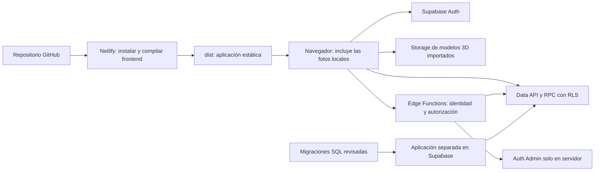

# 07 · Entornos y despliegue

Relacionado: [arquitectura](02-arquitectura-y-frontend.md), [Auth](04-autenticacion-y-acceso.md) y [fases](08-fases-y-validacion.md).

## Estado real del entorno y accesos

El proyecto Supabase Cloud ya está creado y en ejecución. El frontend se trabaja localmente; backend, Auth, Storage, Edge Functions y base se trabajan directamente en ese proyecto cloud. Por decisión del usuario no se levantará Supabase local, PostgreSQL local, Docker o una réplica local. Netlify sigue siendo el destino futuro del frontend, todavía sin producción desplegada ni usuarios reales según el usuario.

Las credenciales están en `.env` en la raíz, ignorado por Git. No volver a solicitar valores ya disponibles; leerlos solo en procesos que los necesiten y no imprimirlos, copiarlos a planes o incluirlos en comandos/logs. Al abrir una sesión nueva revisar este estado y las variables por nombre, sin asumir que un archivo de entorno significa que una función de producto está implementada.

Última validación de accesos: 18 de octubre de 2026, únicamente lecturas.

| Comprobación | Resultado observado | Límite de la evidencia |
| --- | --- | --- |
| URL + clave publicable | Auth health/settings HTTP 200; API de datos responde | No se ejecutó registro ni flujo de aplicación |
| Clave secreta | Auth Admin y descripción de API HTTP 200 | No se crearon cuentas ni se cambiaron datos |
| PostgreSQL | Conexión correcta y consulta explícita READ ONLY; permisos CREATE de base/esquema public disponibles | Capacidad declarada para migraciones; no se ejecutó DDL |
| Coherencia de destino | URL de API y conexión PostgreSQL corresponden al mismo proyecto | Confirmar destino al aplicar cambios futuros |
| Estado de negocio | 0 tablas en public; esquema iam inexistente | Snapshot de la última consulta, no estado garantizado para siempre |
| Token de gestión | Listado de Edge Functions HTTP 200, 0 funciones | Lectura validada; no se probó despliegue/escritura |

El 401 inicial de `/rest/v1/` con clave publicable correspondía a una descripción de API que exigía clave secreta; no se interpretó como fallo de conexión. No se usó una escritura para probar permisos. La CLI no estaba instalada en la revisión; preparar herramientas al comenzar implementación no requiere un stack local.

## Distribución



Netlify publica solo el frontend. No se despliegan SQL como rutas web ni se incluyen credenciales administrativas en el build. Supabase existe como servicio gestionado independiente.

## Variables de entorno y Git

Variables presentes y comprobadas por nombre en `.env`, sin registrar sus valores:

| Variable | Uso |
| --- | --- |
| `SUPABASE_URL` | URL del proyecto Cloud |
| `SUPABASE_PUBLISHABLE_KEY` | API pública/Auth de la aplicación |
| `SUPABASE_SECRET_KEY` | Operaciones administrativas en procesos de servidor |
| `SUPABASE_DB_URL` | Conexión PostgreSQL para herramientas y migraciones remotas |
| `SUPABASE_ACCESS_TOKEN` | API de gestión/Edge Functions según alcance del token |

El token fue creado para Edge Functions con lectura/escritura según lo indicado por el usuario; la comprobación realizada fue solo GET. Su alcance no limita la conexión SQL independiente. No afirmar que se ejecutó un deploy o migración solo porque el token o permiso exista.

El frontend Vite planificado usará estos nombres públicos, todavía no presentes en la última comprobación de `.env`:

```dotenv
VITE_SUPABASE_URL=
VITE_SUPABASE_PUBLISHABLE_KEY=
```

Se completarán con los equivalentes públicos al integrar el frontend, sin copiar secretos al prefijo VITE. No renombrar o eliminar las variables existentes de herramientas por ese cambio. Cualquier `.env.example` futuro contendrá únicamente nombres y valores vacíos; las credenciales reales se mantienen en `.env`. No crear plantillas con cuentas o contraseñas predeterminadas.

Todo valor VITE usado por el frontend se publica en el build. URL y clave publicable pueden ir al cliente; clave secreta, conexión SQL, token de gestión y SMTP no. Las funciones remotas reciben su configuración segura en Supabase, no por incluir el `.env` de la raíz en el paquete del frontend o de la función.

La protección `.env`, `.env.*` y excepción de plantilla vacía ya se aplicó en [`.gitignore`](../../.gitignore). Se verificó exclusión de `.env`, `.env.local` y entornos de subcarpetas, sin archivos reales de entorno rastreados. Las exclusiones de carpetas de trabajo de Netlify/CLI se añadirán cuando esas herramientas generen contenido; no confundirlas con código versionable de migraciones o funciones.

Antes de un push comprobar exclusión y archivos rastreados, sin imprimir valores:

```bash
git check-ignore -v .env .env.local supabase/.env.local
git ls-files '.env' '.env.*' '**/.env' '**/.env.*'
```

La segunda orden solo puede mostrar plantillas vacías permitidas; ignorar un archivo no lo retira si ya estaba rastreado. No versionar volcados con datos privados, credenciales, backups o copias renombradas del entorno.

## Backend versionado en el repositorio

La estructura y procedimiento principal viven en [supabase/README.md](../../supabase/README.md): SQL ordenado en `supabase/migrations/`, cada Edge Function en `supabase/functions/<nombre>/index.ts`, configuración necesaria y pruebas pertinentes. Los archivos ejecutables se crearán al implementar; actualmente existe únicamente su README documental.

Primero preparar la fuente local y después aplicarla al proyecto Cloud autorizado, conservando historial de migraciones y fuente del despliegue. No dejar cambios remotos como única copia. Roles/permisos base necesarios para funcionar pertenecen a migraciones; el seed se reserva a contenido/datos de prueba deliberados. La validación funcional y sus resultados quedan en el documento 08, enlazados con la fuente aplicada.

## Compilación objetivo en Netlify

La fase 0 fijará un gestor y su versión. La propuesta es pnpm, coherente con el lockfile ya presente, tras revisar `pnpm-workspace.yaml` y el comportamiento de scripts de instalación de esbuild. Estos archivos eran trabajo no versionado al iniciar la planificación y no se modifican aquí.

Se añadirá `packageManager` con versión exacta en `package.json` y se versionará el lockfile verificado. Elegir una versión de Node LTS admitida por las dependencias y Netlify, y fijarla para local y build. La versión se decide al reparar la herramienta de pruebas, no se adivina en estos planes.

Configuración prevista, a crear durante implementación:

```toml
[build]
  command = "pnpm run build"
  publish = "dist"
```

Para la SPA con rutas limpias, `public/_redirects` tendrá:

```text
/*    /index.html    200
```

Probar acceso directo y recarga de fichas, montajes y `/auth/callback`. La reescritura no sustituye la pantalla 404 de React. Los archivos estáticos existentes se sirven normalmente. No hace falta añadir funciones de Netlify ni el plugin de emulación de sus servicios para publicar este frontend estático.

La compilación falla actualmente por problemas previos del comparador y del entorno de pruebas; no se declara listo el despliegue hasta resolverlos.

## Configuración de Supabase

1. Utilizar el proyecto Cloud ya creado y las variables existentes; las lecturas de conexión están verificadas. Confirmar su identidad antes de aplicar archivos, sin crear otro proyecto o stack local.
2. Aplicar migraciones en orden y revisar restricciones, grants y RLS.
3. Si el inventario usa GLB importados, crear su bucket público con límites de archivo razonables y sin escrituras de visitantes o usuarios registrados. Una escena completamente procedimental no requiere ese bucket.
4. Cargar los recursos 3D importados y el seed publicado, comprobando referencias y tamaños. Las fotos de componentes se resuelven desde los imports de `src/assets/images/` y se publican con Netlify.
5. Configurar Auth, confirmación de correo y plantillas del [contrato de callback](04-autenticacion-y-acceso.md).
6. Registrar Site URL de producción y callbacks permitidos para producción y desarrollo.
7. Verificar envío de correo; preparar SMTP apropiado antes del registro público e invitaciones.
8. Preparar esquema iam sin exposición directa en Data API, roles/permisos base, provisionamiento user y funciones autorizadas; verificar grants y bootstrap controlado del primer administrador.
9. Desplegar Edge Functions administrativas por separado del frontend, con secretos solo en Supabase y autenticación del solicitante; probar visitante, user y revocación de permisos.
10. Configurar plantilla/callback de invitación y establecimiento de contraseña; comprobar resultados parciales entre Auth Admin y asignación IAM.

En desarrollo se usará el puerto real de Vite, por defecto `http://localhost:5173`, y se registrará su callback. Las previews de Netlify solo tendrán acceso de prueba si su origen está permitido de forma deliberada. Preferir una preview estable; no abrir redirecciones a cualquier dominio.

## Desarrollo actual y despliegues futuros

| Contexto | Frontend | Backend/base |
| --- | --- | --- |
| Actual | Vite en el equipo | Supabase Cloud del proyecto ya creado; datos de desarrollo |
| Preview futura | Netlify si se prepara | El destino Cloud configurado explícitamente; callback permitido |
| Producción futura | Netlify al publicar | Destino acordado antes de admitir usuarios reales; no existe producción actualmente |

No se exige una base local ni un segundo proyecto para ejecutar este plan. El usuario autoriza reconstrucciones necesarias de tablas propias, datos de prueba y Edge Functions del alcance en el proyecto de desarrollo cuando se inicie implementación; no repetir aprobaciones para tareas rutinarias ya autorizadas. La solicitud vigente de actualizar planes no inicia cambios remotos. Preservar las fuentes versionadas, comprobar el destino y mantener coherente el historial; no extender esa autorización a borrar el proyecto o esquemas internos gestionados por Supabase.

SQL, Edge Functions y frontend tienen despliegues separados. Aplicar sus cambios con contratos compatibles; revertir Netlify no revierte automáticamente base o funciones. La aparición de usuarios reales o producción cambiará el contexto declarado y deberá reflejarse en estos planes antes de aplicar allí procedimientos de reconstrucción de desarrollo.

## Archivos y límites del plan gratuito

Los recursos aprobados usan rutas versionadas, por ejemplo `models/frame-reference/v1/frame.glb`. Aprovechar caché para rutas inmutables. No subir originales de trabajo pesados como si fueran recursos de descarga. Medir descarga inicial y consumo real de Storage antes de ampliar el catálogo.

Las fotos de componentes se mantienen en `src/assets/images/`, optimizadas y referenciadas por el mapeo local. Forman parte de los archivos estáticos publicados en Netlify; modificarlas requiere un nuevo build. Su transferencia corresponde al alojamiento del frontend. La geometría procedimental no consume Storage de Supabase: se genera en memoria, aunque sus metadatos de catálogo puedan estar en PostgreSQL.

El plan gratuito sirve como punto de partida, no como capacidad ilimitada. Revisar cuotas vigentes de base, Storage, transferencia, Auth y disponibilidad en el panel al preparar el lanzamiento. Si el límite afecta principalmente a modelos, primero optimizar archivos y carga; después evaluar alojamiento de assets o un cambio de plan según uso real.

## Verificación antes del primer deploy funcional

- Build y pruebas relevantes pasan con instalación reproducible.
- Las variables públicas están presentes en el contexto correcto y no hay secretos incluidos.
- Rutas profundas, callback y enlace antiguo de modelo funcionan al recargar.
- Registro, entrada, recuperación, cierre y guardado se prueban desde el dominio publicado.
- Se comprueba por API el aislamiento de dos cuentas y la denegación de escrituras de catálogo sin permiso, además de las operaciones autorizadas.
- Un fallo de Storage o WebGL deja disponible la lista y las fichas.

## Referencias

- [Netlify: Vite, carpeta de publicación y rutas SPA](https://docs.netlify.com/build/frameworks/framework-setup-guides/vite/).
- [Vite: exposición de variables de entorno](https://vite.dev/guide/env-and-mode).
- [Supabase: claves publicables y secretas](https://supabase.com/docs/guides/getting-started/api-keys).
- [Supabase: redirecciones de Auth](https://supabase.com/docs/guides/auth/redirect-urls).
- [Supabase: migraciones remotas](https://supabase.com/docs/guides/deployment/database-migrations).
- [Supabase: despliegue de funciones](https://supabase.com/docs/guides/functions/deploy).
- [Supabase: uso y cuotas del plan](https://supabase.com/docs/guides/platform/billing-on-supabase).
