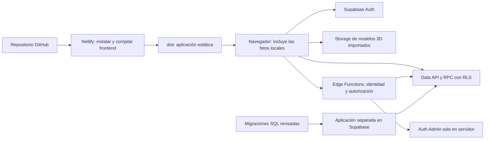

# 07 · Entornos y despliegue

Relacionado: [arquitectura](02-arquitectura-y-frontend.md), [Auth](04-autenticacion-y-acceso.md) y [fases](08-fases-y-validacion.md).

## Estado real del entorno y accesos

El proyecto Supabase Cloud ya está creado y en ejecución. El frontend se trabaja localmente; backend, Auth, Storage, Edge Functions y base se trabajan directamente en ese proyecto cloud. Por decisión del usuario no se levantará Supabase local, PostgreSQL local, Docker o una réplica local. El frontend ya está publicado en https://atlasmtb.netlify.app mediante conexión GitHub/Netlify, según confirmación del usuario y comprobación HTTP/navegador. Se conserva el frontend local para desarrollo. Los apartados históricos inferiores describen comprobaciones anteriores; el retorno Auth al dominio público ya está configurado, con lectura posterior y confirmación de acceso del usuario al final de este documento.

Las credenciales están en `.env` en la raíz, ignorado por Git. No volver a solicitar valores ya disponibles; leerlos solo en procesos que los necesiten y no imprimirlos, copiarlos a planes o incluirlos en comandos/logs. Al abrir una sesión nueva revisar este estado y las variables por nombre, sin asumir que un archivo de entorno significa que una función de producto está implementada.

Validación histórica previa al inicio: 18 de octubre de 2026, únicamente lecturas. Estado actual en la actualización siguiente.

| Comprobación | Resultado observado | Límite de la evidencia |
| --- | --- | --- |
| URL + clave publicable | Auth health/settings HTTP 200; API de datos responde | No se ejecutó registro ni flujo de aplicación |
| Clave secreta | Auth Admin y descripción de API HTTP 200 | No se crearon cuentas ni se cambiaron datos |
| PostgreSQL | Conexión correcta y consulta explícita READ ONLY; permisos CREATE de base/esquema public disponibles | Capacidad declarada para migraciones; no se ejecutó DDL |
| Coherencia de destino | URL de API y conexión PostgreSQL corresponden al mismo proyecto | Confirmar destino al aplicar cambios futuros |
| Estado de negocio | 0 tablas en public; esquema iam inexistente | Snapshot de la última consulta, no estado garantizado para siempre |
| Token de gestión | Listado de Edge Functions HTTP 200, 0 funciones | Lectura validada; no se probó despliegue/escritura |

El 401 inicial de `/rest/v1/` con clave publicable correspondía a una descripción de API que exigía clave secreta; no se interpretó como fallo de conexión. No se usó una escritura para probar permisos. La CLI no estaba instalada en la revisión; preparar herramientas al comenzar implementación no requiere un stack local.

## Actualización de implementación · 19 de octubre de 2026

El snapshot anterior conserva la comprobación histórica previa al inicio. Actualmente hay doce tablas propias, trece migraciones aplicadas con historial remoto y la función `admin-users` desplegada desde la fuente del repositorio. Las pruebas API y SQL de aislamiento, roles y guardado pasaron; evidencia y pendientes completos en [12](12-estado-implementacion.md).

Los nombres públicos VITE ya están integrados mediante `.env.local` ignorado. Node 24.22.0 y pnpm 12.6.0 fijados; build correcto y pruebas ejecutables. Existen `netlify.toml` y `public/_redirects`; no hay despliegue Netlify todavía. Las secciones prospectivas inferiores describen el contrato de despliegue y no sustituyen este estado.

Auth permite lectura de configuración (HTTP 200), pero la escritura con el token actual devuelve HTTP 403. Site URL observado: localhost:3000, sin callbacks; no hay SMTP propio configurado. Las plantillas y callbacks preparados en `supabase/` siguen pendientes de aplicación. La primera cuenta administradora `admin@atlas.mtb` ya está confirmada y vinculada a admin con doce permisos mediante la operación controlada del repositorio.

## Distribución



Netlify publica solo el frontend. No se despliegan SQL como rutas web ni se incluyen credenciales administrativas en el build. Supabase existe como servicio gestionado independiente.

## Variables de entorno y Git

Variables presentes y comprobadas por nombre en `.env`, sin registrar sus valores:

| Variable | Uso |
| --- | --- |
| `SUPABASE_URL` | URL del proyecto Cloud |
| `SUPABASE_PUBLISHABLE_KEY` | API pública/Auth de la aplicación |
| `SUPABASE_SECRET_KEY` | Operaciones administrativas en procesos de servidor |
| `SUPABASE_DB_URL` | Conexión PostgreSQL para herramientas y migraciones remotas |
| `SUPABASE_ACCESS_TOKEN` | API de gestión/Edge Functions según alcance del token |

El token se usa para Edge Functions: lectura y despliegue de `admin-users` ya comprobados. También permite leer configuración de Auth, pero su escritura devolvió HTTP 403. La conexión SQL independiente permitió aplicar las trece migraciones; el alcance del token no limita ese acceso PostgreSQL.

El frontend Vite usa estos nombres públicos mediante `.env.local` ignorado, conservando los nombres originales de herramientas en `.env`:

```dotenv
VITE_SUPABASE_URL=
VITE_SUPABASE_PUBLISHABLE_KEY=
```

Se completaron con los equivalentes públicos, sin copiar secretos al prefijo VITE. No renombrar o eliminar las variables existentes de herramientas por ese cambio. El `.env.example` contiene únicamente nombres y valores vacíos; las credenciales reales se mantienen en `.env`. No crear plantillas con cuentas o contraseñas predeterminadas.

Todo valor VITE usado por el frontend se publica en el build. URL y clave publicable pueden ir al cliente; clave secreta, conexión SQL, token de gestión y SMTP no. Las funciones remotas reciben su configuración segura en Supabase, no por incluir el `.env` de la raíz en el paquete del frontend o de la función.

La protección `.env`, `.env.*` y excepción de plantilla vacía ya se aplicó en [`.gitignore`](../../.gitignore). Se verificó exclusión de `.env`, `.env.local` y entornos de subcarpetas, sin archivos reales de entorno rastreados. La carpeta temporal de la CLI y los resultados de navegador están ignorados; no confundirlos con fuentes de migraciones o funciones.

Antes de un push comprobar exclusión y archivos rastreados, sin imprimir valores:

```bash
git check-ignore -v .env .env.local supabase/.env.local
git ls-files '.env' '.env.*' '**/.env' '**/.env.*'
```

La segunda orden solo puede mostrar plantillas vacías permitidas; ignorar un archivo no lo retira si ya estaba rastreado. No versionar volcados con datos privados, credenciales, backups o copias renombradas del entorno.

## Backend versionado en el repositorio

La estructura y procedimiento principal viven en [supabase/README.md](../../supabase/README.md): SQL ordenado en `supabase/migrations/`, cada Edge Function en `supabase/functions/<nombre>/index.ts`, configuración necesaria y pruebas pertinentes. Las fuentes ya existen: trece migraciones aplicadas, Edge Function desplegada, operaciones controladas, plantillas, datos de catálogo en borrador y pruebas. El detalle de estado y sus límites está en 12.

Primero preparar la fuente local y después aplicarla al proyecto Cloud autorizado, conservando historial de migraciones y fuente del despliegue. No dejar cambios remotos como única copia. Roles/permisos base necesarios para funcionar pertenecen a migraciones; el seed se reserva a contenido/datos de prueba deliberados. La validación funcional y sus resultados quedan en el documento 08, enlazados con la fuente aplicada.

## Compilación objetivo en Netlify

La fase 0 fijó pnpm 12.6.0 y Node 24.22.0, con `.node-version`, packageManager, un único lockfile y permiso de build de esbuild. La instalación con `--frozen-lockfile`, el build y las pruebas pasan. Se eliminó el lockfile npm redundante.

Configuración fuente actual: [`netlify.toml`](../../netlify.toml), con build `pnpm run build` y publicación de `dist`; todavía no se publicó el frontend. Mantener las variables públicas en el contexto de Netlify al desplegar, sin secretos privilegiados.

La SPA ya incluye `public/_redirects`:

```text
/*    /index.html    200
```

Probar acceso directo y recarga de fichas, montajes y `/auth/callback`. La reescritura no sustituye la pantalla 404 de React. Los archivos estáticos existentes se sirven normalmente. No hace falta añadir funciones de Netlify ni el plugin de emulación de sus servicios para publicar este frontend estático.

Los fallos previos del comparador y de compatibilidad Vite/Vitest se resolvieron. Quedan la aceptación funcional integral, las mediciones y el dominio/correo para declarar listo el despliegue.

## Configuración de Supabase

1. Utilizar el proyecto Cloud ya creado y las variables existentes; las lecturas de conexión están verificadas. Confirmar su identidad antes de aplicar archivos, sin crear otro proyecto o stack local.
2. Aplicar migraciones en orden y revisar restricciones, grants y RLS.
3. Si el inventario usa GLB importados, crear su bucket público con límites de archivo razonables y sin escrituras de visitantes o usuarios registrados. Una escena completamente procedimental no requiere ese bucket.
4. Cargar los recursos 3D importados y el seed publicado, comprobando referencias y tamaños. Las fotos de componentes se resuelven desde los imports de `src/assets/images/` y se publican con Netlify.
5. Configurar Auth, confirmación de correo y plantillas del [contrato de callback](04-autenticacion-y-acceso.md).
6. Registrar Site URL de producción y callbacks permitidos para producción y desarrollo.
7. Verificar envío de correo; preparar SMTP apropiado antes del registro público e invitaciones.
8. Preparar esquema iam sin exposición directa en Data API, roles/permisos base, provisionamiento user y funciones autorizadas; verificar grants y bootstrap controlado del primer administrador.
9. Desplegar Edge Functions administrativas por separado del frontend, con secretos solo en Supabase y autenticación del solicitante; probar visitante, user y revocación de permisos.
10. Configurar plantilla/callback de invitación y establecimiento de contraseña; comprobar resultados parciales entre Auth Admin y asignación IAM.

El servidor de este trabajo se ejecuta en `http://localhost:5174`: el puerto 5173 estaba ocupado por otro proceso y se conservó. La configuración de Auth preparada contempla callbacks concretos de 5173, 5174 y del navegador de pruebas en 127.0.0.1:4180; el usuario los aplicará desde Dashboard. Las previews de Netlify solo tendrán acceso de prueba si su origen está permitido de forma deliberada. Preferir una preview estable; no abrir redirecciones a cualquier dominio.

## Desarrollo actual y despliegues futuros

| Contexto | Frontend | Backend/base |
| --- | --- | --- |
| Actual | Vite en el equipo | Supabase Cloud del proyecto ya creado; datos de desarrollo |
| Preview futura | Netlify si se prepara | El destino Cloud configurado explícitamente; callback permitido |
| Producción futura | Netlify al publicar | Destino acordado antes de admitir usuarios reales; no existe producción actualmente |

No se exige una base local ni un segundo proyecto para ejecutar este plan. El usuario autoriza reconstrucciones necesarias de tablas propias, datos de prueba y Edge Functions del alcance en el proyecto de desarrollo cuando se inicie implementación; no repetir aprobaciones para tareas rutinarias ya autorizadas. La solicitud posterior del usuario autorizó implementar y aplicar los cambios del alcance. Preservar las fuentes versionadas, comprobar el destino y mantener coherente el historial; no extender esa autorización a borrar el proyecto o esquemas internos gestionados por Supabase.

SQL, Edge Functions y frontend tienen despliegues separados. Aplicar sus cambios con contratos compatibles; revertir Netlify no revierte automáticamente base o funciones. La aparición de usuarios reales o producción cambiará el contexto declarado y deberá reflejarse en estos planes antes de aplicar allí procedimientos de reconstrucción de desarrollo.

## Archivos y límites del plan gratuito

Los recursos aprobados usan rutas versionadas, por ejemplo `models/frame-reference/v1/frame.glb`. Aprovechar caché para rutas inmutables. No subir originales de trabajo pesados como si fueran recursos de descarga. Medir descarga inicial y consumo real de Storage antes de ampliar el catálogo.

Las fotos de componentes se mantienen en `src/assets/images/`, optimizadas y referenciadas por el mapeo local. Forman parte de los archivos estáticos publicados en Netlify; modificarlas requiere un nuevo build. Su transferencia corresponde al alojamiento del frontend. La geometría procedimental no consume Storage de Supabase: se genera en memoria, aunque sus metadatos de catálogo puedan estar en PostgreSQL.

El plan gratuito sirve como punto de partida, no como capacidad ilimitada. Revisar cuotas vigentes de base, Storage, transferencia, Auth y disponibilidad en el panel al preparar el lanzamiento. Si el límite afecta principalmente a modelos, primero optimizar archivos y carga; después evaluar alojamiento de assets o un cambio de plan según uso real.

## Verificación antes del primer deploy funcional

- Build y pruebas relevantes pasan con instalación reproducible.
- Las variables públicas están presentes en el contexto correcto y no hay secretos incluidos.
- Rutas profundas, callback y enlace antiguo de modelo funcionan al recargar.
- Registro, entrada, recuperación, cierre y guardado se prueban desde el dominio publicado.
- Se comprueba por API el aislamiento de dos cuentas y la denegación de escrituras de catálogo sin permiso, además de las operaciones autorizadas.
- Un fallo de Storage o WebGL deja disponible la lista y las fichas.

## Referencias

- [Netlify: Vite, carpeta de publicación y rutas SPA](https://docs.netlify.com/build/frameworks/framework-setup-guides/vite/).
- [Vite: exposición de variables de entorno](https://vite.dev/guide/env-and-mode).
- [Supabase: claves publicables y secretas](https://supabase.com/docs/guides/getting-started/api-keys).
- [Supabase: redirecciones de Auth](https://supabase.com/docs/guides/auth/redirect-urls).
- [Supabase: migraciones remotas](https://supabase.com/docs/guides/deployment/database-migrations).
- [Supabase: despliegue de funciones](https://supabase.com/docs/guides/functions/deploy).
- [Supabase: uso y cuotas del plan](https://supabase.com/docs/guides/platform/billing-on-supabase).


## Recursos exteriores versionados · 20/10/2026

Migraciones 014 y 015 aplicadas en el mismo Supabase Cloud: contrato de perfil por modelo, validación de categoría y generadores v3/v4. La ingesta visual conserva las generaciones anteriores y mantiene 114 variantes publicadas seleccionables. El orden de reposición y las fuentes se especifican en `supabase/catalog/README.md`; no sustituye ni reinicia las migraciones anteriores. Frontend local en 127.0.0.1:5174, sin despliegue Netlify nuevo. Evidencia y límites de fidelidad/rendimiento en [12b](12b-evidencia-geometria.md).

## Mallas de referencia integradas · 20/10/2026

Migración 016 y publicación visual v5 aplicadas en el mismo proyecto Cloud. El bucket público `models` contiene 74 binarios vigentes para 76 capturas GLB, con fuentes locales, hashes y rutas inmutables; la escritura anónima devuelve HTTP 403. Hay 53 modelos, 512 capturas de variante históricas, 510 recursos y 114 variantes públicas seleccionables. Las cuatro prearmadas usan v5 y los montajes anteriores conservan sus identidades. Procedimiento de reposición en `supabase/catalog/README.md`, evidencia en [12b](12b-evidencia-geometria.md). Frontend local en 5174, sin nuevo despliegue Netlify ni cambios de configuración de Auth.


## Continuidad exterior v6 y frenos v7

Migraciones 017/018 y ambas transiciones aplicadas al Cloud existente. No cambian tablas, Auth, IAM ni funciones Edge. Snapshot limpio: 606 variantes, 604 recursos, 53 modelos y cuatro prearmadas; 114 elecciones vigentes. Se añadieron 74 binarios GLB v6 con rutas inmutables y se conserva Storage v5. Escritura anónima denegada (403). El frontend sigue local en 5174, sin nuevo despliegue. Reposición explícita hasta v7 en el README del catálogo; evidencia en [12c](12c-evidencia-continuidad.md).

## Miniaturas y complementos comerciales · 21/10/2026

Migraciones 019/020 (bucket privado y políticas de miniaturas) y 021 (seis perfiles nuevos de complementos v8) aplicadas al mismo Cloud. Se ingirió `supabase/catalog/cockpit-reviewed.json`: 59 modelos, 120 elecciones actuales, 612 variantes y 610 recursos con historial. Doce tablas propias y cuatro prearmadas; no se altera Auth/IAM ni se despliegan funciones nuevas. La auditoría de consultas no requirió índices/migraciones de rendimiento. Evidencia en 12d/11n y fuentes de imágenes locales; frontend permanece local en 5174.

## Ampliación gravity · 21/10/2026

Migración 022 aplicada y fuente aditiva `gravity-reviewed.json` publicada. Nuevos GLB inmutables en `catalog/v9/`, verificados por SHA256 y descarga pública; fuentes/binarios conservados en models/catalog-v9. Estado: 70 modelos, 146 elecciones y 22 migraciones; doce tablas propias, mismas cuatro prearmadas. No cambia Auth/IAM/Edge Functions ni despliegue Netlify; frontend local en 5174. Ver 11o/12.

## Google OAuth · 21/10/2026

El usuario creó el proyecto/cliente web en Google y configuró el proveedor directamente en Supabase. Lectura posterior de Management API HTTP 200: Google habilitado, ID y secreto presentes (sin imprimir valores), Site URL `http://localhost:5174` y retorno permitido `http://localhost:5174/auth/callback`. Estas observaciones sustituyen para el acceso local los valores antiguos de localhost:3000 y allow-list vacía; no confirman cambios en plantillas ni SMTP.

Frontend con PKCE y detección automática de tokens deshabilitada; el callback distingue código OAuth de los token_hash de correo. No se copian secretos a variables VITE. La comprobación de navegador llegó a la pantalla real de Google sin introducir credenciales; consentimiento y regreso con una cuenta del usuario siguen pendientes. Al desplegar habrá que registrar el dominio definitivo y su retorno.

## Primer despliegue público · atlasmtb.netlify.app

El usuario publicó el frontend mediante GitHub y entregó https://atlasmtb.netlify.app. Portada, componentes, bicicletas, entrada y callback responden HTTP 200 con HTTPS y SPA. La lectura de Auth muestra todavía Site URL y retorno de localhost:5174; PATCH acotado a site_url/uri_allow_list devolvió HTTP 403. `supabase/auth-config.json` contiene el destino público propuesto y conserva el retorno local existente; no afirmar aplicado en Cloud hasta nueva lectura. Requiere guardar en Dashboard Site URL `https://atlasmtb.netlify.app` y añadir `https://atlasmtb.netlify.app/auth/callback` a Redirect URLs. El cliente Google conserva su callback Supabase; añadir el origen público en el cliente OAuth. No cambiar credenciales.

La preflight de admin-users desde Netlify devolvió 403; sin secreto ALLOWED_ORIGINS remoto, la función usa los orígenes predeterminados versionados. Añadido únicamente el dominio público a esos predeterminados, conservando locales y verificaciones de sesión/permisos; desplegar por el procedimiento API existente y comprobar origen permitido, visitante denegado y origen ajeno denegado. Sin cambios SQL, IAM ni Storage.

Resultado de la corrección CORS: admin-users desplegada por API desde la fuente versionada. Preflight Netlify y localhost:5174 HTTP 204 con origen exacto; origen ajeno HTTP 403 sin cabecera de autorización; POST sin sesión desde Netlify HTTP 401. No se alteraron permisos ni datos. La actualización de Auth sigue pendiente de Dashboard por HTTP 403 del PATCH.

Confirmación posterior del despliegue: el usuario informa que el acceso Google desde la web publicada funciona correctamente. Nueva lectura Management API HTTP 200 confirma Site URL https://atlasmtb.netlify.app, retorno público /auth/callback autorizado, retorno localhost:5174 conservado y proveedor Google activo. El pendiente anterior de URLs queda resuelto; el HTTP 403 describe solo el intento automático previo. Consentimiento y regreso reales confirmados por el usuario; no equivalen a una prueba automatizada de guardado público o de correo SMTP.
