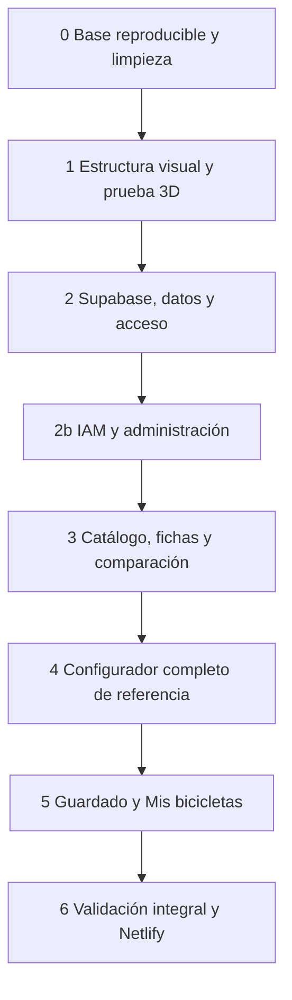

# 08 · Fases y validación

Relacionado: [índice del plan](README.md) y [ciclo documental](../README.md).

Estado global: implementación autorizada por el usuario el 19 de octubre de 2026. Se inicia fase 0 y se continúa según dependencias y aceptación de este archivo; ninguna funcionalidad se declara terminada por su documentación. No crear commits de implementación sin una nueva petición explícita.

La entrega es full scope del alcance acordado, no un MVP. Una prueba de concepto dentro de una fase ayuda a comprobar una decisión; no reemplaza la implementación completa de esa función ni reduce el inventario que se acuerde. Se mantienen fuera las funciones no solicitadas.

Avance y límites de las comprobaciones reales en [12](12-estado-implementacion.md); este archivo conserva la aceptación completa de cada fase.

## Alcance y trabajo incluido en la implementación

La referencia de estilo UI/UX aprobada es COMMENCAL; la composición de acceso/registro de 06a y las de 06b/06c están aprobadas. La portada de 06a se conserva como propuesta; identidad gráfica y recursos definitivos siguen pendientes de revisión. La composición administrativa de catálogo/prearmadas quedó aprobada en 06d. En este cierre se incorporan los principios de lenguaje y claridad de interfaz solicitados por el usuario, junto a decisiones de producto y contratos técnicos, sin añadir una fase de aprobación para cada tarea.

### Decisiones confirmadas por el usuario

| Tema | Decisión |
| --- | --- |
| Identidad | ATLAS MTB; eslogan «Cada pieza define tu camino». Logotipo profesional y elegante como representación principal |
| Público | Ciclistas y talleres/tiendas, con prioridad inicial en los ciclistas; sin añadir funciones comerciales a esta etapa |
| Acceso | Portada, catálogo, fichas y comparación públicos; configurador, avisos de montaje, guardado y montajes privados requieren cuenta |
| Portada | Presentación breve como gancho visual de entrada; sin recorrido explicativo extenso ni categorías en portada |
| Catálogo y precios | Modelos reales verificados y selección acotada de variantes útiles; precios orientativos con fuente, mercado, moneda y fecha |
| Cobertura 3D | Todas las piezas del catálogo montables, con genérico identificado y versionado cuando proceda |
| Transmisión | Cambio trasero seleccionable con mando asociado, sin selector separado |
| Cobertura por disciplina | Enduro y descenso, con cuadros reales representados aproximadamente |
| Compatibilidad mecánica | Permitir combinaciones visuales incluso con conflictos conocidos, mostrando avisos |
| Personalización | Colores libres en cuadro y piezas habilitadas; el resto conserva acabados |
| Profundidad | Cada función y campo acordados se implementa y comprueba de principio a fin |
| Infraestructura | Frontend en Netlify, Supabase para servicios y sin workers propios |
| IAM | Auth nativo, login común y esquema propio iam; registro siempre user, user/admin iniciales protegidos; roles personalizados creables y asignables |
| Administración | Usuarios/roles, catálogo y referencias desde web según permiso; Auth Admin solo en Edge Functions de Supabase; sin acceso automático a montajes ajenos |
| Arquitectura | Módulos por funcionalidad con reglas de montaje independientes de React, Three.js y Supabase; principios de Clean Architecture aplicados sin capas obligatorias |
| Código | SOLID con criterio, responsabilidad separada, tipado y reutilización de componentes y reglas sin clonación innecesaria |
| Lenguaje de interfaz | Títulos sin repeticiones vacías y terminología dirigida al usuario; mapeo explícito desde códigos técnicos; voz de producto sin comentarios de asistente ni narración de la pantalla |
| Navegación y fichas | Espacio con pestañas Bicicletas, Componentes y Mis bicicletas; contexto conservado, ficha completa lateral/inferior y detalle dentro del panel del configurador |
| Bicicletas prearmadas | Inicio desde cuadro o composición de referencia, distinguiendo fábrica y ejemplo; aplicar requiere sesión y no guarda automáticamente |
| UI administrativa | Pestañas Usuarios/Roles/Permisos; tablas integradas, panel lateral derecho y matriz horizontal de roles por permisos verticales; [06c](06c-administracion-usuarios-roles-y-permisos.md) |
| Vistas de acceso | Composición aprobada de [06a](06a-portada-y-acceso.md): imagen estática a la izquierda y formulario a la derecha; móvil sin panel fotográfico; registro con confirmación y estado «Revisa tu correo» |
| Estilo y movimiento | Referencia UI/UX COMMENCAL; limpieza, bicicleta protagonista, contraste y carácter deportivo. Movimiento puntual, contenido propio y alternativa estática |
| Fotos y archivos 3D | Fotos de componentes locales en `src/assets/images/`; GLB importados en Supabase Storage. La geometría generada por código no necesita archivos almacenados |

### Trabajo de concreción incluido en el plan

| Pendiente | Qué hay que cerrar | Qué afecta |
| --- | --- | --- |
| Referencias prearmadas concretas | Bicicletas, versiones y tallas a incluir; composición documentada de fábrica o ejemplo ATLAS para cada una | La función está aprobada; falta su inventario y contenido verificable |
| Componentes integrados | Mantener aros/bujes y manillar/potencia separados según 11; otros integrados no están incluidos automáticamente | Su incorporación sería cambio de alcance, no una tarea pendiente obligatoria |
| Inventario concreto | Selección acotada de modelos comerciales reales, tallas y versiones útiles para enduro/descenso; sin cubrir toda la oferta ni combinaciones teóricas; cobertura ampliada por el usuario en [11 y 11a–11m](11-propuesta-de-inventario.md), con M/L y pedalier seleccionable; variantes físicas por completar | Cantidad de recursos, contenido y combinaciones que se deben entregar completas |

No interpretar «inventario concreto» como soporte de todas las marcas o todas las tallas del mercado. Una vez fijado, ninguna entrada acordada para 3D puede quedar como una tarjeta sin representación funcional. Los selectores entre piezas existentes no se limitan por incompatibilidades mecánicas: la restricción pendiente es de cobertura, no de permiso para combinarlas.

### Ejecución y validación dentro de las fases

Por aclaración del usuario, completar datos, diseñar propuestas pendientes, preparar recursos, implementar y validar son trabajos del plan de implementación. No se exige que esos trabajos estén resueltos fuera del plan antes de comenzar. Sus dependencias indican el orden interno: por ejemplo, definir un contrato antes de aplicar su migración o revisar un boceto antes de construir esa pantalla.

| Trabajo incluido | Fases de ejecución | Resultado y aceptación |
| --- | --- | --- |
| Completar inventario, medidas, vigencia y prearmadas | Investigación en 1–2; ingesta y comprobación en 2–3; cobertura en 4–6 | Registros concretos en 11a–11m con fuentes/fecha, gama actual, tallas originales y composición por slot; cada variante incluida funciona y se recupera. Una familia localizada no completa la tarea |
| Cerrar diccionarios y manifiestos 3D | Primeros contratos/recursos en 1; diccionarios definitivos y validadores en 2; manifiestos y versiones completos en 4 | Tipos, códigos, obligatoriedad, unidades, límites y casos inválidos comprobados; anclajes y versiones por variante/talla coherentes con 03a/05. No copiar estimaciones visuales a especificaciones comerciales |
| Diseñar e implementar administración de catálogo/prearmadas | Preparar bocetos en 1–2b; revisión visual, implementación y pruebas en 2b | ASCII de tablas/paneles, campos por categoría y acciones de borrador/publicación; formularios completos, permisos efectivos y errores/recuperación probados. Conservar UI IAM aprobada |
| Preparar y validar recursos visuales/rendimiento | Recursos y dispositivo de referencia en 1; cobertura/optimización en 4; validación integral en 6 | Modelos/manifiestos, revisión de vistas y proporciones, tamaño transferido y métricas con dispositivo/navegador/red identificados; corregir hasta cumplir criterios de 05 sin reducir el alcance aprobado |

La revisión estética se realiza sobre propuestas concretas dentro de la ejecución; no obliga al usuario a resolver SQL, índices, coordenadas o todas las medidas del catálogo. Preguntar cuando falte una decisión real de negocio o una preferencia visual necesaria, continuar las tareas independientes y registrar solo el bloqueo específico. No crear una aprobación general nueva por cada fase.

Las pruebas y correcciones son parte del trabajo necesario para terminar cada función. Una tarea solo se marca completa con su evidencia; una prueba fallida sigue dentro de la fase hasta resolverse. La implementación está autorizada por la solicitud posterior del usuario. Registrar comprobaciones y pendientes en [12](12-estado-implementacion.md).

### Contratos técnicos que debe cerrar el desarrollo

No requieren al usuario decidir detalles de SQL o de Three.js. Deben especificarse y probarse antes de dar por completa su fase:

- Tipos, códigos, campos obligatorios/opcionales y unidades por categoría, distinguiendo datos documentados y parámetros visuales estimados. El [esquema y grupos de campos de 03a](03a-esquema-y-campos.md) y los [contratos de operación de 03](03-datos-y-operaciones.md) son la base; el diccionario final debe corresponder al inventario elegido.
- Manifiesto y anclajes por cuadro/variante soportados, posición estática, tamaños de piezas y piezas pintables. Las referencias reales se necesitan para preparar recursos coherentes; no se prometen automáticamente por elegir una librería.
- Guardado con una única ruta de escritura, transacción, revisión controlada y recuperación de timeout usando un ID conocido. Contrato corregido en el documento 03.
- Referencias visuales y variantes inmutables, conservando versiones usadas por montajes guardados. Una ruta de archivo versionada no basta si después cambia su variante.
- Colores libres persistidos y validados por pieza; un `finish_id` predefinido por sí solo no los representa.
- Continuidad de la intención pública tras entrar; borradores locales separados por cuenta, reautenticación, cierre de sesión y guardado de una instantánea sin borrar cambios posteriores.

### Servicios y accesos disponibles

Proyecto Supabase Cloud creado y credenciales presentes en `.env`. Ya se comprobaron conexión PostgreSQL/permisos CREATE, Auth/API, Auth Admin y listado de Edge Functions. [El documento 07](07-entornos-y-despliegue.md#estado-real-del-entorno-y-accesos) conserva resultados y límites: solo lectura, sin migraciones o despliegues probados. No volver a enumerar URL/clave como datos faltantes ni pedirlos por chat.

Frontend local y backend/base en Cloud; no se prepara un stack/base local de Supabase. Faltan herramientas de implementación cuando se inicie, configuración funcional de Auth/correo, permisos efectivos tras migraciones y origen futuro Netlify. El dispositivo/navegador de referencia se concreta antes de medir 3D. Credenciales administrativas nunca en el frontend.

### Inconsistencias documentales resueltas en esta revisión

Se eliminó la ambigüedad entre una demostración pequeña y la entrega final. Se cambió la política anterior que bloqueaba conflictos mecánicos por el montaje visual libre solicitado. Se añadió la persistencia de color libre, que no cabía en el contrato anterior de acabados. También se unificaron las escrituras de montajes por RPC para evitar eludir validaciones o duplicar incrementos de revisión, se definió recuperación de guardados inciertos y se conservaron las referencias visuales de montajes antiguos.

Son correcciones del plan; la aplicación aún no las implementa. La compilación, Auth, RLS, RPC y renderizado deberán comprobarse durante la ejecución. Esta revisión de documentos no demuestra que esos servicios funcionen.

## Revisión adversarial de datos

Se ejecutó una revisión documental con tres agentes por solicitud del usuario: suspensiones/cuadros, demás componentes y datos/consultas. [El documento 09](09-revision-adversarial-de-datos.md) registra fuentes y contraejemplos. La alternativa de ocho tablas de negocio y TanStack Query se mantiene, corrigiendo contratos; IAM añade las cuatro tablas de 04a. El cambio/mando ya quedó confirmado en la revisión integral posterior. Quedan decisiones de inventario e integrados; el rendimiento, SQL y aislamiento siguen pendientes de comprobación real. Esta revisión no marca fases como implementadas ni mueve documentos a `validation/`.

## Orden y dependencias

La prueba 3D temprana sirve para detectar límites de fidelidad y rendimiento antes de ampliar el catálogo. La integración real de Supabase llega antes del guardado. No se crean workers propios ni servicios fuera del conjunto Supabase/Netlify aprobado; Edge Functions forma parte de Supabase.

## Fase 0 · Base reproducible y limpieza

**Objetivo:** disponer de un punto de partida que compile y permita comprobar cambios.

- [x] Revisar archivos modificados/no versionados y conservar trabajo ajeno a la reconstrucción.
- [x] Fijar pnpm y Node compatibles; revisar el permiso de build de esbuild en el workspace actual.
- [x] Resolver la incompatibilidad instalada entre Vitest y Vite, con una elección coherente de versiones.
- [x] Corregir o sustituir el comparador que consume campos inexistentes; retirar la importación sin uso del test de rutas.
- [x] Confirmar instalación reproducible con el lockfile elegido, build y ejecución de pruebas pertinentes.
- [ ] Clasificar contenido reutilizable, revisar fuentes y retirar botones, cifras y promesas ficticias del nuevo recorrido.

Se pueden sustituir páginas y CSS actuales. No borrar imágenes o datos hasta comprobar si una parte del nuevo catálogo los utiliza. Conservar pnpm-lock.yaml y pnpm-workspace.yaml, ya versionados; revisar su coherencia durante la fase 0.

**Aceptación:** build correcto, pruebas arrancan y pasan para lo conservado, un único gestor documentado y contenido de prueba identificado. No se declara arreglado un fallo solo por ocultarlo en configuración.

## Fase 1 · Estructura visual y prueba de viabilidad 3D

**Objetivo:** validar la dirección de interfaz y una bicicleta proporcionada antes de desarrollar todos los detalles.

- [ ] Crear navegación y rutas objetivo, componentes básicos, tokens y distribución responsive.
- [ ] Aplicar la referencia COMMENCAL a jerarquía, contraste, espacio e imagen con contenido propio; revisar portada breve en escritorio y móvil.
- [ ] Preparar y revisar el recurso dinámico propuesto para portada, su imagen alternativa y controles de pausa; comprobar movimiento reducido, reproducción denegada y recurso fallido sin bloquear acceso.
- [ ] Añadir transiciones de controles, paneles y cámara según el documento 06; sin motor 3D decorativo en portada ni librería nueva por obligación.
- [ ] Aplicar los límites de módulos elegidos: reglas de montaje sin SDK/canvas, accesos a datos acotados y ninguna dependencia circular entre configurador y montajes guardados.
- [ ] Crear controles compartidos cuando exista comportamiento común, con etiquetas y errores propios por uso; sin clonar componentes por cada campo ni crear un formulario universal innecesario.
- [ ] Aplicar el vocabulario visible y los mapeos de resultados internos; revisar la jerarquía de títulos de los recorridos implementados.
- [ ] Implementar una primera pantalla de catálogo y la estructura del configurador con datos de prueba explícitos.
- [ ] Preparar los bocetos pendientes de portada y administración de catálogo/prearmadas; revisar propuestas concretas dentro de las fases 1–2b, conservando las composiciones ya aprobadas.
- [ ] Iniciar la investigación del inventario y las referencias físicas de 11a–11m; registrar vigencia, medidas y vacíos sin inventar variantes.
- [ ] Elegir una bicicleta base de referencia y registrar las vistas/medidas disponibles y sus incertidumbres.
- [ ] Mostrar cuadro, horquilla, ruedas, neumáticos, cockpit y transmisión representativos.
- [ ] Probar cambio de una pieza, un acabado y controles de cámara.
- [ ] Registrar tamaños de archivo, primera vista y fluidez en escritorio y un móvil de referencia.
- [ ] Revisar el conjunto desde lateral, frente, superior y tres cuartos con el nivel de aproximación aceptado.

**Aceptación:** bicicleta reconocible y proporcionada, interfaz utilizable en móvil, prueba de cambio visible y ausencia de dependencia de CAD oficial para todas las piezas. Si no se alcanza la calidad visual, ajustar estrategia gráfica, recursos y complejidad de geometría antes de multiplicar variantes. No reducir funciones ni inventario aprobado para cerrar la fase; cualquier reducción de alcance requiere decisión del usuario.

## Fase 2 · Supabase, datos y autenticación

**Objetivo:** conectar catálogo y cuentas reales con aislamiento de montajes.

- [ ] Reproducir las composiciones de acceso y registro aprobadas de [06a](06a-portada-y-acceso.md) en escritorio y móvil; incluir confirmación de contraseña, visibilidad por campo, requisitos reales y estado de confirmación de correo/reenvío.
- [ ] Comprobar teclado móvil, autocompletado, errores asociados, conservación del correo y retorno al origen; no añadir campos de perfil, textos de relleno o panel fotográfico en móvil.

- [x] Preparar en supabase/migrations y aplicar al proyecto Cloud, conservando historial según [supabase/README.md](../../supabase/README.md), las migraciones de doce tablas propias —ocho de negocio y cuatro IAM—, restricciones, índices y RLS de [03](03-datos-y-operaciones.md), [03a](03a-esquema-y-campos.md) y [04](04-autenticacion-y-acceso.md); publicación/transacciones y composiciones prearmadas verificadas.
- [x] Crear en esta fase el núcleo IAM requerido por Auth/RLS: roles/permisos base protegidos, provisionamiento de registro siempre user ignorando metadata, consulta de acceso propio y helpers de autorización vigentes. Ordenar las migraciones para que las políticas/registro no dependan de funciones o datos que recién se crearían en 2b.
- [ ] Cerrar diccionarios por categoría y casos de frontera del documento 09 antes de publicar variantes; no declarar datos aproximados como especificaciones reales.
- [ ] Medir consultas representativas con EXPLAIN (ANALYZE, BUFFERS) y roles/RLS reales en entorno de prueba; índices según operadores, paginación estable y todos los filtros técnicos sobre la misma variante.
- [ ] Integrar TanStack Query sin duplicar el borrador; probar caché por usuario, cancelación y respuestas tardías tras cambio de cuenta, sin reintento automático inseguro de guardados.
- [ ] Completar fichas de variantes, medidas, vigencia y composiciones prearmadas de 11a–11m como trabajo de esta fase; revisar tallajes originales y excepciones.
- [ ] Preparar un seed inicial pequeño y verificable para integración y completar después la ingesta de todo el inventario acordado antes de aceptar el catálogo; no copiar automáticamente todas las afirmaciones del prototipo.
- [ ] Resolver fotos locales por `image_key` y comprobarlas en el build publicado; configurar Storage y rutas versionadas si se usan modelos GLB importados.
- [x] Integrar el cliente Supabase con los equivalentes públicos VITE de las variables actuales; no renombrar/eliminar las credenciales existentes de herramientas ni exponer secretos.
- [ ] Implementar registro, entrada, confirmación, callback, recuperación y cierre según el documento 04.
- [ ] Configurar URLs y plantillas de Auth en el proyecto Cloud de desarrollo; verificar envío de correos con el frontend local.
- [x] Comprobar por API que dos usuarios no pueden acceder a los datos del otro y que las escrituras directas no eluden la RPC.
- [ ] Confirmar que visitantes y user no pueden modificar catálogo; solo operaciones con permiso modifican datos. La subida web de archivos sigue fuera de alcance.
- [ ] Probar portada, catálogo, ficha y comparación sin cuenta; exigir sesión para el configurador y continuar «Probar» tras el acceso, incluidos cancelación, variante retirada y confirmación en otro dispositivo.

**Aceptación:** se puede entrar con una cuenta real de prueba, recuperar su acceso y cerrar sesión; permisos funcionan fuera de la interfaz, no solo mediante botones ocultos. La falta de credenciales o de correo funcional queda como pendiente, no como validación aprobada.

## Fase 2b · IAM y administración funcional

**Objetivo:** ejecutar permisos y administración completos según [04a](04a-iam-roles-y-permisos.md) y [04b](04b-administracion-y-operaciones.md), conservando el acceso común.

- [ ] Reutilizar y verificar el núcleo IAM, roles base, provisionamiento user, consulta de acceso y helpers ya implantados en fase 2; iam sigue sin exposición de tablas ni escritura directa. Esta fase desarrolla las operaciones y UI administrativas, no retrasa prerrequisitos de autenticación/RLS.
- [x] Ejecutar bootstrap del primer admin por el responsable del proyecto, sin credenciales predeterminadas ni ascenso automático del primer registro.
- [ ] Reproducir [06c](06c-administracion-usuarios-roles-y-permisos.md): tres pestañas integradas, tablas, búsqueda/paginación reales, crear usuario desde cabecera y detalle en panel derecho; adaptación móvil accesible.
- [ ] Implementar matriz de permisos: agrupación por área, roles horizontales, sistema en lectura, personalizado editable, borrador local, descarte y guardado transaccional por lote con revisiones; sin concesiones por usuario.
- [ ] Probar matriz con más de un rol modificado: todo se confirma o revierte, se conservan cambios ante conflicto y no se borran permisos de columnas no cargadas.
- [ ] Implementar lista y formularios de roles personalizados: crear, editar nombre/descripción/permisos, asignar, desactivar y eliminar no asignados; validaciones, revisión y límites del actor en servidor.
- [ ] Proteger user/admin, impedir cambios propios que bloqueen acceso y serializar asignaciones/ediciones para conservar al último administrador incluso con solicitudes simultáneas.
- [x] Versionar cada Edge Function bajo supabase/functions/<nombre>/index.ts con su configuración/dependencias necesarias antes del despliegue Cloud.
- [ ] Implementar listado paginado de cuentas, invitación desde Edge Function y asignación segura por identidad; no exponer Auth Admin o correos de otras cuentas a usuarios sin permiso.
- [ ] Completar callback invite y establecimiento de contraseña; comprobar cuenta existente, enlace vencido/repetido, timeout y resultado parcial entre invitación y rol sin promoción indebida.
- [ ] Completar y revisar los bocetos ASCII de administración de catálogo/prearmadas: tablas, panel lateral, campos condicionales por categoría y acciones de borrador/publicación. Esta tarea pertenece a la fase; no se exige resuelta antes de iniciar el plan.
- [ ] Implementar edición/publicación de catálogo y prearmadas con permisos separados, diccionarios de categoría y protección de variantes/recursos usados; sin editar SQL o subir GLB desde UI.
- [x] Revalidar permisos y limpiar caché/formularios administrativos ante revocación, cambio de cuenta o denegación; sin confiar en JWT/metadata o interfaz como única autoridad.

**Aceptación:** user no alcanza funciones administrativas mediante UI, API, RPC o payload manipulado; admin puede crear un rol distinto, elegir permisos válidos, asignarlo y comprobar sus restricciones reales. La creación del rol no inventa una capacidad del software. Invitaciones no anuncian éxito total ante asignación fallida. Usuarios con roles administrativos siguen sin acceder a montajes ajenos. Se comprueban privilegios retirados y ediciones concurrentes, sin sustituir pruebas de servidor por ocultar botones.

## Fase 3 · Catálogo, fichas y comparación

**Objetivo:** conectar información técnica con decisiones sobre variantes.

- [ ] Implementar las composiciones de [06b](06b-espacio-de-trabajo.md): layout persistente y las tres pestañas; conservar filtros, desplazamiento y selección, con URL e historial coherentes y limpieza de datos privados al salir.
- [ ] Completar galería de Bicicletas con completos/cuadros y detalle lateral; preparar y verificar en Supabase todas las composiciones de referencia acordadas, incluyendo ambas disciplinas y tipos fábrica/ejemplo.
- [ ] Listar catálogo publicado con búsqueda, filtros reales, paginación y estados de consulta.
- [ ] Abrir ficha completa en panel lateral/inferior, cambiar entre tarjetas sin cerrar y elegir variantes sin diálogos encadenados; probar entrada directa y cierre con/sin historial previo.
- [ ] Conservar filtros en URL y resolver fichas por slug e identificadores estables.
- [ ] Verificar existencia comercial, fuentes y fecha del inventario seleccionado; agrupar versiones por familia/modelo sin duplicar tarjetas por color ni generar combinaciones inexistentes.
- [ ] Separar modelo comercial y variante; presentar unidades y datos sin confirmar.
- [ ] Mostrar precios orientativos disponibles con moneda, mercado, fuente y fecha; probar datos ausentes y referencias de mercados/monedas diferentes sin conversiones o comparaciones engañosas.
- [ ] Mantener portada breve, con imagen, frase y acción de acceso; catálogo público accesible mediante enlace secundario.
- [ ] Implementar comparación de hasta tres variantes de una categoría, sin duplicados ni rankings engañosos.
- [ ] Conectar «Probar en mi bicicleta» con el slot correspondiente.
- [ ] Revisar redirección de enlaces hash antiguos y enlaces inexistentes.

**Aceptación:** búsqueda y filtros cambian resultados; una ficha identifica su variante; comparación muestra diferencias correctas; los datos ausentes no se convierten en cero, precios inventados o textos `undefined`.

## Fase 4 · Configurador completo del inventario

**Objetivo:** completar el configurador para todas las categorías y variantes acordadas de enduro y descenso, usando la bicicleta de referencia como caso de comprobación, sin limitar a ella la entrega.

- [x] Definir y validar unidades, ejes, origen y manifiestos de recursos.
- [ ] Iniciar desde cuadro o desde cada referencia prearmada/talla acordada; validar referencias retiradas, conservación de intención durante acceso y guardado explícito sin cambios silenciosos.
- [ ] Implementar todos los slots acordados del documento 03 y los inventarios de enduro y descenso; distinguir posiciones delanteras y traseras.
- [x] Resolver modelos GLB y generadores; sincronizar selección de pieza y panel.
- [ ] Implementar acabados, color libre en piezas habilitadas, borrador local versionado y deshacer última sustitución.
- [ ] Implementar avisos de conflictos conocidos y datos insuficientes sin impedir aplicar o guardar combinaciones visuales; revisar dependencias al cambiar cuadro.
- [ ] Manejar selecciones rápidas, recurso fallido, falta de WebGL y pérdida de contexto sin perder el montaje.
- [ ] Adaptar calidad al dispositivo; comprobar presupuestos y liberar recursos.
- [ ] Etiquetar representaciones aproximadas y evitar atribuir precisión no verificada.

**Aceptación:** todos los cuadros, variantes y componentes acordados para el configurador están operativos en ambas disciplinas; la misma configuración reconstruye la misma bicicleta y colores; las sustituciones no producen piezas duplicadas, escalas arbitrarias o estados fuera de orden. Una interferencia derivada de una combinación incompatible permitida se avisa y no se disimula como encaje real. La lista de componentes funciona aunque el visor no pueda dibujarse.

## Fase 5 · Guardado y Mis bicicletas

**Objetivo:** persistir y recuperar el montaje completo con su propietario.

- [x] Implementar `save_build`, transacción, validación estructural y control de revisión.
- [ ] Crear, abrir, renombrar y eliminar montajes con sus estados visibles.
- [ ] Conservar borrador al solicitar acceso y pedir guardado explícito al regresar.
- [ ] Probar sesión caducada, error de red, respuesta incierta, conflicto entre pestañas y cambios realizados durante un guardado.
- [ ] Verificar referencias retiradas del selector y montajes incompletos.
- [ ] Limpiar caché privada y recuperación local al cerrar sesión o cambiar de usuario.

**Aceptación:** tras guardar, cerrar y recargar, se recuperan variantes y acabados correctos. Un fallo de la RPC no deja media configuración. Otro usuario no puede obtenerla ni editarla mediante IDs manipulados. Un conflicto no sobrescribe trabajo silenciosamente.

## Fase 6 · Validación integral y publicación

**Objetivo:** entregar un frontend funcional en Netlify conectado a Supabase.

- [ ] Revisar jerarquía, contraste, teclado, foco, formularios y movimiento reducido.
- [ ] Revisar la propuesta de logotipo: versiones clara/oscura, símbolo pequeño, legibilidad de MTB y eslogan, márgenes y ausencia de marca duplicada.
- [ ] Revisar textos por recorrido: sin encabezados redundantes, códigos internos, errores brutos del SDK o términos técnicos del software sin conversión a lenguaje de usuario.
- [ ] Completar recorridos en 360, 768 y 1440 px; probar al menos un navegador de escritorio y uno móvil reales.
- [ ] Medir la bicicleta de referencia con red y dispositivo identificados; ajustar calidad si es necesario.
- [ ] Añadir configuración de Netlify y reescritura de rutas limpias.
- [ ] Configurar variables públicas y verificar exclusión Git de entornos.
- [ ] Probar desde la URL publicada rutas profundas, Auth, recuperación, consulta y guardado.
- [ ] Configurar correo apropiado para registro público y revisar cuotas vigentes.
- [ ] Registrar evidencia y pendientes; mover el conjunto a validation cuando el alcance esté implementado.
- [ ] Tras superar los criterios, actualizar resultados y mover el conjunto a finished según docs/README.md.

**Aceptación:** recorrido completo de catálogo a montaje guardado en el dominio publicado, sin fallos bloqueantes ni acciones que aparenten funcionar. El rollback del frontend y la compatibilidad con la migración aplicada están entendidos.

## Matriz de aceptación funcional

| Caso | Resultado esperado | Método |
| --- | --- | --- |
| Instalación y build | Resultado reproducible sin errores | Lockfile fijado, instalación y build |
| Límites de arquitectura | Reglas del montaje comprobables sin red/canvas; catálogo no carga el motor 3D; sin importaciones circulares | Revisión de imports, prueba del modelo y análisis del build |
| Reutilización de controles | Comportamiento compartido consistente y etiquetas/errores adecuados a cada campo | Revisión de composición y pruebas de los controles reutilizados |
| Traducción de resultados | Códigos conocidos con texto específico; desconocidos con fallback seguro; sin datos internos expuestos | Probar respuestas conocidas, desconocidas y errores de servicio |
| Inventario y precios | Modelos reales, variantes comerciales documentadas, sin duplicaciones por color; precio fechado y contextualizado o ausencia explícita | Revisión de fuentes de todo el inventario, UI de ficha/comparación y actualización de referencia sin alterar montajes |
| Acceso y continuidad | Páginas públicas accesibles; editor exige sesión y retoma una intención válida sin guardar automáticamente | Navegación directa, recarga, cancelación y acceso con o sin intención local |
| Pestañas y paneles | Contexto conservado, URL compartible, Atrás/Adelante y un solo panel de detalle | Navegación, entrada directa, variante múltiple, cambios rápidos, cierre con foco y móvil sin gestos obligatorios |
| Registro y roles base | Registro público asigna solo user; claves/roles base protegidos | Alta con metadata/payload manipulado, primer registro, fallo de provisionamiento y asignación desde el proyecto |
| UI de usuarios y roles | Tablas sencillas, crear/detalle en panel, campos editables autorizados y búsqueda global real | Teclado, selección, recarga, error, cuenta existente, resultados en otras páginas y móvil |
| Matriz de permisos | Roles horizontales, permisos por área, sistema protegido y guardado explícito por lote | Dos roles modificados, conflicto/rollback, columnas no cargadas, navegación con borrador y equivalencia móvil |
| Roles configurables | Crear y asignar rol personalizado funciona; permisos no otorgables rechazados; roles en uso protegidos | UI y RPC directa, revisión concurrente, sistema/inactivos y reasignación explícita |
| Autorización vigente | Una sesión no conserva administración tras perder permiso; último admin protegido | Token anterior, formulario viejo, peticiones simultáneas y cambio de cuenta |
| Invitación administrativa | Identidad/permiso verificados, contraseña del destinatario y resultados parciales correctos | Edge Function sin sesión, user, rol autorizado, cuenta existente y fallo Auth/IAM |
| Administración de negocio | Escrituras/publicación autorizadas, sin destruir referencias usadas | Funciones directas, campos protegidos, borradores, nuevas versiones y montajes previos |
| Consultas y aislamiento | Filtros en una misma variante, modelos únicos paginados, payload acotado y caché privada aislada | Planes de lectura bajo RLS, ausencia de N+1, cambios rápidos de filtros y cuenta durante consultas/guardados |
| Referencias prearmadas | Fábrica/ejemplo identificados, composiciones reales verificadas; aplicar copia un borrador propio sin guardar automáticamente | Todas las referencias/tallas acordadas, datos retirados, sesión ausente y actualización de referencia sin cambiar montajes previos |
| Acceso y registro visual | Distribución aprobada, campos y textos correctos; confirmación de correo y reenvío; móvil sin imagen | Revisión en escritorio y móvil con teclado abierto; foco, autocompletado, visibilidad de cada contraseña y errores recuperables |
| Movimiento | Respuesta visual breve, portada operativa con imagen fija, pausa accesible y respeto al movimiento reducido | Móvil real, teclado, reproducción denegada, recurso fallido y pestaña oculta |
| Jerarquía y vocabulario | Títulos informativos, sin repeticiones vacías; mismos conceptos nombrados de forma consistente; sin comentarios de asistente o narración de la pantalla | Revisión contextual de catálogo, ficha, configurador, cuenta y guardado |
| Visitante filtra y abre ficha | Consulta real y URL consistente | Prueba de interfaz |
| Comparar variante duplicada o cuarta | Selección coherente, máximo tres | Prueba de lógica/interfaz |
| Registro y recuperación | Correo, callback y sesión reales | Integración con cuenta de prueba |
| Usuario B manipula ID de A | Lectura y escritura denegadas | Data API y RPC con sesiones separadas |
| RPC falla al guardar piezas | No quedan escrituras parciales | Integración de base en entorno de prueba |
| Dos pestañas guardan misma revisión | Segunda recibe conflicto | Integración y recorrido manual |
| Cambia medida o cuadro | Se conserva o revisa lo afectado | Prueba de reglas y revisión visual |
| Mezcla piezas mecánicamente incompatibles | Se permite aplicar, guardar y recuperar, con avisos | Integración de montaje y guardado |
| Color libre en pieza habilitada | Se aplica a sus nodos y reaparece al abrir el montaje | Interfaz y persistencia real |
| Color libre en pieza no habilitada | Se rechaza el dato inválido; se mantiene el acabado válido | RPC con entrada manipulada |
| Timeout tras crear montaje | Se localiza por el mismo ID y no se duplica | Interrumpir respuesta tras confirmar transacción |
| Cambia recurso publicado | El montaje anterior conserva su versión | Integración con variantes versionadas |
| Cambios rápidos de piezas | Prevalece la última selección preparada sobre sus dependencias vigentes | Demorar la carga de una horquilla, cambiar cuadro y comprobar que no se aplican anclajes calculados para la base anterior |
| Falla GLB o WebGL | Lista y borrador siguen disponibles | Simular fallo de recursos/contexto |
| Foto local del componente | Se resuelve después del build; clave ausente usa placeholder | Comprobar catálogo en preview de producción |
| Pieza procedimental | Se dibuja con parámetros disponibles sin solicitar un GLB ni subir geometría a Storage | Inspeccionar peticiones durante su construcción e interacción |
| Sesión expira o se cierra | Sin datos privados de otra cuenta | Recorrido con dos cuentas |
| Recarga de ruta en Netlify | Pantalla correcta sin 404 de servidor | URL directa publicada |
| Git y entorno | Archivos reales ignorados, plantilla vacía permitida | check-ignore y ls-files |

Escribir pruebas donde aporten valor a lógica de ensamblaje, persistencia, permisos y recorridos. No exigir un test que copie cada línea de CSS ni tests decorativos para esta entrega documental. Las pruebas SQL/RLS se realizan con cuentas y datos de prueba controlados en el proyecto Supabase Cloud de desarrollo; un mock del SDK no demuestra aislamiento.

Esta matriz organiza la validación; no limita las pruebas a un recorrido feliz por pantalla. Para cada campo funcional acordado se comprueban entrada, ausencia permitida, valores inválidos, aplicación al dominio, persistencia y recuperación cuando correspondan. Para cada operación se comprueban permisos y errores relevantes. La cobertura debe incluir todo el inventario definido para el configurador, no solo la bicicleta usada en la primera prueba técnica.

## Evidencia de la revisión inicial

Fecha: 18 de octubre de 2026. Entorno: repositorio local antes de reconstruir la aplicación.

| Comprobación | Resultado observado |
| --- | --- |
| Lectura del código | Prototipo React 18/Vite; catálogo local, detalle y comparador; sin Supabase ni 3D |
| `npm run build` | Falló: campos inexistentes en Compare y una importación no usada en routing.test |
| `npm run test -- --run` | Falló al iniciar: Vitest instalado requiere una exportación `vite/module-runner` ausente en Vite instalado |
| `git ls-files` sobre entornos | No había archivos de entorno rastreados al iniciar la documentación |

Las fallas anteriores permanecen sin corregir en esta entrega de planificación; se resolverán en fase 0. La revisión documental, enlaces y exclusiones Git de esta entrega se registran aparte al finalizarla y no equivalen a validar la aplicación futura.

### Revisión de esta entrega documental

En una revisión anterior del 18 de octubre de 2026 se comprobaron los 10 documentos Markdown y sus 41 enlaces internos, cifras de esa revisión y no del conjunto ampliado actual: sin destinos inexistentes, bloques de código sin cerrar o ejemplos JSON inválidos. Hay 14 diagramas Mermaid; se revisaron sus relaciones y bloques, sin ejecutar un renderizador de Mermaid.

En una revisión histórica se comprobaron exclusiones Git y una plantilla vacía; esos cambios se retiraron entonces para mantener la fase documental. Después, al preparar la conexión real, se aplicaron las exclusiones de `.env` y sus variantes. El estado vigente —proyecto Cloud creado, variables disponibles y lecturas verificadas— está centralizado en [07](07-entornos-y-despliegue.md); no interpretar la retirada histórica como falta actual de protección o credenciales. Esta comprobación no valida todavía la nueva aplicación.

También se retiraron los cambios anticipados de logo, cabecera y HTML, junto con los recursos gráficos generados. El código fuente del prototipo conserva su estado anterior; `.gitignore` incorpora la exclusión de variables locales descrita en 07; las decisiones de ATLAS MTB y su eslogan permanecen documentadas como requisitos futuros.

### Comprobación de la reorganización documental

El 18 de octubre de 2026 se revisó el conjunto ampliado: 14 documentos en `docs/` y `AGENTS.md`, 89 enlaces locales y 4 anclas internas, sin destinos rotos. Se comprobaron cierres de bloques y ejemplos JSON; los 16 bloques Mermaid se comprobaron estructuralmente, sin renderizador. `git diff --check` no detectó errores de espacios. Las composiciones aprobadas se trasladaron completas a 06a/06b, y el esquema quedó centralizado en 03a. No se ejecutaron build, pruebas de aplicación o SQL por tratarse exclusivamente de documentación.

### Comprobación documental de la ampliación IAM

El 18 de octubre de 2026 se comprobaron 16 documentos en docs y AGENTS.md: 118 enlaces locales y 4 anclas, sin destinos rotos, bloques abiertos o JSON inválido. Los 19 bloques Mermaid se revisaron estructuralmente sin renderizador. `git diff --check` sin errores. Se actualizaron exclusiones anteriores de panel/roles y el total de tablas. La revisión multiagente histórica de 09 no se atribuye retroactivamente al nuevo IAM. No se ejecutaron SQL, Auth, Edge Functions o pruebas de aplicación; los criterios de 2b siguen pendientes.

## Estado vigente de ejecución

La implementación está autorizada y en curso desde el 19 de octubre de 2026. El estado comprobado y los pendientes se mantienen en [12](12-estado-implementacion.md), con el contexto de acceso en [07](07-entornos-y-despliegue.md). Las comprobaciones históricas anteriores no describen el estado actual del código.

El frontend ya integra las variables públicas, las herramientas están fijadas y hay trece migraciones y una Edge Function aplicadas en Cloud, con fuentes locales. Pasan build, treinta y cinco pruebas unitarias y los contratos API/SQL; hay pruebas reales de navegador con cuentas y recursos temporales. Ninguna de esas comprobaciones declara completo el alcance de esta matriz. Quedan dentro de las fases la cobertura comercial del inventario, sus recursos y medidas, la aceptación administrativa y de recuperación ante fallos, las mediciones y la integración final de correo/dominio. El usuario confirmó que callbacks y plantillas de Dashboard siguen pendientes; el callback de recuperación se probó por separado mediante un enlace temporal sin envío de correo.

No mover el conjunto a `finished/` ni declarar terminado el catálogo por tener publicados los primeros conjuntos enduro/DH o por una composición sintética de aceptación. No hace falta una nueva autorización rutinaria para seguir con los trabajos de implementación ya acordados; no crear commits ni publicar el frontend sin la solicitud correspondiente.

## Revisión integral adversarial posterior

[10 · Auditoría integral](10-auditoria-integral-de-planes.md) registra la revisión de tres agentes de producto/UX, datos/IAM y arquitectura/operación, incluyendo el IAM ampliado. [11 · Inventario e ingesta documental](11-propuesta-de-inventario.md) responde a la solicitud del usuario y requiere revisión antes de fijar variantes. Nada se considera implementado por esta auditoría.

Añadir a la aceptación: dependencias de permisos y selectores autorizados; edición pública sin bypass de publicación; login de roles limitados sin bucles; categoría/parentesco y fallback visual inmutables; copia con retiradas; sustituciones fuera de orden y retirada conjunta de cambio/mando; cobertura 3D de cada variante del inventario finalmente aprobado.

### Ampliación documental posterior de inventario

La propuesta de cuatro cuadros/una talla se sustituye por la cobertura de marcas y categorías de 11a–11m. M y L son prioridades donde existan; conservar tallajes originales distintos, sin equivalencias inventadas. Pedalier ahora seleccionable (`bottom_bracket`), plato incluido con bielas; el modelo de doce tablas se conserva. Mantenimiento por modelo/generación como información documental, sin agenda. Manillar/potencia/sillín sencillos genéricos identificados.

Antes de cerrar fase 2: verificar diccionarios, códigos y fuentes por categoría, incluida estructura de mantenimiento y nuevas interfaces de pedalier; antes de cerrar fases 3–5: filtros aplicables, cada variante y talla acordadas, recursos inmutables, avisos, guardado y recuperación. Las familias localizadas no se contabilizan como variantes ingeridas ni como cobertura final validada.

Delimitación de ingesta confirmada después: solo gama actual documentada. Exigir evidencia de vigencia por referencia y no incluir históricos por tener manual; conservarlos únicamente como contraejemplos. Comprobación documental de esta ampliación: 34 Markdown, 222 enlaces locales, 30 anclas y 71 bloques cerrados sin errores; JSON de ejemplo válido y `git diff --check` limpio. No se ejecutaron pruebas de aplicación o servicios.

### Dictamen documental del 19 de octubre de 2026

La [reevaluación multiagente de 10](10-auditoria-integral-de-planes.md#reevaluación-de-procedencia--19-de-octubre-de-2026) considera procedente iniciar las bases cuando el usuario autorice implementación. Los contratos corregidos mantienen el alcance completo. Completar variantes/vigencia, diccionarios finales, recursos y UI administrativa de negocio son tareas dentro de las fases, con dependencias internas y criterios de aceptación; no requisitos externos que el usuario deba resolver antes de iniciar el plan. El dictamen no inicia la implementación ni certifica el producto.

Ampliación posterior de fases 3/4: cinco fuentes comerciales, 53 modelos y 116 variantes publicados de 128, con 114 variantes seleccionables y dos capturas anteriores conservadas, incluyendo seis cuadros con dos geometrías y cuatro modelos de neumático. Se comprobó recuperación local tras reautenticación y limpieza al salir expresamente. La revisión interna de doce borradores no autoriza publicarlos ni sustituye fidelidad final; pendientes y evidencia en 12/12a.

### Ampliación de movimiento compartido · 19/10/2026

Como parte del movimiento de fase 1 y su aplicación transversal a las fases siguientes, ejecutar la revisión solicitada en [06](06-ui-y-ux.md): transiciones de secciones sin remontar estado, interacciones de controles y selección, entrada de paneles y avisos, adaptación móvil y movimiento reducido. Resultado esperado: tratamiento consistente en acceso, catálogo, comparación, montajes y administración, sin librerías nuevas ni cambios de reglas/escena. Validar navegación/foco, errores y preferencia reducida con pruebas de navegador y las comprobaciones de build existentes; conservar evidencia en 12 sin dar por cerrada la aceptación integral del producto.

### Cobertura fotográfica del catálogo · 19/10/2026

Solicitud del usuario: completar la cantidad de fotografías de componentes. Dentro de las fases 1/3, auditar modelos publicados y sus claves, localizar fotos del producto en fuentes comerciales, descargar/optimizar assets locales y registrar procedencia y alcance visual. Reutilizar fotografía de familia solo cuando corresponda al modelo, sin prometer acabado o medida exactos; nunca asignar a un cuadro una bicicleta completa sin identificarlo. Mantener los genéricos ATLAS diferenciados de productos comerciales. Conectar tarjetas/fichas al mismo resolver, comprobar imágenes cargadas y cobertura real y documentar pendientes concretos en 12. No modificar reglas 3D ni publicar variantes pendientes para completar fotografías.

Revisión de galerías solicitada posteriormente: ejecutar la nueva dirección de Componentes/Bicicletas de 06b dentro de fases 1/3. Resultado: cabecera compartida, tarjetas e imágenes con mayor jerarquía, filtros integrados y respuesta de interacción; aceptación por navegación, filtrado, versiones/paneles, teclado, móvil sin desbordamiento y movimiento reducido, además de revisión de capturas. No modifica operaciones Cloud o alcance del inventario.

Ampliación solicitada de ancho adaptable: retirar el límite de contenedores de trabajo y adaptar rejillas/márgenes conforme a 06. Incluir comprobación en pantallas de 1920/2560 px además de móvil, y regresión de tablas, paneles y navegación. Conservar límites legibles de formularios cortos, sin confundirlos con el ancho exterior de la vista.
