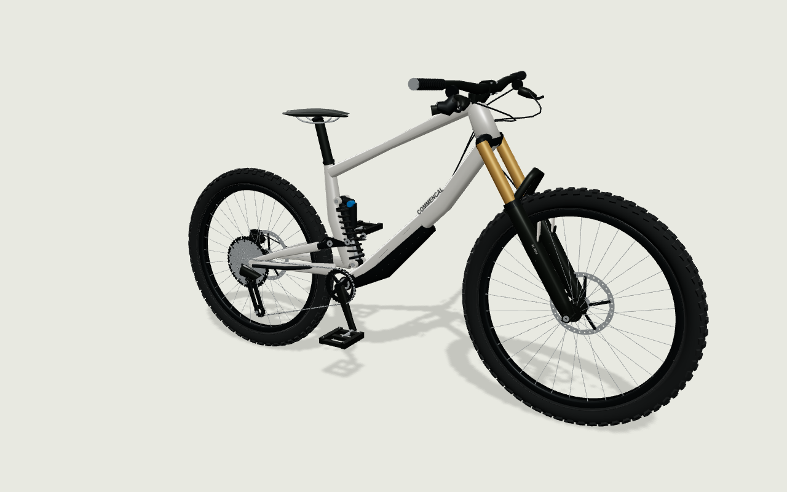
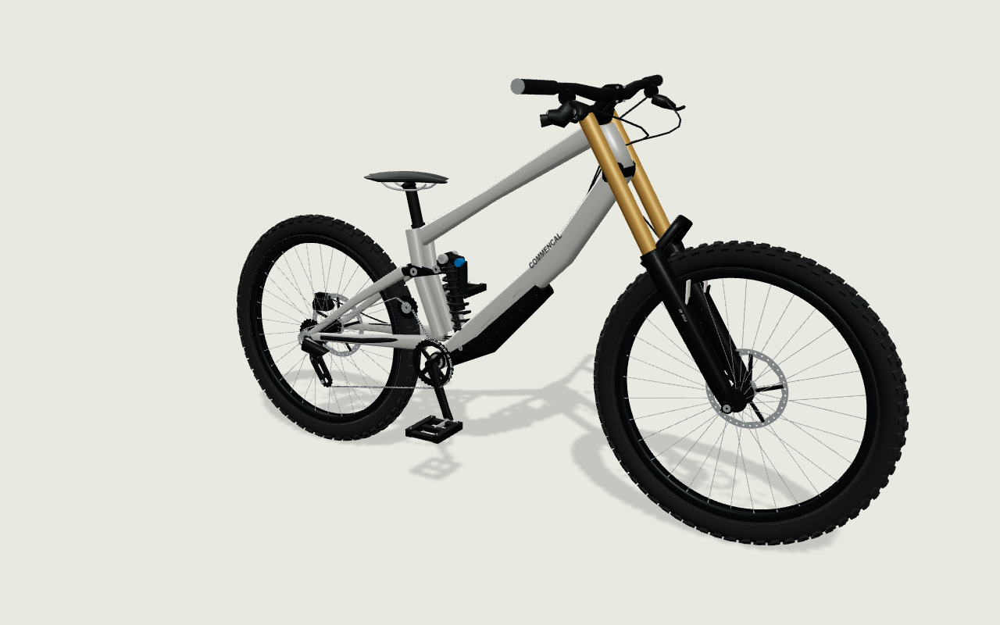

# Evidencia de geometría exterior · 20/10/2026

Alcance autorizado: mejorar todos los modelos del inventario. V3 introduce 53 perfiles exteriores explícitos y v4 corrige el barrido espacial conservando volumen en secciones transversales. Se conservan v1/v2/v3 y sus recursos para montajes guardados. Contrato y límites en [05a](05a-fidelidad-modelos.md); referencias fotográficas y audiovisuales por modelo en [el inventario de referencias](../../supabase/catalog/visual-v3-references.md).

## Resultado verificable

- 53 modelos y 128 capturas con recursos nuevos. Se mantienen 114 variantes públicas seleccionables; 12 borradores no se publican y las dos capturas Specialized retiradas siguen fuera de elección. Archivar generaciones previas no elimina sus variantes.
- Cuadros con secciones variables, basculantes, bieletas, guardas y anclajes; horquillas con botellas, barras, puentes y pletinas; amortiguadores aire/muelle con depósito; ruedas con perfil de aro, radios y dibujo distinto por familia de neumático; discos perforados, pinzas/manetas, cassette con dientes, cadena articulada visualmente, cambio/mando, bielas y pedales abiertos. Auxiliares ATLAS siguen identificados como genéricos.
- Unificación de mallas por material para evitar una llamada de dibujo por taco, diente o eslabón. Las ediciones del nombre/color de otra pieza no reconstruyen todos los sólidos detallados. Se liberan geometrías y texturas propias al sustituir o desmontar recursos; los materiales de selección mantienen su ciclo independiente.
- Las especificaciones comerciales, acabados y reglas de compatibilidad no se sustituyeron por medidas extraídas de fotos. Las combinaciones incompatibles siguen admitidas con avisos.

## Comprobaciones ejecutadas

| Comprobación | Resultado |
| --- | --- |
| `pnpm run check` | Build y 46 pruebas en 14 archivos correctos. Avisos conocidos de anotaciones Zod y tamaño de bundles. |
| `node scripts/review-visuals.mjs` | 53 modelos y 128 capturas renderizadas en Chromium/SwiftShader de escritorio, sin errores; cuatro cámaras por modelo. Máximo de 225 234 triángulos enviados incluyendo sombras y 131 llamadas de dibujo. |
| Revisión adicional SCOTT | Dos tallas y cuatro cámaras repetidas después de situar el amortiguador dentro de su envolvente estimada. Sin errores; 219 506 triángulos y 125 llamadas incluyendo sombras. |
| Pruebas geométricas | Posiciones/normales finitas y mallas acotadas en las 128 capturas v4; radios de neumáticos acordes con el ensamblaje; volumen transversal real en v4 y conservación del barrido v3. |
| Transición real Cloud v3 → v4 | Dos montajes guardados antes de publicar conservaron sus IDs y se reabrieron/guardaron después del archivo; las cuatro composiciones v4 se guardaron con color personalizado. Cuenta y montajes temporales eliminados. |
| SQL de perfiles | Cobertura de 53 perfiles, 114 elecciones públicas, rechazo de categoría incorrecta y conservación de recursos anteriores comprobados con rollback del test. |
| Móvil emulado | 53 modelos en cuatro cámaras, sin errores de renderizado; selección directa repetida después de corregir el límite de distancia de la cámara móvil. Máximo de 224 994 triángulos y 131 llamadas incluyendo sombras iniciales. |
| Catálogo público | 16 pruebas correctas en escritorio y Pixel 7 emulado: composición, tallas, filtros, comparación, fotos, mantenimiento y capturas anteriores. |
| Selección y sombras | Seis pruebas correctas: selección por rayos de la malla en enduro/DH, cambio de cámara y caché de sombras con actualización al retirar/restaurar neumático, en escritorio y móvil. |
| Recorridos autenticados | Cinco correctos: guardar/reabrir enduro y DH, sustituir frenos, cambiar talla Nomad y guardar Sender incompleta. Cuenta/fixtures temporales eliminados. |
| Contratos Cloud | `scripts/validate-supabase.mjs` correcto: Auth nativo, aislamiento, revisiones, contratos, roles, concurrencia/revocación y bloqueo. Cuentas temporales limpiadas. |
| Migraciones | 014 y 015 aplicadas desde sus fuentes locales al Cloud existente. Sin cambios de tablas IAM, Auth gestionado ni Edge Functions. |

Los dos fallos iniciales de selección móvil descubrieron el límite fijo de OrbitControls, ya corregido. La prueba de caché detectó además la conversión de PCFSoft de Fiber 8 a PCF en Three 0.186; ahora se solicita PCF explícitamente. El lector de métricas de la prueba considera tanto el último frame como el máximo acumulado, porque la escena bajo demanda puede quedar sin otro frame después de cambiar una pieza. Estas correcciones se verificaron en las seis pruebas finales.

Snapshot final de Cloud, después de limpiar fixtures: 53 modelos, 384 capturas de variante —incluido historial—, 382 recursos, 348 capturas publicadas históricas/actuales, 114 publicadas seleccionables, 128 recursos v4 y 92 posiciones en cuatro prearmadas. La captura comercial vigente no se confunde con el número total de filas versionadas.

Los contactos de fotogramas FOX/COMMENCAL fueron revisados durante la preparación v3. El promocional COMMENCAL no aporta detalle suficiente para certificar el cuadro; no se presenta como prueba geométrica. Los artefactos temporales de esa sesión no sobreviven necesariamente al reinicio del equipo. URLs, alcance y procedimiento de extracción se conservan en el inventario de referencias.

Artefactos de renderizado de esta comprobación: `/tmp/atlas-visual-v4-review/`, con capturas y `results.json`; SCOTT en `results-scott-ransom-rc-427727.json`. Son archivos de trabajo temporales, no recursos que se publican con la aplicación. Para reproducir, iniciar Vite en 5174 y ejecutar los scripts indicados. `--model=<slug>` permite repetir un modelo concreto sin sobrescribir el informe integral; `--mobile --models-only` repite un representante por modelo en cuatro cámaras.

## Límites de aceptación

Renderizar todos los perfiles y respetar las medidas conocidas no acredita un parecido del 90 %. Se revisaron manualmente contactos de los ocho cuadros y muestras frontal, superior y perspectiva de componentes; no existe una validación CAD multivista completa de los 53 artículos. Continúan aproximados reversos, pequeños detalles, interiores, interfaces no documentadas y algunos acabados. SCOTT conserva un carenado aproximado y el artículo exacto sigue sin foto local verificada; las bielas SLX OEM no adquieren una identidad comercial exacta por tener geometría nueva.

La aceptación de parecido final por modelo y los 30 fps sostenidos en Android físico siguen pendientes. Chromium con emulación Pixel 7 no equivale a un móvil real ni al binario Brave Android. No se ha desplegado Netlify ni se declara terminada la aceptación integral de la aplicación.

## Rendimiento medido después de las correcciones

Compilado aislado de revisión en modo producción; Chromium 156 con ANGLE/SwiftShader en este equipo, caché vacía, red simulada a 10 Mbps y 80 ms. Pixel 7 es un viewport emulado, sin GPU ni temperatura de teléfono físico. La entrada aislada no mide Auth, latencia del catálogo ni la portada completa de Netlify.

| Entorno | Disciplina | Primera imagen completa | Transferencia | Triángulos máximos con sombras | Llamadas máximas con sombras | Interacción observada |
| --- | --- | --- | --- | --- | --- | --- |
| Escritorio 1280×800 | enduro | 877 ms | 486743 bytes | 219,434 | 125 | 11 fps |
| Escritorio 1280×800 | downhill | 856 ms | 486743 bytes | 204,010 | 123 | 11.8 fps |
| Pixel 7 emulado 412×839 | enduro | 857 ms | 486743 bytes | 219,434 | 125 | 20.2 fps |
| Pixel 7 emulado 412×839 | downhill | 859 ms | 486743 bytes | 204,010 | 123 | 21.2 fps |

La primera imagen, descarga y geometría cumplen los presupuestos en esta entrada aislada. **La prueba por software no alcanza los 30 fps**; tampoco acredita ese objetivo en un Android real. La primera medición móvil antes de reutilizar sombras dio 17,0/18,9 fps; la repetición final dio 20,2/21,2 fps en este equipo. Son observaciones de esta sesión con carga normal del host, sin promesa de mejora equivalente en otro dispositivo.

Los máximos incluyen el render inicial del mapa de sombras; durante órbita se reutiliza ese mapa. Las pruebas instrumentadas comprueban menos llamadas en cambio de cámara y un nuevo pase de sombras al retirar/restaurar una pieza. No se retiraron detalles ni cambiaron las medidas para mejorar la cifra. Salida temporal reproducible: `node scripts/measure-scene.mjs`, `/tmp/atlas-scene-performance/results.json`.

## Capturas conservadas

Capturas del recurso actual con cámara en perspectiva; sin el rótulo de revisión interno. Son representaciones aproximadas, no fotografías ni CAD de fabricante.

## Candidato trazado a partir de referencias · 20/10/2026

El rechazo del parecido de v3/v4 exige cambiar el método, conservando esas versiones. Primer conjunto local: SUPREME DH V5, FOX 40 MY27 y Bomber CR 250 × 75. [Fuentes y límites](../../models/reference-set/README.md), [trazado](../../models/reference-set/supreme-v5-trace.json), [fuente Blender](../../models/reference-set/reference-set.blend) y [reconstrucción](../../models/reference-set/build.py). El cuadro utiliza contornos separados del dibujo oficial; la horquilla tiene otro contorno de puente y proporciones contrastadas frontalmente. Se revisaron contactos audiovisuales y tomas concretas, distinguiendo las suspensiones Öhlins del vídeo de montaje de las piezas FOX/Bomber elegidas.

| GLB candidato | Triángulos | Mallas por material | Bytes |
| --- | ---: | ---: | ---: |
| SUPREME DH V5 | 21 696 | 4 | 1 278 948 |
| FOX 40 MY27 | 28 892 | 7 | 1 508 556 |
| Bomber CR 250 × 75 | 26 676 | 6 | 1 054 016 |
| Total | 77 264 | 17 | 3 841 520 |

Comprobaciones: build de producto correcto; 48 pruebas en 15 archivos correctas, incluidas dos de exportación GLB con GLTFLoader (metros, orígenes, entreojos, dirección/eje, valores finitos, volumen y presupuesto). Dos recorridos de navegador correctos, escritorio y Pixel 7 emulado: cuatro elecciones, referencia/superposición/opacidad/3D, proporción de imagen y lienzo, ausencia de desbordamiento y errores, y envío de más de 75 000 triángulos del conjunto completo. No prueban parecido, Android físico ni 30 fps. Se mantienen las advertencias conocidas de tamaño de bundle del build.

La herramienta interna se abre en `/tests/fixtures/reference-review.html` con Vite. Muestra referencia/render/superposición y volúmenes giratorios; no se incluye en el build del producto. La referencia de conjunto es solo el cuadro; cada componente tiene su propia referencia. La talla dibujada no está rotulada y su altura calibrada difiere aproximadamente 5 mm de la ficha M. Anchos, pivotes y cotas de instalación de horquilla sin fuente suficiente se identifican como estimados. Esta entrega no se publica en Cloud ni sustituye los 53 modelos. Siguen pendientes revisión visual del conjunto, montaje intercambiable con sus transformaciones/manifiestos y extensión al resto del inventario conforme a 05a/08.

- [Cuadro frente al dibujo lateral](assets/reference-set-overlay.png).
- [Conjunto candidato en perspectiva](assets/reference-set-assembled.png).
- [Revisión en móvil emulado](assets/reference-set-mobile.png).

## Extensión integrada v5 · 20/10/2026

El usuario aprobó el método del conjunto trazado y su extensión. La generación v5 está publicada en Cloud y disponible en el configurador principal: 53 modelos, 128 capturas nuevas y 114 variantes públicas seleccionables. Se mantienen doce borradores y las identidades históricas. Snapshot posterior: 512 variantes, 510 recursos y cuatro prearmadas; estos totales incluyen versiones anteriores.

Ocho cuadros, cinco horquillas y cuatro amortiguadores aportan 76 capturas GLB, almacenadas como 74 binarios únicos. Las otras 52 capturas usan geometría paramétrica v5. Cassettes, cadenas, bujes y pedalieres reutilizan operaciones dimensionales anteriores; no se presentan los 53 modelos como reconstrucciones completas de superficies. [Fuentes, reconstrucción y límites](../../models/catalog-v5/README.md).

Comprobaciones realizadas:

- Build y 56 pruebas en 17 archivos correctos, incluidos parseo de todos los GLB y reglas puras de montaje.
- Renderizado de 128 variantes/53 modelos; 53 representantes en cuatro cámaras móviles emuladas y repetición frontal de ocho cuadros después de ajustar el encuadre. Máximo observado: 259 138 triángulos y 133 llamadas incluyendo sombras.
- Diez regresiones de selección/revisión; cuatro pruebas de selección sobre GLB reales en Chromium y dos en Brave Linux con perfil móvil; cinco recorridos autenticados de montaje y persistencia correctos.
- Transición Cloud v4 → v5: dos montajes anteriores conservaron sus IDs y pudieron reabrirse/guardarse; las cuatro prearmadas nuevas se guardaron. Pruebas SQL y contratos Cloud correctos; fixtures temporales eliminados.
- Los 74 binarios públicos responden con sus tamaños esperados; escritura anónima rechazada con HTTP 403. Limpieza limitada a binarios provisionales no referenciados; recursos históricos protegidos.
- Ocho comparaciones registradas de cuadros y cambio a 3D sin errores. La herramienta interna permite referencia/modelo/superposición/3D y queda fuera del build público. El registro afín no determina perspectiva, profundidad oculta ni exactitud industrial.

### Comparación de rendimiento

Misma máquina, Chromium con SwiftShader, Pixel 7 emulado, caché vacía y red de 10 Mbps/80 ms. La transferencia se obtiene mediante CDP, que incluye Storage entre orígenes. La entrada aislada no incluye Auth ni consultas del catálogo.

| Generación | Disciplina | Primera imagen completa | Bytes transferidos | Interacción observada |
| --- | --- | ---: | ---: | ---: |
| v4 | Enduro | 1166 ms | 535 283 | 13,0 fps |
| v4 | Descenso | 991 ms | 535 283 | 14,7 fps |
| v5 | Enduro | 3880 ms | 2 521 615 | 10,0 fps |
| v5 | Descenso | 4179 ms | 3 062 227 | 10,4 fps |

La fidelidad adicional aumenta descarga y coste de renderizado. Esta entrada cumple los presupuestos de primera imagen inferior a cinco segundos y transferencia inferior a diez MB; **no alcanza 30 fps en la prueba por software**. Android físico con Chrome/Brave y el parecido final por modelo continúan pendientes. No se certifica similitud del 90 %, cinemática ni CAD de fabricación. Las cifras anteriores de v4 pertenecen a otras ejecuciones y no sustituyen esta comparación emparejada.

Resultados conservados: [v5](assets/atlas-v5-performance.json) y [comparación v4](assets/atlas-v4-comparison-performance.json). Reproducción: `node scripts/measure-scene.mjs --version=v5 --mobile`; renderizado: `node scripts/review-visuals.mjs --version=v5`; superposiciones: `node scripts/review-reference-overlays.mjs`.

Capturas: [enduro](assets/atlas-v5-enduro.png), [descenso](assets/atlas-v5-downhill.png), [Nomad](assets/atlas-v5-nomad.png), [frontal](assets/atlas-v5-front.png), [móvil emulado](assets/atlas-v5-mobile.png), [superposición META](assets/atlas-v5-meta-overlay.png) y [superposición Nomad](assets/atlas-v5-nomad-overlay.png).

La revisión posterior de conexiones y caras ocultas, con recursos v6 y reparación de carcasas de freno v7, se registra por separado en [12c](12c-evidencia-continuidad.md). Las cifras y capturas anteriores conservan su contexto histórico.
