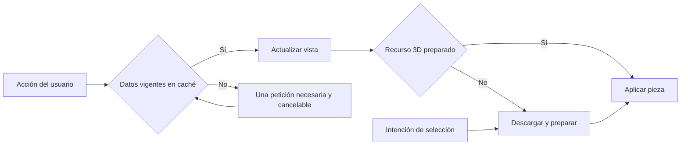

# Auditoría y corrección de carga de datos · 21/10/2026

Solicitud: validar con varios agentes las consultas de Componentes, Bicicletas, Mis bicicletas y selección/montaje 3D; corregir consultas repetidas, esperas y transferencia innecesaria sin cambiar el alcance funcional. Forma parte de las fases de consultas, catálogo, montaje y rendimiento de [08](08-fases-y-validacion.md).

## Trabajo y aceptación

1. Auditar SQL real con RLS, índices, cardinalidad y `EXPLAIN ANALYZE`; medir REST y payload. Añadir índices solo cuando el plan y la carga justifiquen su necesidad.
2. Medir recorridos públicos y autenticados antes/después: consultas por búsqueda, apertura/reapertura, filtros, pestañas, detalle y elección de piezas.
3. Reutilizar datos mediante TanStack Query, con claves por identidad para montajes privados e invalidación tras escrituras. Cancelar consultas obsoletas, agrupar fuentes de miniaturas y diferenciar información ligera de tarjetas de información técnica del montaje.
4. Precargar recursos por intención de selección, evitar pasos seriales y reutilizar GLB ya preparado. Conservar el montaje visible hasta que la sustitución esté preparada; no modificar geometría publicada.
5. Validar cache caliente, cambios de cuenta/revocación, guardado y conflicto, modelos anteriores y ausencia de errores/regresiones. Build y pruebas relevantes; registrar resultados y límites sin convertir emulación en aceptación física.



## Evidencia inicial

Revisión independiente de tres áreas: SQL/RLS; catálogo y navegación; selección y recursos 3D. Un cuarto frente revisa montajes privados y miniaturas. Datos actuales: 53 componentes, 606 variantes históricas y 604 recursos.

Planes SQL con RLS real: catálogo completo 4,60 ms, filtro de horquilla 0,239 ms, facetas generales 4,593 ms, familias DH 6,998 ms, variantes de montaje 4,739 ms, lista propia 2,284 ms y detalle 1,391 ms. No se observa evidencia de índices faltantes para esta cardinalidad. No constituye prueba de concurrencia ni catálogo de gran volumen.

Baseline navegador público local contra Supabase Cloud: tarjeta de frenos descarga 26.292 bytes de datos; ficha adicional 11.039 bytes. Detalle de prearmada hace tres consultas consecutivas de aproximadamente 174 + 190 + 277 ms. Volver a Bicicletas repite familias (149 ms). Cada miniatura visible solicita sus piezas por separado antes de descargar la imagen. Archivos de medición temporales en `/tmp/atlas-query-audit/`; herramientas y resultados finales se completan en esta fase.

## Límites

Una primera descarga de red y la preparación de GPU no pueden garantizar respuesta instantánea. La aceptación distingue apertura inicial, reutilización en caché y selección tras precarga; no se declarará 30 fps ni Android físico validados con esta auditoría.

## Resultado implementado y medido

| Recorrido / datos | Antes | Después |
| --- | --- | --- |
| Página general, 24 modelos / 51 variantes | 120.755 B | 36.843 B (−69,5 %) |
| Tarjetas de cuadros | 69.148 B | 21.262 B (−69,3 %) |
| Tarjetas de frenos | 26.292 B | 10.475 B (−60,2 %) |
| Ficha de prearmada desde la galería | 3 consultas consecutivas | 2; versiones conocidas reutilizadas, peticiones independientes en paralelo |
| Fuentes de miniaturas | Una lectura por tarjeta | Un lote por página; subconjuntos ya obtenidos sin otra lectura |
| Volver a Bicicletas con datos vigentes | Repetía familias | 0 consultas adicionales en el recorrido medido |
| Aplicar una pieza después de precarga por intención | La descarga se iniciaba al aplicar | 0 consultas y 0 descargas adicionales al aplicar |

Las métricas de bytes comparan el mismo contenido publicado mediante las dos proyecciones reales, sin compresión HTTP. La proyección ligera mantiene imágenes, marcas, medidas y atributos de tarjetas; ficha/selector conservan la información completa. Las duraciones de observación del script público incluyen esperas deliberadas para registrar solicitudes; no son tiempos de primera imagen ni una comparación de velocidad de producción.

Cambios funcionales:

- Búsquedas de catálogo/bicicletas con 300 ms y piezas con 250 ms; escribir varias teclas rápidas genera una petición. Categoría, búsqueda y página cambian juntas, sin solicitar combinaciones transitorias de filtros.
- Caché pública de cinco minutos y propia de 30 segundos, con invalidación tras escrituras. Montajes privados por identidad; Auth cancela y limpia al cambiar cuenta o revocar permisos. Variantes/fuentes solo solicitan IDs faltantes, comparten lotes y no cancelan un consumidor activo al abortar otro.
- Apertura del renderer en paralelo con datos. Precarga GLB solo por hover sostenido (120 ms), foco o pulsación; respeta ahorro de datos. Cuadro y pieza pendiente se preparan en paralelo. Se conserva la escena hasta tener el reemplazo listo.
- Guardado actualiza la instantánea confirmada en caché y no espera el refresco de listas. Renombrar no vuelve a descargar todas las piezas. Eliminar invalida todas las páginas, elimina detalles/miniaturas en caché y vuelve a la página válida si se vacía la última.
- La miniatura de prearmada se identifica también por su configuración visual: editar piezas/colores cambia la clave; renombrar no exige otra imagen. La cola de captura libera el lienzo antes de continuar con el siguiente.

## Validación final

- `pnpm run test`: **78 pruebas de 25 archivos correctas**. Incluye lotes/deduplicación, invalidación, caché privada, aborto compartido, cambio de cuenta, cambio de fuente visual y borrado de la última página.
- `tests/browser/data-loading.spec.ts`: **4 correctas**, dos en escritorio y dos Pixel 7 emulado. Búsqueda rápida: una petición; selector de versión, reapertura de ficha, vuelta a pestaña y filtro de subconjunto: cero lecturas adicionales donde los datos están vigentes.
- `scripts/validate-configurator-performance.mjs desktop` y `mobile`: **6 correctas**. Cuenta real temporal de tipo user, piezas GLB actuales, guardado de un cuadro incompleto, imagen WebP de 640 px y reapertura de composición de 23 posiciones. Tras la captura: detalle, pestaña y editor guardado sin relecturas; prearmada caliente sin releer fuentes ni descargar modelos.
- Selección tras precarga, muestra de escritorio: **68 ms** hasta estado aplicado, **194 ms** hasta primer dibujo; Pixel 7 emulado: **70/186 ms**. Chromium SwiftShader, sin red limitada ni prueba de Android físico. La marca de primer dibujo no certifica la imagen final completa ni todos los componentes en todos los dispositivos. No se compara contra una muestra de clic anterior inexistente.
- Suites existentes `catalog.spec.ts`, `discovery.spec.ts`, `public.spec.ts`: **14 correctas** en escritorio, incluyendo modelos históricos, tallas, filtros, navegación y entradas públicas/privadas.
- `scripts/validate-supabase.mjs`: **30 comprobaciones correctas** de Auth/IAM, aislamiento, revisiones, escritura atómica, revocación y cuentas bloqueadas; cuentas temporales eliminadas.
- Build correcto. Ocho planes SQL representativos y seis lecturas REST correctas mediante `scripts/audit-query-performance.mjs`. Sin cambios de índices, RLS ni geometría por esta optimización.

El arranque concurrente de pruebas detectó colisiones de artefactos y cierre del servidor compartido (un caso `ERR_CONNECTION_REFUSED`); no se contabilizaron como aceptación. Se aislaron salidas en `/tmp/atlas-query-audit/` y se añadió puerto configurable; los dos perfiles del configurador se volvieron a ejecutar con servidor propio en 4182 y pasaron. El runner limpia las imágenes de sus identidades temporales y después las cuentas.

Herramientas reproducibles (Node/pnpm fijados del repositorio):

```sh
node scripts/audit-query-performance.mjs
node scripts/measure-data-loading.mjs --label=current
pnpm exec playwright test tests/browser/data-loading.spec.ts
node scripts/validate-configurator-performance.mjs desktop
node scripts/validate-configurator-performance.mjs mobile
```

El medidor público usa el frontend existente en 5174; admite `ATLAS_BASE_URL`. Los reportes son de trabajo y se generan fuera del repositorio. No se han creado commits ni hecho push. Siguen abiertos el rendimiento sostenido en hardware, la escena DH fría bajo red limitada y el parecido por modelo ya documentados en 12c; esta entrega no los declara resueltos.

## Segunda auditoría integral · 21/10/2026 · En ejecución

Solicitud de ampliar la optimización a todas las vistas y contrastar propuestas entre agentes. Dentro de las mismas fases de 08: catálogo/navegación, configurador/miniaturas, SQL/Auth/administración; revisión cruzada de caché, historial, autorización y cancelación. Se añaden comparación y renombre de montajes al recorrido de aceptación.

Aceptación: medir transferencia y peticiones evitadas, conservar referencias históricas y revisiones, comprobar rechazo de lecturas administrativas sin permiso y mantener aislamiento entre identidades; validar guardado/reapertura y montaje sin nuevas descargas en caliente. No añadir índices sin evidencia ni alterar geometrías publicadas. Resultados se registran a continuación una vez comprobados.

### Cambios contrastados e integrados

Tres agentes con revisión cruzada de catálogo, escena y datos; integración adicional de comparación y renombre. Se conservaron las geometrías y las identidades publicadas, las lecturas históricas y el aislamiento por cuenta.

| Caso medido | Antes | Ahora |
| --- | --- | --- |
| Ficha SUPREME DH V5 | 39.896 B, diez variantes | 8.548 B, dos actuales (−78,6 %); histórica solo si se pide |
| Ficha FOX 40 | 29.710 B | 7.043 B (−76,3 %) |
| Ficha freno del recorrido público | 11.039 B | 2.358 B (−78,6 %) |
| Marcas al abrir administración de prearmadas | 376.240 B, historial de 24 modelos | 1.983 B, mismas marcas y cero componentes (−99,47 %) |
| Listado de usuarios, tres muestras por vía | Edge: 442/411/449 ms, mediana 442 | RPC autorizada: 147/147/128 ms, mediana 147 (−66,7 % muestral) |
| Detalle de prearmada contraído | Información técnica montada aunque cerrada | 65 nodos iniciales; 1.205 al desplegar las 23 piezas |

Los bytes comparan JSON real sin compresión; no son porcentajes de mejora global. Las duraciones de RPC incluyen transporte; tres muestras no son una prueba de carga. V10 sin historial no reduce su ficha (7.476 B), evitando atribuir ahorro donde no lo hay. El recorrido público completo mantiene dos consultas de detalle de prearmada y cero consultas al volver a las pestañas calientes: la optimización de esa vista reduce trabajo DOM, sin afirmar que se haya reducido ese payload.

- La ficha consulta variantes actuales; una captura histórica explícita se lee por ID, incluso sin elecciones actuales. No sembrar una ficha parcial como si incluyera todo el catálogo. Un ID ajeno al componente no se muestra.
- Los lotes de variantes comparten las intersecciones de solicitudes simultáneas. Un consumidor que se cancela no aborta otro; cancelar la identidad impide repoblar la caché.
- Comparación usa las variantes completas ya resueltas por las fichas, con la misma vigencia pública, evitando volver a leer piezas conocidas.
- Administración aplica búsqueda agrupada de 300 ms, cambio atómico de búsqueda/página, cancelación y vigencia privada de 30 segundos. La matriz guardada reutiliza la respuesta confirmada e invalida roles otorgables/usuarios. Las invalidaciones independientes de catálogo/prearmadas se ejecutan en paralelo.
- Listar usuarios llama a la RPC existente `admin_list_users`, con permiso `users.read` en servidor; invitación/asignación siguen en Edge. Contrato actualizado en 04b. No se exponen tablas Auth, secretos o metadata completa. No hay migraciones ni índices nuevos.
- Auth comparte únicamente verificaciones concurrentes de foco/acceso denegado, sin introducir un TTL de permisos: un foco posterior vuelve a validar.
- Escena memoizada, montaje calculado una vez y transformaciones una vez por pieza (antes tres). La pintura actualiza materiales propios sin clonar otra vez el árbol ni disponer recursos compartidos. Prueba React con diez cambios de estado ajenos: cero nuevos renders de Canvas, cálculos de montaje o clones; cambiar nombre/selección tampoco recalcula montaje ni clona GLB.
- Microbenchmark CPU Chromium con GLB publicado TUES: cien cambios de color, 13,8 ms con clonado frente a 0,2 ms repintando materiales propios. No mide GPU, fluidez sostenida ni FPS.
- Renombrar en Mis bicicletas reutiliza el blob de la revisión anterior de la misma cuenta cuando está en caché; solo cambia el nombre, y la miniatura nueva conserva comprobaciones de cuenta/revisión antes de publicación. Sin blob previo se conserva la captura habitual.

### Comprobaciones de integración

Build correcto y 117 pruebas unitarias correctas en 34 archivos. Una ejecución concurrente con varias suites WebGL agotó los 5 segundos de una prueba previa que reconstruye 128 capturas v4; al repetir la suite completa pasó sin modificar sus límites. Un primer ensayo del nuevo test de escena falló por simular un Group con un nodo DOM: se corrigió el doble de prueba y se volvió a comprobar. Ninguno de esos ensayos fallidos cuenta como aceptación.

Escritorio: 13 recorridos de catálogo, descubrimiento, historial, comparación y carga correctos; tres de selección directa/sombras correctos; tres autenticados de configurador, montajes y prearmadas correctos. Pixel 7 emulado: tres recorridos autenticados correctos. En selección preparada: cero consultas/descargas nuevas al aplicar; escritorio 60 ms aplicado/206 ms primer dibujo y móvil emulado 159/293 ms en esta muestra. No son comparación controlada de velocidad con la muestra anterior, ni prueban imagen final completa. Guardado y reapertura mantienen sus referencias y reutilizan datos/modelos en caliente.

Fuentes reproducibles: `measure-data-loading.mjs --label=massive-before|massive-after`, `audit-query-performance.mjs`, suites de `catalog`, `discovery`, `data-loading`, `visual-selection`, runner `validate-configurator-performance.mjs desktop|mobile` y pruebas unitarias añadidas. Informes de trabajo en `/tmp/atlas-query-audit/massive-*.json`; cifras relevantes conservadas en este documento. La primera carga y los límites físicos de Android/30 fps/red DH documentados anteriormente siguen abiertos; esta entrega no los declara resueltos. Sin commits ni push.

Cierre adicional de integración: 12 recorridos públicos móviles correctos (se omite solo ancho de escritorio), dos administrativos de rendimiento escritorio/móvil correctos y recorrido administrativo funcional de creación/edición de roles y borradores correcto. Total de integración de esta ronda: **37 casos de navegador correctos** por perfil, sin contar las repeticiones de revisión independientes. La administración emite una lectura por búsqueda, cero lecturas adicionales Roles→Permisos y cero listados Edge; runner reproducible `scripts/validate-admin-performance.mjs desktop|mobile`. `scripts/test-authenticated.mjs desktop 'administrator manages'` comprueba los guardados reales y limpia fixtures.

**37 comprobaciones Cloud correctas**, incluida equivalencia RPC/Edge, rechazo anónimo/user/sesión revocada y cuentas bloqueadas. Cuentas temporales y fixtures eliminados. Planes actuales de SQL con RLS: catálogo 4,916 ms, filtro horquilla 0,294 ms, facetas 5,167/1,820 ms, familias 6,115 ms, variantes 0,839 ms, lista propia 5,408 ms y detalle 1,376 ms; sin evidencia de índices nuevos necesarios para esta cardinalidad. No representa carga concurrente de producción.

El primer ensayo UI administrativo usó una búsqueda por marca donde la operación filtra nombre de modelo; se corrigió el dato de prueba y se repitió escritorio/móvil. Resultado final: build, 117 pruebas unitarias, 37 casos de navegador y 37 comprobaciones Cloud correctos. `git diff --check` correcto; `.env`/`.env.local` ignorados y solo plantilla de entorno rastreada. Frontend local 5174 responde HTTP 200.
