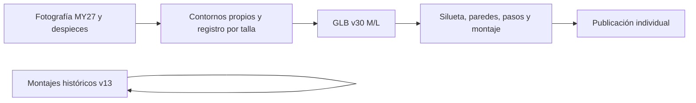

# 12x · Santa Cruz V10.8 CC · MY27 · v30

Revisión individual M/L autorizada, desde v13, preservando otras28capturas/guardados históricos/fotos/prearmadas. Investigar fotos propias MY27 y despiecesV10.8 oficiales; trazar frente con ventana secundaria, arco de amortiguador, triángulo trasero y dos enlacesVPP. No copiar siluetaTUES ni de otra generación.

Plan: fuentes y trazado específico → construcción offline → contornos independientes/rayosFrontSide/pasos completos → multivista/acercamientos y montaje → pruebas/tipos/build → carga/relecturaSHA/publicación/transición/auditoría. Conservar especificaciones y anclajes geométricos oficiales de dirección/ruedas; corregir solo referencias visuales de sillín/suspensión justificadas por fotografía, contrato exacto porID. Registro fotográfico de tres puntos es estimación de perspectiva, no CAD ni100%metrológico. Sin commits.

## Resultado implementado

Publicado v30 únicamente para las dos elecciones M/L del V10.8 CC MY27, sucesoras de v13. Se conservaron fotos comerciales, 28 capturas vigentes de los otros cuadros, recursos históricos y prearmadas. Fuente, registro, observación/inferencia y reproducción en [models/catalog-v30](../../models/catalog-v30/README.md).

Foto oficial del cuadro desnudo 3200×2400, cuatro detalles oficiales compartidos por la página MY27 y cuatro despieces realmente inspeccionados. Nombres MY25/MY26 se conservan en las fuentes; no se presentan como fotos nuevas MY27. No se afirma vídeo muestreado en esta revisión. Trazado normalizado a 1600×1200; la foto oblicua se rectifica afín a BB/dirección/eje trasero oficiales de cada talla. No es CAD ni registro por similitud sin cizalla.

Frente propio con ventana secundaria bajo tubo superior y arco alrededor del amortiguador; basculante de triángulo cerrado por ambos lados, placas VPP y herrajes reconstruidos. Protecciones, freno y patilla conservan asimetría lógica. Volúmenes ocultos/profundidades y puntos tapados siguen siendo inferencias. Se actualizaron cinco anclajes visuales estimados (tija, sillín, ambos ojos y pivote inferior) con contrato completo antes/después; dirección/ruedas/medidas/acabados permanecen iguales. Distancia comercial del amortiguador250 mm.

## Evidencia

- [52 muestras independientes por talla](../../models/catalog-v30/contour-review.json), interiores y exteriores: cero fallos nuevos; v13 fallaba14 por talla al compararse con este registro actual. Dos etiquetas preliminares se corrigieron por opacidad de la foto antes de comparar geometría. No equivale a100 % de parecido.
- [96 rayos FrontSide/DoubleSide](../../models/catalog-v30/sides-review.json) desde ambas caras y ángulos oblicuos: cero paredes próximas descartadas; opacidad/depthWrite correctos. Sin DoubleSide global para ocultar orientación. La geometría anterior se rediseña, por lo que no se exige igualdad de superficies v13/v30.
- [22 rayos axiales](../../models/catalog-v30/bore-review.json) y [50 completos del pedalier](../../models/catalog-v30/passage-review.json): cero obstrucciones en las muestras; eje de tija/sillín alineado. No certifica tolerancias mecánicas ni toda la inserción de tija.
- [Exportaciones](../../models/catalog-v30/inspection.json): dos GLB, cinco mallas por talla, geometrías finitas, nodos pintables y marcadores coherentes. Total3.545.684 bytes, cargados y releídos por SHA.
- [Preservación](../../models/catalog-v30/preservation.json):28 capturas ajenas y ambos GLB históricos v13 intactos por SHA. El exterior completo del V10 se reconstruyó; no se afirma preservación local de caras dentro de ese modelo.
- 14 vistas generales M/L, diez acercamientos de dirección, dos overlays y tres poses de conjunto sin errores del visor. [Vistas](../../models/catalog-v30/evidence/views.jpg), [overlay M](../../models/catalog-v30/evidence/overlay-m.jpg), [montaje](../../models/catalog-v30/evidence/motion.jpg). El overlay utiliza BB/eje trasero/dirección, los mismos landmarks del constructor; no utiliza el antiguo anclaje de sillín.
- Perfil de movimiento específico por identidad de recurso, VPP estimado, inferior en enlace de entrada y superior fijo; intervalo visual0,12rad. Pruebas verifican elevación de rueda y compresión del amortiguador. Tres poses no certifican recorrido completo208mm, colisiones exhaustivas o palancas exactas. Versiones anteriores conservan su perfil.
- 367 pruebas/69 archivos correctos con dos workers, tipos offline y compilación correctos. Una ejecución inicial simultánea con build/revisiones agotó el timeout de5s de una prueba histórica Endurov23; repetición completa con concurrencia limitada pasó sin cambiar test/timeout. Avisos habituales de tamaño de bundle y anotaciones de dependencia no impiden build.
- [Transición Cloud](../../models/catalog-v30/transition.json): dos guardados v13 conservados, dos nuevos v30 correctos y cuenta temporal eliminada. Publicación SQL propia y fuentes locales antes de aplicar. Auditoría posterior de lectura en [cloud-after.json](../../models/catalog-v30/cloud-after.json); no migraciones/Auth/IAM/Edge nuevos.

Estado tras publicar:70 modelos,146 elecciones,782 variantes/780 recursos históricos, cuatro prearmadas/92 posiciones,22 migraciones/doce tablas propias. La selección actual usa v30, mientras montajes privados previos mantienen su identidad; reelección del cuadro incorpora esta revisión. No hay aceptación CAD/100 %, Android físico/FPS o cierre integral del producto. Sin commits.
