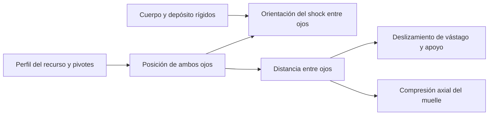

# 12y · Suspensión trasera de todos los cuadros y shocks actuales

Solicitud: revisar que los cuadros sigan ejes de articulación y que todos los amortiguadores telescopen y compriman el muelle; evitar desplazar el shock como un bloque. Contrato/plan en [05c](05c-movimiento-suspension.md), fuentes y reproducción en [motion-v2](../../models/motion-v2/README.md).

## Implementación

Perfiles actuales registrados por recurso (quince modelos/30 tallas) y cuatro identidades v11 utilizadas por prearmadas anteriores. Seis modelos llegaban a extender el amortiguador en vez de acortarlo. Se corrigieron asignaciones de ojos/ejes/registros y se limita la trayectoria antes de una inversión, con compresión monótona y cierre de articulaciones. No modificar bytes GLB ni convertir montajes privados.

Vivid clasificaba cuerpo y depósito como resortes; la identificación helicoidal corrige esa deformación. Los38 shocks publicados de cuatro familias separan vástago/apoyo móvil y carcasa/depósito rígido. Coil comprime su longitud real con diámetro conservado y apoyo superior estable; aire desliza sus piezas sin crear muelle. Las geometrías/materiales compartidos permanecen intactos.

La inspección cercana detectó que una primera corrección del META acortaba el shock pero separaba su clevis: se corrigió el enlace que lo transporta y los ejes inferiores, no se aceptó solo la ecuación de compresión. [Comparación](../../models/motion-v2/evidence/meta-capra.jpg).

## Comprobación

- [Auditoría inicial](../../models/motion-v2/audit-before.json) y [final](../../models/motion-v2/audit-after.json):72 GLB (30 cuadros actuales,4 anteriores de prearmadas y38 shocks publicados),41 posturas por recurso, sin incidencias registradas en trayectoria/compresión axial. No incluir doce borradores como catálogo publicado.
- 107 pruebas específicas:34 cuadros×38 shocks×100 posturas, cierre matemático de pivotes, compresión/elevación monótonas, carrera máxima, lectura de los72 binarios, clasificación de una hélice por coil y ninguna en aire, apoyo superior/diámetro e identidades intactas. Esto no confirma compatibilidad física de todas las combinaciones visuales.
- 45 capturas de los quince conjuntos en reposo/medio/máximo, con recaptura del META después de la revisión cercana. [Informe](../../models/motion-v2/browser-review.json) y [vistas](../../models/motion-v2/evidence/frames-compressed.jpg).
- Reproducción/pausa, selección sin compresión inmediata, restauración, movimiento reducido, nueve familias de horquilla/cuatro de shock y resorte comprobados en escritorio y Pixel7 emulado. Guardado y reapertura con postura neutral comprobados con cuenta temporal eliminada por el runner. No se persiste la postura temporal.

Resultado final: **474 pruebas en70 archivos y build correctos**; doce comprobaciones de navegador sumando diez de interacción/familias y dos de guardado/reapertura después de corregir las prearmadas. [Resumen reproducible](../../models/motion-v2/validation.json). Aviso habitual de bundle grande, sin fallo de compilación.

## Prearmadas: corrección necesaria para la integración

La primera prueba de guardado no pudo iniciar ninguna composición: sus cuatro cuadros v11 ya estaban retirados. Se preparó fuente/SQL local y se aplicaron exactamente cuatro referencias de cuadro hacia META v21/SUPREME v25, mismos componente/talla/especificaciones/acabados. Otras88 posiciones y montajes privados iguales antes/después. [Operación y evidencia](../../models/motion-v2/preset-publication.json); fuente aditiva `supabase/catalog/motion-v2-examples.json`. Después pasó el guardado/reapertura en escritorio y móvil emulado. No relajar las restricciones de piezas retiradas ni reescribir privados para solucionar este caso.

El catálogo mantiene70 modelos/146 elecciones/782 variantes/780 recursos históricos, cuatro prearmadas/92 posiciones,22 migraciones/doce tablas propias; no cambio de Auth/IAM/Edge. Reponer la operación acotada después de v30 al restaurar fuentes históricas.

## Límites

Guías exteriores estimadas, incluidas reducciones de seis barras y puntos ocultos. Algunos intervalos son muy conservadores: el porcentaje no equivale al recorrido completo anunciado. Cierre de cuatro cuerpos no prueba continuidad de cada superficie ni ausencia exhaustiva de interferencias; no certifica CAD, curvas de fabricante, sag/cargas o ajuste mecánico. Chromium con SwiftShader/Pixel7 sigue siendo emulación, sin aceptación de Android físico/Brave real/FPS. Sin commits.
