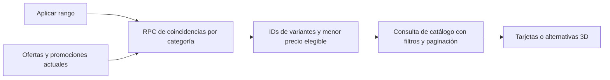

# 13j · Precio por componente y categoría

El usuario autorizó implementar un filtro individual de precio en Componentes y en el selector de piezas del configurador. No es un presupuesto acumulado del montaje. Se conservan selección visual libre, carrito, cotización y precios aceptados.

```text
Componentes / categoría seleccionada
[Marca ▾] [Disciplina ▾] [Precio: Todos       ▾]
                            ┌─────────────────────────────┐
                            │ Desde S/       Hasta S/     │
                            │ [           ]  [          ] │
                            │ Limpiar           Aplicar   │
                            └─────────────────────────────┘

Activo: [Hasta S/ 2.500       × ▾]

Configurador · Horquilla
[Buscar alternativa…                         ]
Precio
[Hasta S/ 2.500                             × ▾]
[Modelo / variante elegible      S/ 2.200       ]
```

## Contrato

- Importes en soles, hasta dos decimales; mínimo/máximo opcionales, límites inclusivos. Cero es un importe explícito; un campo vacío no significa cero. No aceptar negativos, exponentes, valores no finitos o un mínimo mayor al máximo.
- Precio comercial vigente de una oferta activa, con la promoción aplicable más favorable sin acumular. No usar `price_reference`, stock o totales de montaje como precio del filtro. Artículos agotados pueden seguir apareciendo: este es un filtro de precio, no de disponibilidad.
- Un modelo aparece si alguna variante actual tiene una oferta elegible. La tarjeta y la ficha conservan las variantes elegibles; los importes de tarjeta respetan rango y variantes filtradas. La ficha conserva solo ofertas dentro del rango. Sin precio, no hay coincidencia; nunca interpretar ausencia como cero.
- La comparación corresponde a la unidad de venta del artículo (unidad, par o juego), no a una conversión silenciosa. La tarjeta indica la unidad junto al precio y el control lo explica al abrirse.
- Se aplica antes de paginar, junto con marca, disciplina, búsqueda y especificaciones. Recuentos y paginación pertenecen al conjunto filtrado.
- En catálogo el rango se conserva en `price_min`/`price_max` de URL; aplicar o limpiar vuelve a la primera página. Cambiar categoría borra el rango. En el configurador es estado transitorio por categoría: cambiar de categoría lo limpia; no se guarda como parte del montaje ni modifica una pieza ya montada.
- Control compartido, desplegable compacto, etiqueta del rango con acción de borrado, cierre exterior/Escape y foco recuperado. Teclado y móvil conservan los mismos campos; no crear otro modal ni un formulario permanente de presupuesto.

## Implementación



Migración043 añade exclusivamente `catalog_price_matches(text,bigint,bigint)` con lectura pública autorizada a anon/authenticated, `search_path` vacío y filtros explícitos de publicación/selección. Reutiliza `_sales_discount` y los índices existentes de ofertas/vínculos/promociones. No crea tablas, índices redundantes ni modifica catálogo, recursos GLB, stock o pedidos.

Sin rango se conserva la consulta anterior y no se ejecuta la RPC de precio. Con rango, una lectura acotada por categoría se comparte durante30s entre páginas, búsqueda y proyecciones de tarjetas/completas. La consulta del catálogo recibe los IDs antes de paginar. Si no hay coincidencias, devuelve vacío sin pedir una página de catálogo. El editor obtiene los importes del mismo resultado; no descarga GLB ni consulta precios por cada opción. Las tarjetas mantienen su lote compartido de ofertas y la ficha reutiliza la coincidencia cacheada. Guardar una oferta/promoción invalida tanto los precios como los resultados filtrados. La compra vuelve a validar importes en servidor; el filtro no fija un precio contractual.

No se presenta como actualización en tiempo real entre dispositivos: las lecturas se consideran frescas durante30s. El conjunto de IDs es adecuado al inventario actual; antes de crecer a miles de variantes por consulta, revisar el tamaño de la petición PostgREST y trasladar esa intersección a una consulta paginada de servidor si corresponde.

## Validación

- SQL transaccional en `supabase/tests/catalog-price-filter.sql`: lectura anónima, límites inclusivos/abiertos, categoría, promoción vigente más favorable, caducadas/futuras/inactivas, paridad con `sales_offers`, stock cero, oferta inactiva, variante retirada y rechazo de rangos inválidos. Fixtures con rollback; no cambiar versiones publicadas a borrador para probar filtros.
- Pruebas de reglas/control/API: decimales, URL, rangos inválidos, aplicación explícita, Escape, vacío real y reutilización de coincidencias entre páginas/proyecciones.
- Suite general bajo Node24.22.0:571 pruebas correctas, dos omitidas,84 archivos correctos y uno omitido. La primera ejecución con Node26 del terminal falló en cuatro pruebas preexistentes por `localStorage`; no se cambió código de aplicación para compensar una versión fuera de contrato.
- `scripts/validate-price-filter-browser.mjs`: recorridos de catálogo/ficha/editor en escritorio y Pixel7 emulado, límites de viewport y solicitudes. Resultados/capturas en `models/local/validation/price-filter/`, ignorado. El script utiliza una cuenta efímera, no guarda montajes ni crea pedidos; limpia su carrito y cuenta al terminar.

Recorridos de navegador completados en escritorio1440×1000 y Pixel7 emulado: filtro de horquillas hasta S/2.500 produce cuatro modelos/ocho variantes; ficha dentro del rango, entrada inválida sin consultas, rango vacío, limpieza, cambio de categoría, alternativas3D, Escape y límites de viewport correctos. Tres consultas de coincidencias por recorrido (rangos/contextos distintos), sin peticiones GLB durante la comprobación y sin errores JavaScript. Cuenta/carrito temporales eliminados. La prueba de API verifica además la reutilización entre páginas/proyecciones. El precalentamiento por interacción con una opción del editor conserva su comportamiento anterior. Se corrigió una carrera del evento nativo `toggle` que podía restablecer una entrada rápida; prueba dirigida y recorrido repetido correctos. La composición restablece los estilos genéricos de `details` para alinear el control con los selectores existentes.

Una medición `EXPLAIN ANALYZE` de la RPC sobre ese rango devolvió ocho variantes en3,865ms de ejecución de base de datos; no incluye transporte ni render y no se presenta como garantía de latencia. Consulta de estado confirmó24 tablas,43 migraciones,146 ofertas y695 vínculos. Build final correcto, con avisos preexistentes de tamaño de chunks y anotaciones de dependencias, sin errores de tipos/compilación.

La migración está aplicada en Supabase Cloud:43 migraciones y24 tablas propias. El frontend se prueba localmente, sin despliegue Netlify, cobros, certificación de móvil físico ni commits autorizados por esta implementación. La aceptación visual final corresponde al usuario.

## Comiteo posterior solicitado

El usuario pidió comitear los cambios por partes después de validar la implementación: `e8eeb99` backend y prueba SQL, `962b8b2` interfaz/consultas/caché y `3407ca9` pruebas de reglas/control/API/navegador. Documentación y contexto en cuarto commit. Sintaxis del runner y diff sin errores comprobados; no se repiten escrituras Cloud para comitear. Sin push ni despliegue remoto. Los commits futuros requieren una nueva petición explícita.
