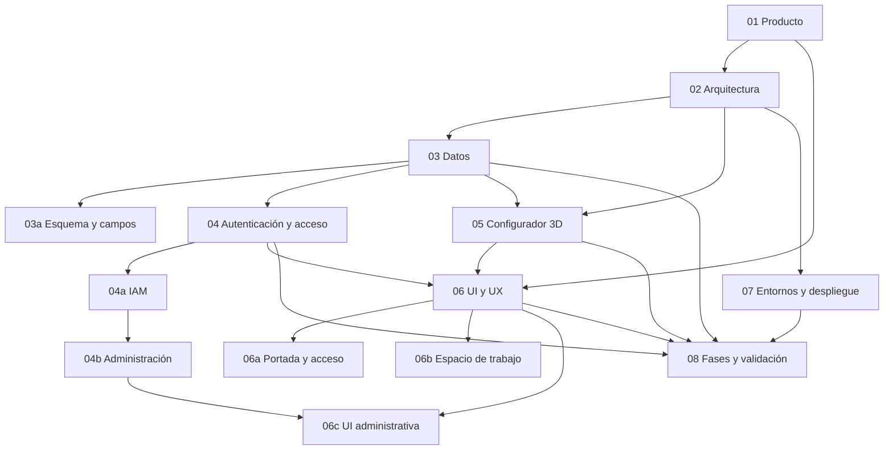

# Atlas MTB: plan de construcción

Estado: planificación de la nueva aplicación. Fecha de referencia: 18 de octubre de 2026.

Por indicación expresa del usuario, esta etapa es únicamente de planificación. Las decisiones aprobadas se documentan aquí; código, recursos, configuración y servicios se trabajarán cuando se indique iniciar implementación. La creación del nuevo logotipo también pertenece a esa etapa futura.

Contexto operativo vigente: proyecto Supabase Cloud creado, credenciales disponibles en `.env` de la raíz y conexiones de lectura validadas. Frontend local y backend/base directamente en Cloud; no stack local de Supabase. El usuario declara que no hay producción ni usuarios reales. Estado y límites de las comprobaciones en [07](07-entornos-y-despliegue.md); fuentes futuras del backend y procedimiento en [supabase/README.md](../../supabase/README.md). Esto no inicia la implementación.

Esta carpeta define en conjunto el producto, su arquitectura y el orden de implementación. La aplicación actual es una referencia de contenido y comportamiento; sus pantallas, estilos y estructura pueden sustituirse. Crear estos planes no significa que Supabase, el inicio de sesión o el visor 3D ya estén implementados. El ciclo de documentación se rige por [docs/README.md](../README.md).

## Leer por capas

| Documento | Pregunta que resuelve |
| --- | --- |
| [01 · Producto y alcance](01-producto-y-alcance.md) | Qué construimos, para quién y con qué nivel de fidelidad |
| [02 · Arquitectura y frontend](02-arquitectura-y-frontend.md) | Cómo se relacionan React, el visor, Supabase y Netlify |
| [03 · Datos y operaciones](03-datos-y-operaciones.md) | Ingesta, composiciones, guardado, archivo, consultas e índices |
| [03a · Esquema y campos](03a-esquema-y-campos.md) | Árbol de ocho tablas de negocio, tipos, relaciones y estructuras JSONB |
| [04 · Autenticación y acceso](04-autenticacion-y-acceso.md) | Registro, acceso común, confirmación, invitación y recuperación |
| [04a · IAM](04a-iam-roles-y-permisos.md) | Cuatro tablas de autorización, roles configurables, permisos y restricciones |
| [04b · Administración](04b-administracion-y-operaciones.md) | Primer administrador, usuarios, roles y edición/publicación del negocio |
| [05 · Configurador 3D](05-configurador-3d.md) | Modelos, geometría por código, ensamblaje y rendimiento |
| [06 · UI y UX](06-ui-y-ux.md) | Principios de contenido, dirección visual, marca, movimiento y accesibilidad |
| [06a · Portada y acceso](06a-portada-y-acceso.md) | Composición de portada, entrada, registro y confirmación de correo |
| [06b · Espacio de trabajo](06b-espacio-de-trabajo.md) | Pestañas, galerías, tarjetas, paneles, configurador y Mis bicicletas |
| [06c · UI administrativa](06c-administracion-usuarios-roles-y-permisos.md) | Tablas de usuarios/roles, paneles derechos y matriz de permisos por rol |
| [07 · Entornos y despliegue](07-entornos-y-despliegue.md) | Variables, Git, Supabase y publicación del frontend |
| [08 · Fases y validación](08-fases-y-validacion.md) | Qué construir primero y cómo comprobar cada entrega |
| [09 · Revisión adversarial de datos](09-revision-adversarial-de-datos.md) | Revisión histórica de ocho tablas de negocio |
| [10 · Auditoría integral](10-auditoria-integral-de-planes.md) | Revisión adversarial de todo el plan, incluyendo IAM; correcciones y pendientes |
| [11 · Inventario e ingesta documental](11-propuesta-de-inventario.md) | Índice de 11a–11m: gama actual por categoría, modelos, campos y validaciones; datos concretos por completar |

## Decisiones compartidas

- Marca aprobada: **ATLAS MTB**. Eslogan: **Cada pieza define tu camino**. Logotipo vectorial profesional, elegante y legible; la propuesta gráfica está sujeta a revisión visual.
- Producto web que une catálogo técnico, comparación y montaje visual de bicicletas MTB, con foco inicial en enduro y descenso.
- Público confirmado: ciclistas y talleres/tiendas, con prioridad inicial en los ciclistas. Las vías comerciales futuras son hipótesis del documento 01; no incorporan membresías, pagos ni un sistema de empresa al alcance actual.
- Administración aprobada: pestañas Usuarios, Roles y Permisos; tablas sencillas y panel derecho para crear/ver/editar. Matriz de roles en horizontal y permisos agrupados por área en vertical, con guardado explícito y roles de sistema en lectura.
- Espacio de trabajo aprobado con pestañas Bicicletas, Componentes y Mis bicicletas, sin recarga y con contexto conservado. Fichas completas en panel derecho —inferior ampliable en móvil— y detalle del configurador dentro de su panel existente.
- Inicio desde cuadro o desde bicicleta prearmada de referencia aprobado; montajes de fábrica documentados y ejemplos ATLAS distinguidos. Su inventario exacto y variantes se completan según la cobertura ampliada de 11.
- Portada breve como gancho visual para iniciar sesión; detalle y herramientas en sus vistas. Catálogo acotado de modelos comerciales reales, con variantes útiles y acabados sin duplicar tarjetas; precios orientativos con moneda, mercado, fuente y fecha, sin sincronización en tiempo real.
- Entrega full scope del alcance acordado: todas sus funciones y campos operativos; las fases no reducen la entrega a un MVP.
- Frontend con React, TypeScript y Vite; 3D con Three.js, React Three Fiber y Drei.
- Arquitectura aprobada: módulos por funcionalidad con independencia de las reglas de montaje tomada de Clean Architecture, sin capas adicionales por obligación.
- Código tipado, responsabilidades separadas, SOLID aplicado con criterio y reutilización de controles y reglas que compartan comportamiento real.
- Lenguaje de interfaz directo y coherente, sin títulos redundantes ni identificadores técnicos del software expuestos al usuario; resultados internos traducidos a mensajes útiles. Voz de producto MTB, sin comentarios de asistente, narración de la pantalla o instrucciones de relleno.
- Referencia visual UI/UX aprobada: COMMENCAL, con limpieza, contraste, bicicleta protagonista y carácter deportivo; contenido propio. Movimiento puntual y funcional, con alternativa estática y movimiento reducido; composición y recursos finales pendientes de revisión.
- Base objetivo de doce tablas propias: ocho de negocio y cuatro de IAM (roles, permisos, permisos por rol y asignación de usuarios); JSONB con contratos por categoría, índices según consultas y TanStack Query para datos remotos. La revisión adversarial del documento 09 condiciona los contratos antes de implementar; no certifica rendimiento ni cobertura de todos los SKU.
- Frontend local durante desarrollo; Netlify lo publicará cuando corresponda. Supabase Cloud ya creado gestiona PostgreSQL, Auth, Storage, RPC y Edge Functions. No se levanta una base/stack local ni un segundo proyecto por obligación. Credenciales en `.env`, sin valores en documentos o Git.
- SQL/migraciones y Edge Functions deben quedar versionados en `supabase/` antes de aplicarse al proyecto Cloud; la estructura y el historial siguen su README. Cuando se autorice implementar se permiten reconstrucciones necesarias de aplicación en ese entorno de desarrollo, sin repetir aprobaciones rutinarias.
- Fotos de componentes en `src/assets/images/`, publicadas con el frontend. Storage se reserva para GLB importados y sus recursos asociados; la geometría generada por código no necesita archivos 3D almacenados.
- Cobertura confirmada: todas las piezas del catálogo podrán montarse en 3D, con recurso genérico identificado y versionado cuando proceda. Cambio trasero seleccionable con mando asociado, sin selector independiente; cobertura ampliada e ingesta documental por categoría en 11 y 11a–11m. Pedalier seleccionable; plato incluido con bielas.
- Sin workers propios, servidor dedicado, microservicios ni motor de física dentro del alcance acordado.
- Representación exterior reconocible y proporcionada. Se aceptan modelos aproximados; no se promete precisión de fabricación ni compatibilidad mecánica completa.
- Enduro y descenso con cuadros reales aproximados, cobertura de marcas y tallas principales M/L según 11. Horquillas/amortiguadores FOX, RockShox, Öhlins y Marzocchi; frenos Shimano/Magura/SRAM; transmisión Shimano/SRAM y neumáticos de las marcas indicadas. Manillar, potencia y sillín sencillos genéricos identificados. Variantes concretas pendientes de completar con fuente.
- Las combinaciones con incompatibilidades mecánicas se permiten como montaje visual, con avisos; no se ocultan ni bloquean por ese motivo.
- Colores libres en cuadro y piezas habilitadas; el resto mantiene los acabados del catálogo. El color elegido forma parte del montaje guardado.
- Portada, catálogo, fichas y comparación públicos. Crear o editar montajes, consultar sus avisos y guardar exige iniciar sesión; «Mis bicicletas» contiene solo montajes propios. Tener cuenta no implica una membresía de pago.
- Auth nativo y formulario común con correo y contraseña, sin OAuth. Registro público siempre user; user/admin iniciales protegidos y capacidad completa de crear/configurar roles personalizados y asignarlos según permisos. Primer admin por operación controlada del proyecto; administración posterior mediante la web y funciones protegidas de Supabase. Composición de acceso y registro aprobada en el documento 06: imagen estática y formulario en escritorio, formulario sin panel fotográfico en móvil; registro con confirmación de contraseña y estado de confirmación de correo.
- La reconstrucción del prototipo está autorizada. Se sustituye por fases verificables, sin conservar código o diseño por obligación.

## Comunicación y lectura en nuevas sesiones

Seguir AGENTS.md como contexto persistente al abrir Codex. Recomendar diagramas ASCII/Mermaid para lógica y relaciones cuando aporten claridad; para propuestas de UI usar por defecto bocetos ASCII con campos, acciones y adaptación pertinente antes de implementar. Las composiciones aprobadas se conservan en su documento de UI, no como recursos o pantallas ya entregados.

## Cómo mantener estos planes

Los documentos con sufijo `a`, `b` o `c` desglosan una responsabilidad existente, sin nuevas carpetas o procesos. El árbol de tablas vive en 03a, las reglas de datos en 03, identidad en 04, autorización en 04a y administración en 04b, las composiciones de portada/acceso en 06a y las vistas de trabajo en 06b y la UI de usuarios/roles/permisos en 06c. No copiar estos contratos en otros archivos.

El documento 01 define el alcance. Cada decisión técnica vive en su capa; los demás documentos la enlazan. El documento 08 registra avance y criterios de aceptación, sin sustituir los contratos de datos o las reglas de acceso.

El documento 02 registra la arquitectura modular aprobada con independencia de reglas, sus límites y principios de código; conserva la comparación de alternativas como fundamento. El documento 06 define la comunicación de la interfaz: jerarquía sin repeticiones, vocabulario de usuario y conversión de resultados técnicos a mensajes comprensibles.

Una ampliación debe indicar qué necesidad resuelve y qué fase afecta. No añadir infraestructura por anticipación. Los nombres propuestos de tablas, rutas y módulos son contratos de implementación; los identificadores ficticios de los ejemplos no son datos de producción.

Los pendientes de cierre lógico se enumeran en el documento 08: inventario, contratos por categoría y referencias de ensamblaje. La cobertura ya está cerrada: todas las piezas del catálogo se montan en 3D. La conexión Supabase, el dominio de Netlify y el correo son requisitos de integración. Los datos de prueba pueden ayudar a desarrollar; no cumplen la aceptación final de una función que exige datos o integración reales.
