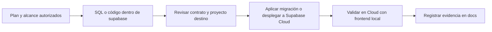

# Supabase Cloud: fuentes y cambios versionados

Relacionado: [planes](../docs/planning/README.md), [entornos y accesos](../docs/planning/07-entornos-y-despliegue.md), [datos](../docs/planning/03-datos-y-operaciones.md) e [IAM](../docs/planning/04a-iam-roles-y-permisos.md).

Estado: implementación autorizada en curso. Migraciones 001–013 aplicadas en Cloud y `admin-users` desplegada. Evidencia y límites en [12](../docs/planning/12-estado-implementacion.md); no declarar completos registro/correos ni catálogo por esta infraestructura.

Herramientas: `node scripts/supabase.mjs push|status|deploy [función]`, con Node de `.node-version` y variables ya configuradas en `.env`. El despliegue usa `--use-api`; no levantar Docker ni Supabase local. Toda corrección posterior a una migración aplicada se escribe en una nueva migración.

`operations/bootstrap-admin.sql` es una operación controlada sobre una identidad confirmada, sin función pública de ascenso. `auth-config.json` y `templates/` contienen configuración de Auth preparada, todavía pendiente por HTTP 403 del token en escritura. `tests/` contiene contratos SQL y preparación/limpieza de pruebas de navegador; no usar sus identidades temporales como administradores reales.

## Entorno acordado

El frontend se ejecuta localmente. PostgreSQL, Auth, Storage y Edge Functions se desarrollan y validan directamente en el proyecto Supabase Cloud ya creado, identificado por las variables locales de la raíz del repositorio.

No se configura un stack local de Supabase, base local, Docker, réplica local o segundo proyecto por obligación. Usar CLI o herramientas de despliegue desde este equipo no significa levantar una base local. El frontend local utiliza el backend cloud.

El usuario confirmó que el proyecto es de desarrollo, sin usuarios reales ni producción desplegada. Cuando se autorice implementar, las reconstrucciones de tablas propias, datos de prueba y funciones del alcance en este proyecto de desarrollo están permitidas. No solicitar confirmación repetida por cambios rutinarios necesarios ya autorizados. La solicitud posterior del usuario autorizó iniciar la implementación del alcance. No confundir esa autorización con eliminar el proyecto, credenciales, esquemas gestionados por Supabase o recursos ajenos al trabajo.

## Estructura objetivo

```text
supabase/
├── README.md
├── config.toml                          Configuración versionada de funciones/herramientas
├── migrations/
│   ├── <timestamp>_create_iam.sql
│   ├── <timestamp>_create_catalog.sql
│   ├── <timestamp>_create_builds.sql
│   └── <timestamp>_policies_and_functions.sql
├── functions/
│   ├── admin-users/
│   │   ├── index.ts                     Punto de entrada de esta función
│   │   └── deno.json                    Dependencias/configuración si las necesita
│   └── _shared/                         Solo lógica realmente compartida
│       └── authorization.ts             Si existe responsabilidad reutilizable
├── seed.sql                             Catálogo/datos de prueba deliberados
└── tests/                               Comprobaciones necesarias sin secretos
    └── <archivo-de-prueba>
```

Los nombres de funciones y migraciones ilustran el orden/responsabilidad; no obligan a crear archivos vacíos o una función por operación. Cada Edge Function real tiene carpeta propia y `index.ts`. Sus módulos auxiliares permanecen dentro de su carpeta salvo reutilización real; no crear `_shared` por anticipación. El nombre de migración usa timestamp único, por ejemplo `YYYYMMDDHHMMSS_descripcion.sql`.

El historial de cambios es Git junto con el historial de migraciones del proyecto, no otra carpeta con copias del mismo SQL. Los originales editables de modelado 3D y sus binarios no son migraciones. Archivos de trabajo de herramientas como `.temp/` no se consideran fuentes versionadas.

## Qué debe quedar en el repositorio

- Tablas, tipos, índices, restricciones, RLS/grants, triggers y funciones SQL/RPC: migraciones ordenadas.
- Roles y permisos base obligatorios de IAM: migración correspondiente, no depender de que alguien ejecute un seed opcional.
- Código completo de cada Edge Function, dependencias necesarias y configuración de autenticación/despliegue sin secretos.
- Seed deliberado de catálogo/datos de prueba, sin cuentas administrativas con contraseñas conocidas.
- Comprobaciones pertinentes y evidencia resumida de aplicación/validación en [fases](../docs/planning/08-fases-y-validacion.md).

No modificar la estructura del proyecto remoto como única copia del trabajo. Primero escribir el archivo local, revisar su efecto y después aplicarlo al proyecto correcto cuando la implementación esté autorizada. Si se hace una corrección excepcional desde el Dashboard, reflejarla inmediatamente en el repositorio y reconciliar el historial, sin dejar divergencias.

## Migraciones remotas

Usar un mecanismo que registre versiones aplicadas —por ejemplo `supabase db push` con conexión remota o la API de migraciones con alcance autorizado— y comprobarlo contra los archivos locales. No ejecutar archivos sueltos por psql y declarar que quedaron registrados en el historial de la CLI. psql sigue siendo válido para consultas de validación y diagnóstico.

Aplicar en orden, una ejecución a la vez. Si falla una migración, distinguir lo aplicado y lo pendiente, reparar con una migración coherente y revalidar; no cambiar retroactivamente un archivo ya aplicado sin reconciliar su versión. Los resets/reconstrucciones de desarrollo deben dejar el historial y el estado remoto consistentes. No usar `supabase db reset` como si trabajara sobre una base local inexistente.

## Edge Functions remotas

Editar el código local y desplegar esa fuente en la función correspondiente del proyecto. Mantener configuración y código juntos; un cambio en Dashboard no puede ser la única versión. Credenciales administrativas y secretos viven en el entorno servidor de Supabase, nunca en `index.ts`, frontend o `config.toml` versionado.

El token de gestión local permite consultar/desplegar según su alcance; el token para Edge Functions no controla los privilegios de la conexión PostgreSQL. Una lectura correcta no demuestra que ya se haya hecho un despliegue de escritura. Registrar nombre de función, fuente/versión, resultado del despliegue y comprobación funcional cuando se ejecute; no publicar tokens o cuerpos de datos privados como evidencia.

## Secuencia de trabajo



La evidencia identifica qué se hizo y qué sigue pendiente. Validar permisos de conexión no valida RLS, el registro, IAM o una Edge Function todavía inexistente.

## Referencias

- [Migraciones Supabase](https://supabase.com/docs/guides/deployment/database-migrations).
- [Despliegue de Edge Functions](https://supabase.com/docs/guides/functions/deploy).
- [Configuración de funciones](https://supabase.com/docs/guides/functions/function-configuration).
